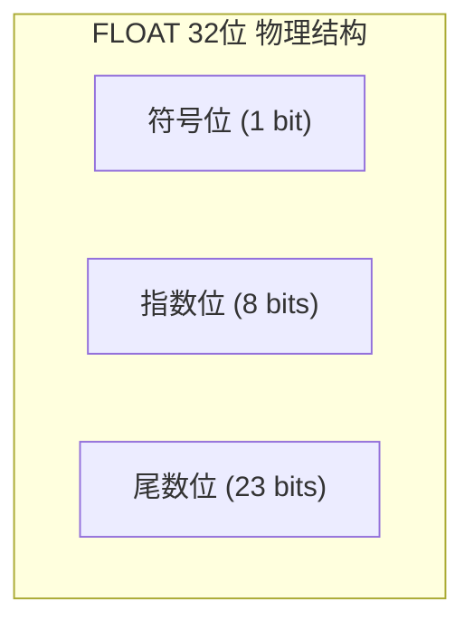
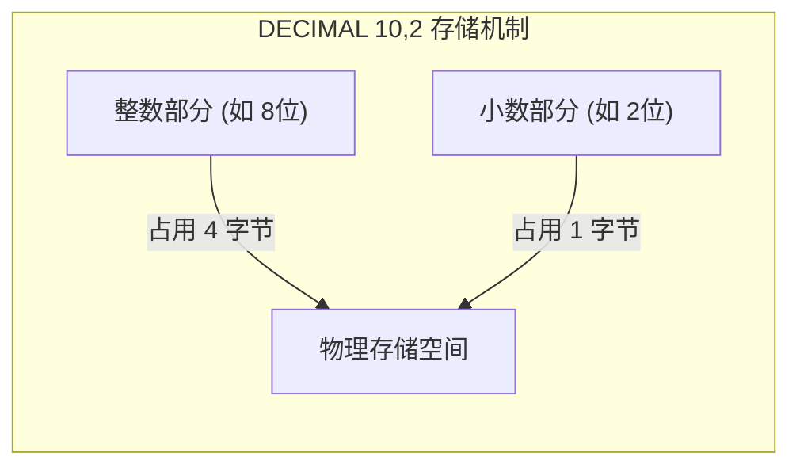

# 数值类型

> **故事线与承上启下**：
> 上一节我们从纯语言设计的视角，学习了 SQL 的基础词法与变量机制。但要动手构建我们的「电商订单管理系统」，首先得从零开始建立各个核心表（如用户表、商品表、订单表）。在敲下 `CREATE TABLE` 建表语句时，面临的第一个核心抉择就是：如何为每个字段挑选最精准的数据类型？尤其是对于商品价格、订单金额等对数值精度有严苛要求的场景，如何设计才能保证系统既节省空间又绝对不会发生财务偏差？本节我们将系统解构 MySQL 中的数值类型。

## ⚡ 速查摘要

- **金额存储**：涉及价格、订单金额、优惠券面额等金钱字段，**必须**使用 `DECIMAL(M, D)` 定点数类型，**绝对禁止**使用 `FLOAT` 或 `DOUBLE` 浮点数。
- **无符号属性**：对于绝不为负数的数值字段（如主键自增 ID、商品库存量、累计销量），必须添加 `UNSIGNED` 限制，可以将正数取值范围扩大一倍并增加逻辑安全性。
- **整型选型**：状态标志选用 `TINYINT`（1 字节），常规关联 ID 选用 `INT`（4 字节），核心高并发流水表或全局分布式 ID 选用 `BIGINT`（8 字节）。
- **自增主键**：配合 `AUTO_INCREMENT` 属性，能够让 MySQL 引擎在写入数据时自动计算并填充连续递增的唯一整数标识。

---

## 🎯 学习目标与验收标准

**学习目标：**
- 掌握 MySQL 整数类型（TINYINT、INT、BIGINT）的存储空间差异及 `UNSIGNED` 属性的应用。
- 深刻理解二进制浮点数（FLOAT/DOUBLE）精度丢失的底层机理。
- 掌握精确数学计算类型（DECIMAL）的声明语法与其在资金领域的绝对统治地位。
- 能够熟练使用 `AUTO_INCREMENT` 声明并使用自增技术主键。

**验收标准：**
- [ ] 能清楚解释为什么 `0.1 + 0.2` 在浮点数类型中不等于 `0.3`。
- [ ] 能够根据不同的订单系统业务字段（如用户状态、商品库存、商品单价），给出最节省存储且安全的数值类型设计。
- [ ] 完成本小节的练习，成功用 DDL 声明包含精确金额及无符号自增主键的临时表，并通过自动化测试脚本验证。

---

## 📖 概念全景

### 1. 整数类型体系与 `UNSIGNED`

MySQL 提供了五种标准的整型，用于保存不带小数的数值。它们在磁盘上所占用的字节数及表示的数值区间有着严格的区别：

| 类型 | 存储空间 (字节) | 有符号取值范围 (SIGNED) | 无符号取值范围 (UNSIGNED) | 典型业务场景 |
|:---|:---|:---|:---|:---|
| **TINYINT** | 1 | -128 ~ 127 | 0 ~ 255 | 状态值 (如 0 禁用 / 1 启用)、性别标识、物流状态 |
| **SMALLINT** | 2 | -32,768 ~ 32,767 | 0 ~ 65,535 | 支付渠道代码、简单年份记录 |
| **MEDIUMINT** | 3 | -8,388,608 ~ 8,388,607 | 0 ~ 16,777,215 | 中等规模系统的相对序号 |
| **INT** (INTEGER) | 4 | 约 -21.4 亿 ~ 21.4 亿 | 0 ~ 约 42.9 亿 | 普通外键关联 ID、商品库存量、累计销量 |
| **BIGINT** | 8 | 约 -922 京 ~ 922 京 | 0 ~ 约 1844 京 | 大系统订单号、分布式雪花算法 ID、高频日志表主键 |

#### 💡 UNSIGNED 的本质
在计算机底层，数值使用二进制补码表示。默认情况下，最左边的 1 位是符号位（0 表示正数，1 表示负数）。
当添加了 `UNSIGNED` 声明后，MySQL 会指示存储引擎**将最左边的符号位也作为数值位来解析**。
例如，`TINYINT` 最大值为二进制 `01111111` (127)。一旦设为 `UNSIGNED`，它能利用原符号位，表示的最大二进制变为 `11111111` (255)。

#### TINYINT(1) 当做boolean值使用
当TINYINT当做boolean使用时， 需要写成：TINYINT(1)

在 MySQL 中，根本没有真正的布尔类型（Boolean）。
为了存储“是/否”（如 is_coupon_applied），MySQL 内部是用 TINYINT（1字节整数）来代替的：0 代表 FALSE，1 代表 TRUE。

为什么只有它被保留了？因为 Java (MyBatis/Hibernate)、Python (SQLAlchemy)、Go (GORM) 等主流 ORM 框架，把 TINYINT(1) 当作了一个类型转换的“暗号”。

1. ORM 的暗号机制：
- 当 ORM 扫描到数据库字段类型是 TINYINT(1) 时，会自动在后端代码里把它转换成 True / False。

- 当 ORM 框架发现数据库里是 TINYINT(4)（或者直接写 TINYINT）时，会把它当作普通的整数（int 或 byte）来处理。如果你定义成 TINYINT（不带括号，默认显示宽度是 4，即 TINYINT(4)），ORM 就会把它当作普通的整型（Integer/Byte）处理。

2. 物理存储毫无区别：


括号里面的是**显示宽度**，它完全不改变物理存储空间，也完全不限制你可以输入的数据范围。

无论是 TINYINT(1) 还是 TINYINT(4)，在磁盘上都雷打不动地占用 1 个字节，数据范围都是 $-128 \sim 127$， 无符号都是 $0 \sim 255$。它哪怕写成 TINYINT(1)，你依然可以往里面存入 100。

括号里面这个数字只有在同时满足以下两个严苛条件时，才会发生唯一的作用：

- 字段定义中加了 ZEROFILL（零填充）。
- 使用 MySQL 官方的原生命令行终端查看数据。

```sql
CREATE TABLE test_tinyint (
    val1 TINYINT(1) ZEROFILL,
    val2 TINYINT(4) ZEROFILL
);

INSERT INTO test_tinyint VALUES (5, 5);
```

```
SELECT * FROM test_tinyint; 时，你看到的结果是:
+------+------+
| val1 | val2 |
+------+------+
|    5 | 0005 |
+------+------+
```

- val1 括号里是 1，显示宽度够了，直接打印 5。
- val2 括号里是 4，显示宽度不够 4 位，所以在左边用 0 帮你补齐到 4 位，变成了 0005。

如果你插入一个超过括号数值的数字，比如 123：
两个字段都能成功存入，并且都会完整显示为 123。TINYINT(1) 绝对不会把你的 123 截断成 1。


### 2. 浮点数（FLOAT/DOUBLE）与精度灾难

在计算机体系中，`FLOAT`（4 字节）和 `DOUBLE`（8 字节）遵循 **IEEE 754 科学计数法标准**。它们使用二进制科学计数法来逼近实数。



由于二进制无法精确地表示十进制的某些小数（例如，十进制的 `0.1` 转换为二进制是无限循环小数 `0.0001100110011...`），因此浮点数在存储这类小数时会进行**近似舍入**。这也就是为什么在程序或数据库中执行 `0.1 + 0.2` 时，得到的结果是 `0.30000000000000004`，而不是精确的 `0.3`。

在财务、对账或支付等高敏感领域，浮点数由于这种天然的精度偏差，累加后会导致严重的账目误差。

### 3. 定点数（DECIMAL）—— 财务级精准

为了解决浮点数的近似偏差，MySQL 引入了 `DECIMAL(M, D)` 类型（别名 `NUMERIC`）。它能够实现十进制的小数点精准存储。

- **M (Precision)**：有效数字总位数（整数位数 + 小数位数），取值范围为 1 ~ 65，默认值为 10。
- **D (Scale)**：小数点后的位数，取值范围为 0 ~ 30，且不得大于 M。例如，`DECIMAL(10, 2)` 表示该字段最多能存 10 位数字，其中小数占 2 位，整数部分占 8 位。最大可存 `99999998.99`。

#### 🛡️ DECIMAL 物理存储机制 (Why & How)
与浮点数使用指数/尾数科学逼近不同，MySQL 底层对 `DECIMAL` 使用了**十进制包装存储 (Packed Decimal)**。
它将每 9 位十进制数字打包压缩进 4 个字节的二进制中，整数部分和小数部分分别计算并独立存储。


这种设计以牺牲极少量的计算性能为代价，换取了 **100% 的十进制数精确表达**。因此，所有与“金钱”相关的字段，都必须选用 `DECIMAL`。

### 4. 布尔类型（BOOLEAN）
在 MySQL 中，虽然可以使用关键字 `BOOLEAN` 或 `BOOL`，但在底层，它们只是 **`TINYINT(1)` 的同义词**。
- `TRUE` 在写入时会被转换为 `1`。
- `FALSE` 在写入时会被转换为 `0`。

### 5. 自增属性（AUTO_INCREMENT）
`AUTO_INCREMENT` 是常用于主键的属性。当某列被赋予该属性后，如果在插入新行时将该列的值设为 `NULL` 或不指定该列，MySQL 会在当前最大值的基础上自动加 1。
- **限制 1**：每个表最多只能有一个 `AUTO_INCREMENT` 列。
- **限制 2**：该列必须被定义为索引的一部分（通常直接作为 `PRIMARY KEY`）。
- **限制 3**：该列通常为整型，不支持小数。

---

## 💻 SQL 语法

### 1. 数值字段定义语法

```sql
-- 创建测试用商品价格段位表
CREATE TABLE temp_products (
    id INT UNSIGNED AUTO_INCREMENT PRIMARY KEY, -- 无符号自增主键
    order_id BIGINT UNSIGNED NOT NULL,
    spu_no VARCHAR(20) NOT NULL,
    price DECIMAL(10, 2) NOT NULL DEFAULT 0.00,  -- 10位有效数字，2位小数，精确存储
    stock INT UNSIGNED NOT NULL DEFAULT 0,       -- 无符号库存量
    is_active TINYINT(1) NOT NULL DEFAULT 1      -- 布尔状态值，实际上是 TINYINT
);
```

### 2. 插入自增值与获取自增 ID

```sql
-- 插入数据时忽略自增 ID，或显式传入 NULL/0
INSERT INTO temp_products (spu_no, price, stock) 
VALUES ('SPU001', 99.90, 500);

-- 获取刚刚插入这行数据时系统生成的最新自增 ID (会话级安全)
SELECT LAST_INSERT_ID();
```

---

## ⚡ 项目实战 —— 电商订单系统场景

作为架构师，在规划「电商订单管理系统」的物理模型时，我们不能随性而为，应当根据业务容量和安全边界，为每个属性量身定制最合适的数值类型：


1. **用户状态 (`users.status`)**：用户状态通常只有“禁用 (0)”和“正常 (1)”，后续可能拓展“注销 (2)”。使用 **`TINYINT`** 仅占用 1 字节即可满足，比使用 `INT` 节省 75% 存储空间。
2. **商品单价 (`products.price`)**：商品售价最高可能达到数万元，且必须保留至分（2位小数）。选用 **`DECIMAL(10, 2)`**，既满足了大额消费，又绝不丢失高精度精度。
3. **商品库存 (`products.stock`)**：库存数量永远不可能为负数，故声明 **`INT UNSIGNED`**。如果声明为 `SIGNED`，库存一旦为负数就会引发数据逻辑混乱；选用 `UNSIGNED` 可以防微杜渐，并在达到上限时抛出错误阻止违规操作。
4. **订单总额 (`orders.total_amount`)**：用户一次购物车结算可能买下数十万元的商品，我们设计为 **`DECIMAL(12, 2)`**（整数 10 位，小数 2 位，最高可记录 99 亿元交易），以应对海量交易总额。

---

## ⚠️ 常见坑点

### 1. 浮点数金额的“隐形偷钱”
如果错误将商品价格 `price` 定义为 `FLOAT`。当进行百万级订单的财务汇总时，多次累加由于浮点数尾数的近似折算，会出现 `0.01` 元的差错。**在财务审计时，即便相差一分钱也算严重账目事故。**

### 2. INT 自增主键的“天花板”
很多系统一开始图省事，把大日志流水表或交易流水表的自增主键设为 `INT UNSIGNED`（最大 42 亿）。但在高并发下，可能一年内就会把 42 亿行全部写满。
当自增 ID 达到 4,294,967,295 后，再次写入会持续产生主键冲突错误，导致系统写入功能彻底停摆。**对于流水型高流量表，主键一律要声明为 `BIGINT`。**

### 3. 未添加 UNSIGNED 导致数据逻辑“漏水”
在扣减库存时，如果写错了代码（例如在库存不足时仍然减库存），若 `stock` 允许负数，数值就会变成 `-10`，导致负库存的诡异现象。使用 `UNSIGNED` 属性可以在数据库底层作为最后的安全屏障，若发生负数溢出，MySQL 会立即报错，拦截异常业务流。

---

## 📋 主动回忆

1. 既然 `BOOLEAN` 也是 `TINYINT(1)` 的别名，如果在 SQL 客户端查询出一个布尔字段，显示的结果会是 `TRUE/FALSE` 还是数字？
显示的是数字， 1 / 0

2. 在定义主键时，`INT` 和 `INT(11)` 占用的物理存储空间有什么不同？*(提示：括号中的 11 是否影响数据范围？)*

在定义主键或任何整数列时，INT 和 INT(11) 占用的物理存储空间没有任何不同。它们都占用 4 个字节（32 位） 的物理存储空间。

括号中的 11 完全不影响数据的存储范围、物理大小或性能。这是一个被误解最深的 MySQL 历史特性。INT(11) 已被废弃 

---

## ✅ 项目练习

请进入 `exercises/02.01.00-numeric/` 目录，按照题目说明编写建表 SQL，定义符合高精度金额和无符号自增主键的订单流水临时表。

使用以下命令验证你的练习答案：
```bash
bash test.sh
```
