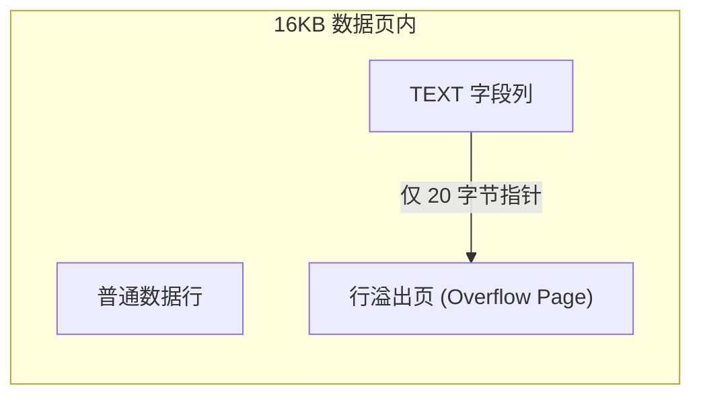

# 字符串类型

> **故事线与承上启下**：
> 前一小节我们彻底厘清了各种整型、自增以及精确保存金钱的定点数类型。除了数字之外，电商系统里同样充斥着各种文本数据（如用户名、邮箱地址、商品详情长文本、图片存储路径以及订单状态的字符串表达）。不同的文本属性对字符集、长度和性能有着完全不同的敏感度。本节我们将解剖 MySQL 中的字符串与大字段存储设计。

## ⚡ 速查摘要

- **定长设计**：针对长度极其固定且检索频繁的属性（如 MD5 密码哈希、固定位数的业务流水号），选用 `CHAR(N)` 定长类型以换取极高的底层存取性能。
- **变长设计**：对于大部分变长短文本（如用户名、邮箱、地址），首选 `VARCHAR(N)` 类型。在设计时，应根据业务实际安全边界设置 N，避免声明过大的空余字符空间。
- **大对象拆分**：商品详情描述大字段选用 `TEXT`，文件图片字节流选用 `BLOB`。为避免大字段引起的“行溢出”导致全表扫描性能雪崩，强烈建议在业务表外部建立“垂直解耦的扩展表”，或直接转存云端 OSS 并在表内只保留 URL 指针。
- **枚举警惕**：`ENUM` 虽能实现底层的数字包装存储，但新增枚举项会引发昂贵的大表 DDL 锁表。订单和支付状态等高度动态演进的值，建议选用 `VARCHAR` 或使用在应用层维护的整型状态码替代。

---

## 🎯 学习目标与验收标准

**学习目标：**
- 掌握 `CHAR(N)` 与 `VARCHAR(N)` 物理存储结构的本质差异与其对内存开销的潜在影响。
- 深刻理解 `TEXT` 与 `BLOB` 引起的数据行溢出（Out-of-row Storage）原理及优化策略。
- 理解 `ENUM` 枚举类型的内部整型映射逻辑及其带来的大表 DDL（锁表）隐患。
- 能够根据具体的系统场景（如密码哈希值、商品超长详情、订单状态），设计出符合业界标准的最佳字段模型。

**验收标准：**
- [ ] 能清楚描述在执行 `ORDER BY` 时，声明 `VARCHAR(255)` 和 `VARCHAR(50)` 存在的内存分配差距。
- [ ] 能解释为什么“不应该将图片和音乐直接存入 `BLOB` 列”的架构原因。
- [ ] 完成本小节的练习，成功用 DDL 声明包含定长、变长、超大文本及枚举字段的商品预览快照表，并通过自动化测试脚本验证。

---

## 📖 概念全景

### 1. CHAR(N) 与 VARCHAR(N) 的底层博弈

这是最常用的一对字符串类型。`N` 统一代表的是**字符数**（Character），而非字节数（Byte）。它们在底层的数据物理页存放和排序开销上有本质不同：

#### 物理存储原理对比

- **CHAR(N)**：固定分配 `N` 个字符的空间。
  - **存储机制**：在 `utf8mb4` 字符集下（一个字符占 1~4 字节），`CHAR(32)` 在物理上会固定分配 `32 * 4 = 128` 字节的存储空间。如果存入的内容不足 32 字符，MySQL 会在尾部填充空格补齐。
  - **读取行为**：在读取时，MySQL 会**自动剔除尾部的所有空格**。所以，如果你的实际数据尾部真的带有空格，在 `CHAR` 列读取时会被误伤剔除。
- **VARCHAR(N)**：动态分配存储空间，仅保存实际占用的字节，再加上额外的长度标记前缀。
  - **存储机制**：存储总大小为：`真实数据字节数 + 长度标记前缀`。
    - 如果最大可能字符占用的字节数不超过 255 字节，MySQL 底层使用 **1 字节**来记录字符串长度。
    - 如果超过 255 字节，MySQL 则使用 **2 字节**来记录字符串长度。
  - **读取行为**：保留尾部空格，不进行任何剔除。

#### ⚠️ VARCHAR 内存开销陷阱 (Why N matters)
既然 `VARCHAR` 是按实际大小存储的，那我们是不是可以把所有的变长字段都无脑定义为 `VARCHAR(255)` 或 `VARCHAR(1000)`？

**答案是：绝对不行。**

虽然在物理磁盘中它们占用的存储是一样的，但当 MySQL 执行复杂查询时：
1. 为了在内存中快速进行排序（`ORDER BY`）或执行分组（`GROUP BY`）去重，MySQL 引擎会使用内存临时表。
2. 内存临时表（尤其是 `MEMORY` 引擎）是不支持变长格式的，它会按照**声明的最大字符数上限**（如 255 或 1000）来为每一行分配**固定大小的内存空间**。
3. 如果高并发查询中有很多包含 `VARCHAR(1000)` 的列被排序，会导致内存被瞬间撑满，MySQL 进而不得不将内存临时表降级为**磁盘临时表**，引发大量的随机磁盘 I/O 读写，导致查询性能急剧恶化。

---

### 2. TEXT / BLOB 与行溢出（Out-of-row Storage）

当需要记录海量文字（如新闻正文、商品详细 HTML 描述）时，我们必须使用大对象类型：
- **TEXT**：存储带字符集的字符流（含 `TINYTEXT`, `TEXT`, `MEDIUMTEXT`, `LONGTEXT`）。
- **BLOB**：存储无字符集的原始二进制字节流（含 `TINYBLOB`, `BLOB`, `MEDIUMBLOB`, `LONGBLOB`）。

#### 💥 行溢出原理
MySQL InnoDB 引擎的默认数据页大小为 **16KB**。InnoDB 规定每一页至少要存放 2 行数据，以保证 B+ 树的层级平衡。
这意味着，如果单行数据的大小超过了约 **8KB**，这一行就会面临“放不下”的尴尬。

为了维护数据页的紧凑，对于超长字段（特别是 `TEXT` 和 `BLOB`），InnoDB 采用**行溢出页**方式存储：
1. **行内（In-Row）**：只保留该字段的 **20 字节**物理指针（包括溢出页的地址和实际数据长度）。
2. **行外（Out-of-Row）**：将该字段的大部分真实数据剥离出来，存放在表空间独立的**行溢出页 (Overflow Page)**上。



#### 🛠️ 性能影响与架构解耦
当执行 `SELECT *` 这种不加节制的查询时，如果表中有很多行包含溢出的 `TEXT` 字段，MySQL 引擎就不得不根据 20 字节的指针，去磁盘的不同物理地址把行溢出页的数据一个个读取并合并回来。这会产生可怕的**随机磁盘 I/O**。

**架构最佳实践：**
- **垂直解耦**：将 `TEXT` 大字段从主业务表中剥离出来，单独建立一张扩展表（如 `product_details`），主表和扩展表通过主键 ID 一对一关联。只有在用户点击“详情页”时，才去查扩展表，保证主表列表查询时的极速检索。
- **对象存储托管**：不要在数据库内存放图片或音频的原始字节（`BLOB`）。应当将其上传到云端对象存储（如阿里云 OSS、AWS S3），数据库中仅使用 `VARCHAR(255)` 存放对应的 URL 地址。

---

### 3. ENUM（枚举）类型的爱与恨

`ENUM('item1', 'item2', ...)` 能够定义一组可选的状态集。

#### 内部映射逻辑
在磁盘存储中，`ENUM` 极其节省空间。它在底层并不是存储字符串，而是将字符串映射为 **1 或 2 字节的无符号整数**：
- 第一项 `'item1'` 映射为数字 `1`
- 第二项 `'item2'` 映射为数字 `2`
- 最大支持 65,535 个不同的值。

#### ❌ 大表 DDL 锁表灾难
在电商系统中，订单状态或支付状态是会随业务发展不断演进的。例如，起初设计只有 `ENUM('PENDING', 'PAID', 'SHIPPED')`。
当有一天需要增加一个退款中状态 `REFUNDING` 时，你必须发起表结构变更：
```sql
ALTER TABLE orders MODIFY COLUMN status ENUM('PENDING', 'PAID', 'SHIPPED', 'REFUNDING');
```
在几千万条流水的大表上，执行此类修改通常需要重建整个表结构（虽然 MySQL 8 针对尾部追加 ENUM 有了部分即时修改的 Instant 优化，但稍有不慎依然会触发昂贵的 DDL 锁表），这在生产环境中会导致严重的锁等待与交易阻塞。

**结论**：凡是涉及后期可能会发生演进、添加、删除的状态字段，**绝对严禁**使用 `ENUM`。在应用层定义常量/枚举，而在数据库中使用 `VARCHAR(20)` 或整型（`TINYINT`）来存储，是更为弹性、易扩展的工程方案。

---

## 💻 SQL 语法

### 1. 常见字符串字段定义

```sql
CREATE TABLE temp_user_profiles (
    user_id INT PRIMARY KEY,
    -- 密码哈希值：定长 SHA-256，必定是 64 位字符，使用 CHAR(64) 性能最好
    password_hash CHAR(64) NOT NULL,
    -- 邮箱地址：长度不固定，限制最长 100 字符，使用 VARCHAR(100)
    email VARCHAR(100) NOT NULL,
    -- 个人主页简介：大段文字，使用 TEXT
    bio TEXT,
    -- 用户终端系统偏好：只在固定的三种间选择，不常改变，使用 ENUM
    theme_preference ENUM('LIGHT', 'DARK', 'AUTO') NOT NULL DEFAULT 'AUTO'
);
```

---

## ⚡ 项目实战 —— 电商订单系统场景

根据对字符串存储底层和弹性的理解，我们为「电商订单管理系统」规划更高级的字符字段：

1. **商品编码 (`products.spu_no`)**：我们为所有商品统一制定编码契约：所有 spu 必须是类似 `'SPU000000123'` 这种 12 位的固定字符串。既然长度恒为 12，我们使用 **`CHAR(12)`**，能够使检索性能最大化。
2. **商品描述 (`products.description`)**：商家会为每个商品上传成千上万字的图文详情，此列必定会发生行溢出。我们将其定义为 **`TEXT`**，但**绝对不会**将其与商品主信息放在同一个 `products` 表中。我们将其垂直解耦到新建的辅助表 `product_details` 中，避免污染主线查询。
3. **订单状态 (`orders.status`)**：未来我们可能会为订单增加“退款申请中 (REFUNDING)”、“部分退款 (PARTIAL_REFUNDED)” 等多种业务状态。考虑到状态的演进性，我们**弃用 `ENUM`**，选择选用 **`VARCHAR(20)`**（例如存 `'PENDING'` 字符串）或整型代码来存储。

---

## ⚠️ 常见坑点

### 1. 将文件和图片字节流存入 `BLOB` 导致备份和带宽破产
有些初学者把商品图片（如 2MB 大小）直接以 `LONGBLOB` 存入数据库。当商品达到十万级时，数据库备份文件将达到数百 GB，每次查询商品数据都会把网卡吞吐量打满，导致整库访问速度雪崩。**图片一律使用 OSS，数据库只存链接。**

### 2. VARCHAR 尾部空格与 CHAR 尾部空格的悲剧
当写入 `CHAR(10)` 的字段值为 `'abc   '`（尾部含三个空格）时，写入后 MySQL 会自动将其填充为 10 字节，但在**读取时会自动把末尾所有空格全刨掉**，返回 `'abc'`。如果你的业务数据里尾部空格具有实际含义，选用 `CHAR` 会导致灾难性数据丢失。

### 3. ENUM 参数隐式数字转换引发错乱
如果 ENUM 里的选项是数字字符串，如 `ENUM('1', '2', '3')`：
当运行 `INSERT INTO t VALUES (1);` 时，MySQL 会将其当作**整型索引**处理，映射为第 1 个选项（即 `'1'`)。而 `INSERT INTO t VALUES ('1');` 写入的也是 `'1'`。如果此时整型数据和字符数据发生错乱，极其难以排查。

---

## 📋 主动回忆

1. 如果声明了 `VARCHAR(100)` 和 `VARCHAR(255)`，并且实际只存储了 `5` 个字符的数据，在它们写入磁盘时占用的空间是否有区别？如果在内存中执行 ORDER BY 呢？

```text
磁盘存储：对于 VARCHAR(100) 和 VARCHAR(255)，实际只存 5 个字符时，磁盘物理占用完全一样，没有区别。

内存排序（ORDER BY）：有巨大区别。VARCHAR(255) 可能会消耗更多的内存，从而更容易触发磁盘临时表排序，导致性能断崖式下跌。
```


2. 为什么 MySQL 不鼓励把超大文本字段（如 `TEXT`）与经常需要按区间范围检索的主线字段（如 `created_at`、`status`）放在同一张大表里？

```text
TEXT 字段分表：因为 TEXT 会导致行溢出，使常规查询无法在一个 I/O Page 内读完，且会导致内存临时表退化为磁盘临时表，严重拖慢索引范围扫描的性能。
```

---

## ✅ 项目练习

请进入 `exercises/02.01.01-string/` 目录，按照题目说明编写建表 SQL，定义符合定长、变长、超大文本及枚举字段的商品预览快照表。

使用以下命令验证你的练习答案：
```bash
bash test.sh
```


# 扩展与延伸

## 如果声明了 `VARCHAR(100)` 和 `VARCHAR(255)`，并且实际只存储了 `5` 个字符的数据，在它们写入磁盘时占用的空间是否有区别？如果在内存中执行 ORDER BY 呢？

1. **磁盘存储**：对于 `VARCHAR(100)` 和 `VARCHAR(255)`，实际只存 5 个字符时，**磁盘物理占用完全一样**，没有区别。
2. **内存排序（ORDER BY）**：**有巨大区别**。`VARCHAR(255)` 可能会消耗更多的内存，从而更容易触发**磁盘临时表**排序，导致性能断崖式下跌。

### 1. 磁盘存储视角（无区别）

`VARCHAR` 是变长存储。InnoDB 在磁盘上存储 `VARCHAR` 的格式为：**[长度列表] + [NULL标志位] + [实际数据]**。

* 存储 5 个英文字符（假设 UTF-8 编码，占 5 字节）：
* 字符长度小于 255，长度列表只需要 **1 个字节**来记录长度（即 `0x05`）。
* 实际数据占 **5 个字节**。


* **结果**：无论是 `VARCHAR(100)` 还是 `VARCHAR(255)`，在磁盘上都只占用 $1 + 5 = 6$ 字节。

### 2. 内存排序视角 `ORDER BY`（致命区别）

当执行 `ORDER BY`、`GROUP BY` 或使用内存临时表时，MySQL 的内部内存存储引擎（如 `Memory` 引擎）在处理中间结果集时，**通常不会使用变长格式，而是采用固定长度（Fixed-length）格式**。

* **分配策略**：MySQL 会按照定义的最大字符数×字符集最大字节数来分配内存空间。
* 假设使用 `utf8mb4` 编码（每个字符最多占 4 字节）。
* `VARCHAR(100)` 排序时，每一行在内存中预分配：$100 \times 4 = 400$ 字节。
* `VARCHAR(255)` 排序时，每一行在内存中预分配：$255 \times 4 = 1020$ 字节。


* **崩溃点（机会成本）**：
MySQL 排序使用 `sort_buffer_size` 控制内存缓冲区大小。
如果你的 `VARCHAR` 声明得过大，高并发下 `ORDER BY` 会导致排序缓冲区迅速被填满。一旦超出阈值，MySQL 就会**把内存排序退化为磁盘文件排序（Filesort）**，引入极其缓慢的磁盘 I/O，并发性能直接暴跌。

---

## 为什么不能把 `TEXT` 与 `created_at`、`status` 放在一张表？

这涉及到 InnoDB 的 **Page（页）结构** 和 **内存利用率** 的底层物理限制。
因为 `TEXT` 会导致**行溢出**，使常规查询无法在一个 I/O Page 内读完，且会导致**内存临时表退化为磁盘临时表**，严重拖慢索引范围扫描的性能。

### 1. 物理层面的“行溢出”（Row Overflow）

InnoDB 是以 **Page（页，默认 16KB）** 为最小 I/O 单位与磁盘交互的。

* **正常行**：如果一行数据很小（比如只有 `status`, `created_at`），一个 16KB 的 Page 可以塞下几百行数据。当你按 `created_at` 范围检索时，**一次磁盘 I/O 读入一个 Page，就能顺便把几百条记录的索引和数据同时加载到 Buffer Pool（内存）中**，效率极高。
* **溢出行**：`TEXT` 或 `BLOB` 字段数据量极大（几KB到几MB）。InnoDB 一个页根本存不下几条。为了保证 B+ 树主键索引的紧凑性，InnoDB 会发生**行溢出**：在主表里只留一个 20 字节的指针，把实际的超大文本存到专门的 **Overflow Page（溢出页）** 中。

### 2. 为什么范围检索（如 `created_at`）会崩？

当你执行 `SELECT * FROM orders WHERE created_at >= '2026-01-01'` 时：

* 如果有 `TEXT` 字段，即便它溢出了，MySQL 在执行 `SELECT *` 时，依然要根据那 20 字节的指针，**高频次、随机地去磁盘的临时溢出页中读取大文本**。
* 这直接导致原本连续的顺序扫描变成了大量的**随机 I/O 读写**。
* 同时，这些巨大的 `TEXT` 数据会迅速**污染并占满 InnoDB Buffer Pool（内存缓存）**，把原本高频访问的热点索引和缓存数据无情挤出，导致全线业务的缓存命中率雪崩。

### 3. 内存临时表的致命退化

在对包含 `TEXT` 字段的表进行复杂查询（如 `JOIN`、`UNION` 或没有索引的 `GROUP BY`）时，MySQL 无法在内存中使用高性能的 `Memory` 存储引擎（因为它不支持 `TEXT/BLOB` 类型）。
MySQL 会迫使该查询**直接在磁盘上创建 Temp Table（TempTable 引擎或 InnoDB 临时表）**。由于磁盘读写速度比内存慢几个数量级，查询耗时会从毫秒级直接飙升到秒级。

---

## 🛠️ 顶尖开发者的最佳实践（垂直拆分）

为了应对这种极端场景，架构师的标准解法是**垂直分表**：

* **主表（`orders`）**：只留高频检索、固定长度或短变长的核心字段。
`id (BIGINT)`, `status (TINYINT)`, `created_at (DATETIME)`。
*优势：一行极小，16KB 的 Page 承载量巨大，范围查询和索引扫描快如闪电。*
* **扩展表（`order_ext`）**：单独存放低频、大体积的字段。
`order_id (BIGINT)`, `order_notes (TEXT)`。
*只有在用户明确点击“查看详情”时，才通过主键 `order_id` 去关联（JOIN 或二次查询）该表。*

---