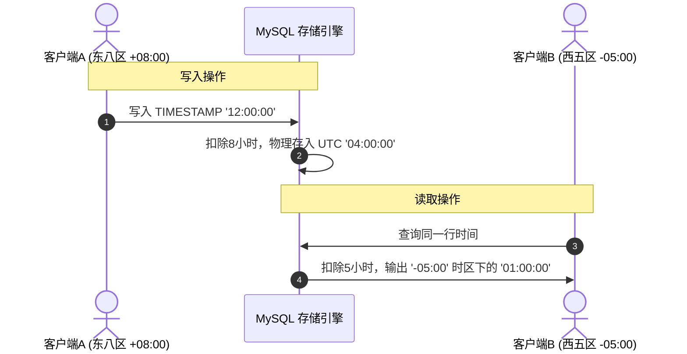

# 日期与时间类型

> **故事线与承上启下**：
> 在完成数字与文本的设计后，几乎所有的电商流水实体（如用户注册、商品上架、订单生成、订单支付、发货履约和退款申请）都需要记录准确的时间点。而在分布式或跨国业务场景中，时区（Time Zone）的不一致往往会导致莫名其妙的“时间相差数小时”的诡异 Bug。本节我们来系统厘清 MySQL 中的日期与时间类型，重点攻克 DATETIME 与 TIMESTAMP 的底层选型博弈。

## ⚡ 速查摘要

- **时区敏感选择**：涉及国际化、多地部署或需要自动适配客户端本地时区的时间快照（如订单创建、支付成功时间），首选 `TIMESTAMP`。
- **远期未来时间**：对于可能超出 2038 年的远期业务时间（如会员到期日、优惠券截止日期、长期合同），**必须**选用 `DATETIME` 以规避“2038年问题”。
- **自动初始化与更新**：通过声明 `DEFAULT CURRENT_TIMESTAMP` 和 `ON UPDATE CURRENT_TIMESTAMP`，可让 MySQL 引擎在底层自动维护数据的创建与最后修改时间。
- **纯日期与纯时间**：如果只需要记录年月日（如用户生日、发薪日），应选择 `DATE`；如果仅记录时间段或营业时长（如每天开业时间），选择 `TIME`，以节省存储空间。

---

## 🎯 学习目标与验收标准

**学习目标：**
- 深刻理解 `DATETIME` 与 `TIMESTAMP` 存储空间、取值范围与时区自动映射机制的本质差异。
- 掌握 2038 年问题（Y2K38）的底层逻辑及其在数据库架构设计中的防范措施。
- 熟练掌握 DDL 中的时间自动增量控制语法（`DEFAULT` 与 `ON UPDATE` 的结合使用）。
- 能够根据业务场景合理选用 `DATE`、`TIME` 特化时间类型进行精细化存储优化。

**验收标准：**
- [ ] 能说出在修改数据库连接时区（`time_zone` 变量）后，DATETIME 列和 TIMESTAMP 列展示的数据分别有何变化。
- [ ] 能够写出让 `updated_at` 字段在行记录被修改时自动刷新为系统当前时间点的 DDL 语句。
- [ ] 完成本小节的练习，成功用 DDL 声明包含日期、自动创建时间、自动更新时间的订单生命周期跟踪表，并通过批改脚本。

---

## 📖 概念全景

### 1. DATETIME 与 TIMESTAMP 的底层博弈

在 MySQL 中，`DATETIME` 和 `TIMESTAMP` 是最常用来记录精确时间（包含时分秒）的两种类型。许多人认为它们可以混用，其实它们在底层有着天壤之别：

| 属性 | DATETIME | TIMESTAMP |
|:---|:---|:---|
| **物理存储空间** | 5 字节 (MySQL 5.6.4 以后) | 4 字节 |
| **取值范围** | `1000-01-01 00:00:00`<br/>至 `9999-12-31 23:59:59` | `1970-01-01 00:00:01 UTC`<br/>至 `2038-01-19 03:14:07 UTC` |
| **时区敏感性** | **时区不敏感**。存入什么字符，就原样取出什么字符。 | **时区高度敏感**。存入时转为 UTC 存，取出时根据当前时区转回展示。 |
| **默认自动初始化** | 支持（MySQL 5.6+ 以后） | 支持 |

#### 🌐 核心机制 1：时区自动换算 (Time Zone Conversion)
- **TIMESTAMP 的运行流**：
  当你向 `TIMESTAMP` 写入 `2026-06-16 12:00:00` 时，MySQL 引擎首先检测你当前的连接时区（例如东八区 `+08:00`），将其转换为 UTC 时间 `2026-06-16 04:00:00` 写入磁盘。当另一个身处美国的客户端（连接时区设为西五区 `-05:00`）查询该字段时，MySQL 会自动从磁盘取出 UTC 时间，转换为 `2026-06-16 01:00:00` 展现。这种自动翻译机制对跨国分布式系统极度友好。
- **DATETIME 的运行流**：
  直接将 `'2026-06-16 12:00:00'` 这一串字符解析为十进制数直接存盘。无论之后什么时区的客户端连进来查询，读取出来的永远是硬编码的 `2026-06-16 12:00:00`。



#### 💥 核心机制 2：2038 年限制与 UNIX 纪元
`TIMESTAMP` 之所以只占用 4 字节，是因为它底层存储的是 **UNIX 时间戳**（从 `1970-01-01 00:00:00` 开始的累积秒数）。
由于 32 位整型能表达的最大正数为 `2,147,483,647`，因此当秒数在 **`2038-01-19 03:14:07`** 达到这个临界值时，再次加 1 秒整型就会产生**算术溢出**，变成负数，从而导致所有依赖 TIMESTAMP 的写入彻底报错崩溃。

这被称为 **Y2K38 问题（2038年问题）**。因此，任何需要记录超出 2038 年的时间字段，都绝对不能使用 `TIMESTAMP`。

---

### 2. DDL 级别的自动维护特性

MySQL 提供了强大的底层修饰符，让引擎自动记录每行数据的生命周期：

- **DEFAULT CURRENT_TIMESTAMP**：在插入数据行（`INSERT`）时，如果未指定该列的值，MySQL 会在底层自动将系统当前的时间戳填入该字段。
- **ON UPDATE CURRENT_TIMESTAMP**：在更新数据行（`UPDATE`）时，只要该行的**其他任意字段值发生了变化**，MySQL 引擎就会在底层自动将该列的值更新为最新时间点。

这通常用于设计业务表的审计时间字段：
```sql
CREATE TABLE temp_logs (
    id INT PRIMARY KEY,
    created_at TIMESTAMP DEFAULT CURRENT_TIMESTAMP,                       -- 行创建时自动写入，后续修改不变
    updated_at TIMESTAMP DEFAULT CURRENT_TIMESTAMP ON UPDATE CURRENT_TIMESTAMP -- 行每次修改时自动更新
);
```

---

### 3. 特化日期时间类型：DATE, TIME 与 YEAR

除精确时间外，许多场景下我们并不需要知道具体的小时和分秒，此时使用特化日期类型是更好的工程选择：

- **DATE**：只记录年月日（形式为 `YYYY-MM-DD`）。
  - **存储空间**：仅占用 **3 字节**。
  - **取值区间**：`1000-01-01` 至 `9999-12-31`。
  - **典型场景**：用户生日、会员入会日期、促销活动按天生效日。
- **TIME**：只记录时分秒（形式为 `HH:MM:SS` 或大范围）。
  - **存储空间**：仅占用 **3 字节**。
  - **独特用法**：不仅能代表“一天中的某个时刻”（如 `08:00:00`），还能代表**时间间隔或累积时长**，其范围可从 `-838:59:59` 到 `838:59:59`（近 35 天的间隔描述）。
- **YEAR**：只占用 **1 字节**，用于保存年份（如 `2026`）。

---

## 💻 SQL 语法

### 1. 时间定义及自动刷新语法

```sql
CREATE TABLE temp_orders_track (
    track_id BIGINT PRIMARY KEY AUTO_INCREMENT,
    order_no VARCHAR(32) NOT NULL,
    -- 首次插入时自动记录，无需在代码中赋值
    created_at TIMESTAMP DEFAULT CURRENT_TIMESTAMP,
    -- 插入时记录，且后续任何修改时自动更新为最新时间点
    updated_at TIMESTAMP DEFAULT CURRENT_TIMESTAMP ON UPDATE CURRENT_TIMESTAMP
);
```

### 2. 时间查询与格式化

在查询时，如果不希望返回默认的 `YYYY-MM-DD HH:MM:SS` 格式，可使用 `DATE_FORMAT(date, format)` 函数：

```sql
-- 查询订单的年份、月份和日期
SELECT DATE_FORMAT(created_at, '%Y年%m月%d日 %H时%i分') AS 友好下单时间 
FROM temp_orders_track;
```

---

## ⚡ 项目实战 —— 电商订单系统场景

根据时区感知与时间范围的架构考量，我们在订单系统中为时间属性选用最匹配的底层规格：

1. **用户注册时间 (`users.created_at`) 与最后修改时间 (`users.updated_at`)**：因为这属于历史性的操作快照（已经发生的事），且未来多国用户注册时需要转换本地时区展示，故优选 **`TIMESTAMP`**。同时配合 `ON UPDATE` 实现修改时间的自更新。
2. **用户生日 (`users.birthday`)**：用户的生日是一个纯粹的自然年月日（例如 1995-10-15）。用户在任何国家，其出生年月日都是确定不变的，不存在时区转换的需要。因此定义为 **`DATE`**，既避免了时区换算的冗余计算，又节省了存储空间。
3. **优惠券截止日期 (`coupons.valid_to`)**：商家发行的长效期优惠券，其截止时间可能会设定到 2040 年甚至更远。为了**防止优惠券提前在 2038 年过期**导致业务计算崩溃，此列**必须**定义为 **`DATETIME`**。
4. **订单支付成功时间 (`orders.paid_at`)**：订单何时完成付款是高频对账的时间线索，选用 **`TIMESTAMP`**。默认值设为 `NULL`，在用户未完成支付前保持为空，支付成功时再行更新。

---

## ⚠️ 常见坑点

### 1. 2038 年定时炸弹（Y2K38）
如果错误地使用 `TIMESTAMP` 存储商品的长期维保截止日期（例如设为 `'2045-12-31'`）。当你执行写入时，MySQL 会报错或被阶段性截断为 `2038-01-19 03:14:07`，导致用户的延保权益直接失效，引发业务纠纷。

### 2. 分布式异地部署下的 DATETIME “时间凭空多出/减少”
如果系统在上海机房（东八区）和东京机房（东九区）分别运行微服务，且数据库使用 **`DATETIME`** 存放记录。
当以上海机房传入 `'2026-06-16 12:00:00'` 写入，在东京机房直接取出展示时，因为 `DATETIME` 没有任何时区标识，东京用户直接看到的也是 `12:00:00`，**但实际上以上海时间为准时，此时东京时间应该是 `13:00:00`**。
这会导致多地时钟读取逻辑产生一小时的误差，对强关联的财务对账和日志追踪产生致命打击。**跨时区部署，非 TIMESTAMP 字段在写入前必须在应用层统一转为特定时区（如 UTC）**。

---

## 📋 主动回忆

1. 在执行 `UPDATE` 时，即使整行的数据并未发生任何实际改变（修改的值和数据库中已有的值完全一样），`ON UPDATE CURRENT_TIMESTAMP` 对应的字段值是否会被更新？
2. `DATE` 和 `DATETIME` 在表示 `1990-05-12` 时，所占用的磁盘物理字节数有何不同？如果本表有一千万行数据，这会相差多少存储？

---

## ✅ 项目练习

请进入 `exercises/02.01.02-date-time/` 目录，按照题目说明编写建表 SQL，定义订单生命周期时间跟踪临时表。

使用以下命令验证你的练习答案：
```bash
bash test.sh
```
