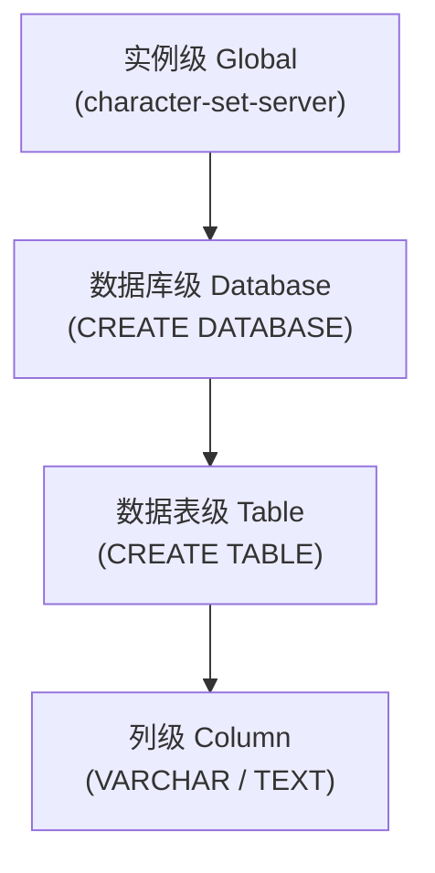
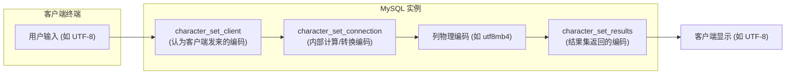

# 02.02.00. 字符集与乱码防范

> **故事线与承上启下**：
> 在前几节中，我们学习了数值、字符串、日期时间等各种基础数据类型，这让我们具备了建表和存放数据的基本能力。然而在真实的电商系统运行中，你很快会遇到两个棘手的工程问题：为什么用户在评论里发了一个 Emoji 表情，数据库就直接报错截断？为什么两个完全不同的商品 SKU 编码 `sku_100A` 和 `sku_100a`，在插入数据库时会被判为唯一性冲突？为了彻底扫清这些障碍，本节我们将深入探讨 MySQL 中的字符集 (Character Set) 与排序规则 (Collation)。

## ⚡ 速查摘要

- **强制规范**：在任何生产环境的 MySQL 中，字符集一律使用 `utf8mb4`，排序规则推荐使用 `utf8mb4_0900_ai_ci`（MySQL 8.0+ 默认）或 `utf8mb4_unicode_ci`。
- **大小写敏感需求**：若要让某个字符串列严格区分大小写（如密码 Hash、Sku 编码、激活 Token），必须将该列的排序规则设为 `utf8mb4_bin`。
- **快捷乱码排查**：在控制台出现乱码时，执行 `SET NAMES utf8mb4;` 可一次性重置客户端、连接与返回结果的字符集翻译链路。

---

## 🎯 学习目标与验收标准

**学习目标：**
- 理解字符集 (Character Set) 与排序规则 (Collation) 的本质区别。
- 搞清楚 MySQL 中旧 `utf8` (utf8mb3) 的缺陷以及 `utf8mb4` 的必要性。
- 掌握 `_ci`（大小写不敏感）和 `_bin`（二进制比较/大小写敏感）排序规则的实际表现。
- 熟知“库 → 表 → 列”三级继承机制。
- 理清客户端与服务端之间的字符集翻译链路（Client-Connection-Results）。

**验收标准：**
- [ ] 能清楚解释为什么在 MySQL 中存储 emoji 表情必须使用 `utf8mb4`。
- [ ] 能在 DDL 中为特定列指定与表默认规则不同的 `utf8mb4_bin` 排序规则。
- [ ] 能独立完成本节练习，让临时国际化评论表满足大小写敏感和 emoji 兼容要求，并通过测试脚本。

---

## 📖 概念全景

### 1. 字符集 vs 排序规则

在数据库中，字符存储与比较是由两个密切配合但职责不同的概念控制的：
- **字符集 (Character Set)**：定义了字符与二进制编码之间的映射关系（“怎么存”）。它决定了数据库支持哪些字符，以及每个字符占用多少字节。
- **排序规则 (Collation)**：定义了字符之间的比较和排序规则（“怎么比”）。例如，字母 `a` 是否等于 `A`？在字母表中 `a` 应该排在 `b` 的前面还是后面？

> [!NOTE]
> 一种字符集可以对应多种不同的排序规则，但一种排序规则只能属于一种字符集。

### 2. 历史大坑：utf8 与 utf8mb4

在很多早期的教程中，大家都习惯设置 `DEFAULT CHARSET=utf8`。但在 MySQL 中，这其实是一个巨大的陷阱。
MySQL 的旧 `utf8` 字符集本质上是 `utf8mb3`，它最多只支持 **3 个字节** 的 UTF-8 字符。然而，标准的 UTF-8 编码最大可达 4 字节。许多现代的 Emoji 表情、复杂的东亚罕见字和特殊符号，在标准的 UTF-8 编码下都是 4 字节。
如果尝试将 4 字节的 Emoji 存入旧的 `utf8` 列，MySQL 会发生 `Incorrect string value` 报错，或者直接将数据截断。
为了解决这一历史局限，MySQL 在 5.5.3 版本引入了 **`utf8mb4`**。它是真正的、完全兼容标准 4 字节的 UTF-8 编码。在 MySQL 8.0 之后，默认的字符集已经全面转为 `utf8mb4`。

### 3. 排序规则后缀的秘密

当你查看 MySQL 的 Collation 时，会发现它们大多带有特定的后缀。这些后缀直接决定了它们的比较行为：
- **`_ci` (Case Insensitive)**：大小写不敏感。例如在 `utf8mb4_0900_ai_ci` 下，`SELECT 'a' = 'A';` 会返回 `1` (True)。这是 MySQL 默认的行为。
- **`_cs` (Case Sensitive)**：大小写敏感。例如 `a` 和 `A` 不相等。
- **`_bin` (Binary)**：二进制比较。直接比对字符底层的二进制编码。因为 `a` 的 ASCII 码是 97，`A` 是 65，二进制完全不同，所以它不仅严格区分大小写，而且在比较速度上是最快的。

### 4. 三级继承机制

MySQL 允许在不同级别定义字符集和排序规则。当低级未显式定义时，会自动继承上一级的配置：



> [!WARNING]
> 最终物理落地并决定数据如何存储和比较的，**永远是列级（Column）字符集**。如果你通过 `ALTER TABLE` 修改了表的默认字符集，这**仅仅会影响以后新加的列**，已经存在的列不会自动级联修改！必须针对已有的每一列单独进行 `MODIFY`。

### 5. 客户端连接转换链

当你在客户端输入一条 SQL，数据流转其实要经历三层字符集翻译：



如果你的终端实际发送的是 UTF-8，但 `character_set_client` 设为了 `latin1`，MySQL 就会用 latin1 的方式去解析 UTF-8 字节，从而在写入时发生乱码。同理，如果 `character_set_results` 设置不当，即使数据库里存的数据是正确的，查出来显示在终端上也是一堆乱码。

---

## 💻 SQL 语法

### 1. 查看支持的字符集与排序规则

```sql
-- 查看当前系统支持的所有字符集
SHOW CHARACTER SET;

-- 查看 utf8mb4 字符集下的所有排序规则
SHOW COLLATION LIKE 'utf8mb4%';

-- 查看当前数据库实例的字符集配置变量
SHOW VARIABLES LIKE 'char%';
```

### 2. 指定不同层级的字符集与 Collation

```sql
-- 1. 创建数据库时指定
CREATE DATABASE IF NOT EXISTS my_db 
  DEFAULT CHARACTER SET utf8mb4 
  DEFAULT COLLATE utf8mb4_0900_ai_ci;

-- 2. 创建表时指定
CREATE TABLE my_table (
    id INT PRIMARY KEY,
    normal_text VARCHAR(100)  -- 继承表的默认字符集
) DEFAULT CHARACTER SET utf8mb4 DEFAULT COLLATE utf8mb4_0900_ai_ci;

-- 3. 在表级别指定默认字符集，但为特定列单独定制排序规则
CREATE TABLE secure_tokens (
    id INT PRIMARY KEY,
    username VARCHAR(50),      -- 继承表级，大小写不敏感
    token_val VARCHAR(255) CHARACTER SET utf8mb4 COLLATE utf8mb4_bin NOT NULL -- 单独指定，大小写敏感
) DEFAULT CHARACTER SET utf8mb4 DEFAULT COLLATE utf8mb4_0900_ai_ci;
```

---

## 🛒 订单系统实战

**业务场景：**
我们要为我们的电商订单管理系统添加国际化评价和 SKU 管理功能。
1. **商品评价内容**：支持多国语言以及用户丰富的表情（Emoji）。评价的检索不需要区分大小写。
2. **SKU 编码**：商家的 SKU 码可能包含大小写字母，并且 `sku_100A` 与 `sku_100a` 代表完全不同的商品，不可混淆，需要设置唯一键。

**实战 SQL：**

```sql
-- 创建临时产品 SKU 表和评价表
CREATE TABLE temp_product_skus (
    sku_id INT AUTO_INCREMENT PRIMARY KEY,
    -- sku_code 必须大小写敏感，所以显式指定为 utf8mb4_bin 排序规则
    sku_code VARCHAR(50) CHARACTER SET utf8mb4 COLLATE utf8mb4_bin NOT NULL,
    sku_name VARCHAR(100) NOT NULL,
    UNIQUE KEY uq_sku_code (sku_code)
) DEFAULT CHARSET=utf8mb4 DEFAULT COLLATE=utf8mb4_0900_ai_ci;

CREATE TABLE temp_product_reviews (
    review_id INT AUTO_INCREMENT PRIMARY KEY,
    sku_code VARCHAR(50) CHARACTER SET utf8mb4 COLLATE utf8mb4_bin NOT NULL,
    -- review_text 需要支持表情符号，并且常规查询不要求大小写敏感
    review_text TEXT CHARACTER SET utf8mb4 COLLATE utf8mb4_unicode_ci NOT NULL,
    created_at TIMESTAMP DEFAULT CURRENT_TIMESTAMP
) DEFAULT CHARSET=utf8mb4 DEFAULT COLLATE=utf8mb4_0900_ai_ci;
```

**解析：**
- `sku_code` 列为了满足绝对唯一和大小写敏感的需求，使用了 `utf8mb4_bin`。如果使用了默认的 `utf8mb4_0900_ai_ci`，当我们试图同时录入 `sku_100A` 和 `sku_100a` 时，唯一性索引 `uq_sku_code` 会判定为冲突，从而阻止写入。
- `review_text` 使用了 `utf8mb4_unicode_ci`，既保证了可以存储 Emoji 表情，又使得一般的全文模糊检索或者等于判断对大小写不敏感，更符合人的阅读与搜索直觉。

---

## ⚠️ 常见坑点

- 💣 **坑点 1：使用旧 utf8 (utf8mb3) 存储 Emoji**
  - **现象**：在移动端或前台输入 `😊` 字符时，接口层抛出 `java.sql.SQLException: Incorrect string value`。
  - **对策**：将表及字段字符集更改为 `utf8mb4`。
- 💣 **坑点 2：忽略 _ci 导致数据唯一性判定漏洞**
  - **现象**：用户表中 `username` 建立了唯一键。恶意用户注册了 `Admin` 账号，导致正常的 `admin` 管理员在登录时或修改密码时逻辑错乱，或者注册时提示冲突。
  - **对策**：对于需要严格区分大小写的字符串字段，必须使用 `_bin`。
- 💣 **坑点 3：客户端与服务端连接字符集不匹配**
  - **现象**：数据库里用 GUI 工具看的好好的中文，到了 Python/Java 后端查出来全都是 `???`。
  - **对策**：在连接池配置（如 JDBC URL）中追加参数：`?characterEncoding=utf8`；或在连接建立后首先执行 `SET NAMES utf8mb4;`。

---

## 🧠 主动回忆

请在不看上文的情况下，尝试回答以下问题：

1. 数据库中的字符集 (Character Set) 和排序规则 (Collation) 它们各自管什么？它们之间有什么关系？
2. 为什么在 MySQL 8.0 中，如果需要大小写敏感地比较某两列，我们需要使用 `_bin` 排序规则？
3. 如果我先建好了一个表，默认字符集是 `latin1`。然后我执行了 `ALTER TABLE my_table DEFAULT CHARACTER SET utf8mb4;`，请问这个表里原有的那些字段的编码会发生什么变化？

## 🧭 进阶路线提示

> 本节只覆盖当前阶段需要掌握的最小知识。这个主题后续还会在以下章节继续展开：

| 后续章节 | 会继续解决什么问题 |
|---|---|
| 04.02 索引工程化与优化器 | 详解两个字符集/排序规则不一致的字段做 JOIN 关联时，为什么会导致索引完全失效。 |
| 05.01 运行配置与状态 | 详解如何在 MySQL 配置文件中永久改变全局默认字符集和排序规则。 |

---

## ✅ 项目练习

去 `exercises/02.02.00-utf8mb4` 目录下，完成你的国际化评论表设计！

**任务描述：**
1. 在 `exercises/02.02.00-utf8mb4/exercise.sql` 中编写一条 `CREATE TABLE temp_international_reviews` 语句。
2. 表中必须包含字段：`review_id` (主键自增), `order_no` (字符串), `user_id` (大整型), `sku_code` (字符串，大小写敏感), `review_text` (大文本，使用 unicode 排序规则)。
3. 确保该表默认字符集为 `utf8mb4`。

**运行验证：**
在终端进入该练习目录，执行自动化测试脚本：
```bash
bash test.sh
```

---

## 🚀 延伸学习

- **Unicode 排序规则的差异**：`utf8mb4_unicode_ci` 是基于标准的 Unicode 排序算法来进行比较的，比较准确，但对复杂字符的比较有性能开销；而 `utf8mb4_general_ci` 是一种快捷简化的排序规则，放弃了部分复杂的特殊排序规则以换取极微小的性能优势（在现代硬件上这种差距已微乎其微，建议首选官方推荐的 `utf8mb4_0900_ai_ci` 或 `utf8mb4_unicode_ci`）。
