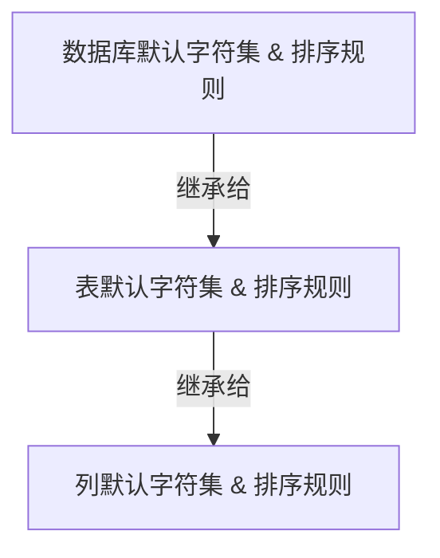

# 03.02.00. 数据库管理

> **故事线与承上启下**：
> 在前一节中，我们拆解了 SQL 理论上的五大子语言分集，建立了清晰的“动结构 DDL” vs “动数据 DML” 的心智分类。现在，我们将正式开始实操这些语法。首先，任何数据表都必须依托于具体的“数据库（Database）”存在。本节我们将攻克最基础的库级 DDL——如何安全、幂等（Idempotent）地创建、修改与销毁数据库。

## ⚡ 速查摘要

- **创建数据库**：`CREATE DATABASE IF NOT EXISTS <库名> CHARACTER SET utf8mb4 COLLATE utf8mb4_0900_ai_ci;`
- **修改字符编码**：`ALTER DATABASE <库名> CHARACTER SET utf8mb4 COLLATE utf8mb4_bin;`
- **销毁数据库**：`DROP DATABASE IF EXISTS <库名>;`

---

## 🎯 学习目标与验收标准

**学习目标：**
- 掌握创建（CREATE）、修改（ALTER）与销毁（DROP）数据库的标准 DDL 语法。
- 理解防御性写法（`IF NOT EXISTS` / `IF EXISTS`）在软件工程与自动化部署中的必要性。
- 理解库级字符集和排序规则的继承机制，以及对后续建表的影响。

**验收标准：**
- [ ] 能写出带字符集和防错判断的创建数据库语句。
- [ ] 能解释为什么不能直接在生产发布脚本中使用无条件 `DROP DATABASE` 或 `CREATE DATABASE`。
- [ ] 能够成功完成练习：在本地创建一个临时库，使用 ALTER 语句修改其默认排序规则，并通过自动化脚本的核对。

---

## 📖 概念全景

### 1. 物理上的“数据库”到底是什么？

在 MySQL (特别是使用 InnoDB 引擎) 中，当我们创建了一个“数据库”（在有些关系型数据库如 Oracle 中也称为 Schema 模式），在操作系统磁盘上，底层其实是在 MySQL 的 `data/` 目录下**创建了一个同名的文件夹**。
这个文件夹在后续建表后，会用来存放对应的表元数据定义文件和数据文件。

### 2. 防御性写法与幂等性

在软件工程中，一个操作如果重复执行多次，其结果与执行一次相同，我们就称这个操作是**“幂等”**的。
对于数据库 DDL 来说，直接运行 `CREATE DATABASE order_system;` 是**非幂等**的。如果库已经存在，它会直接抛错并退出执行。这在 CI/CD 自动化流水线或者执行团队共享的 SQL 脚本时，会直接让整个部署失败。

为此，MySQL 提供了非常有用的防错修饰词：
- **`IF NOT EXISTS`**（如果不存在则执行）：如果目标数据库已存在，MySQL 只会抛出一个警告 (Warning)，而不是报错 (Error)，脚本能够平滑地继续向下执行。
- **`IF EXISTS`**（如果存在则执行）：同样地，当我们要销毁库时，如果库已经被别人删过了，使用它能够避免报错。


> [!NOTE]
> 防御性写法（`IF NOT EXISTS`）是编写生产级、团队协作 SQL 发布脚本的首要铁律！
> 这个防御性写法主要来针对 create/drop database/table 的
> ALTER DATABASE 不支持使用上面的防错修饰词

#### 不同操作防御性差异
变更类型 | 原生支持的防御关键字 | 核心防御手段 |
-- | -- | -- |
创建/销毁 (Create/Drop) | IF EXISTS / IF NOT EXISTS | 关键字直接硬编码 |
结构变更 (Alter) | 绝大多数不支持 | 查询 information_schema 元数据字典，或使用版本控制工具（如 Flyway）|


### 3. 库级字符集与继承机制

正如我们在模块 02.02 中所学到的，字符集和排序规则有三级继承关系。当我们创建数据库时指定的 `CHARACTER SET` 和 `COLLATE`，会被作为本数据库内**所有未来新建表的默认设置**。



如果我们使用 `ALTER DATABASE` 更改了数据库的默认字符编码，这**只会改变该库往后新建表时的缺省编码**，它完全**无法改变**库里已经存在的表和列的字符集。

---

## 💻 SQL 语法

### 1. 创建数据库

```sql
-- 基础写法（非幂等，不推荐在脚本中使用）
CREATE DATABASE order_system;

-- 生产标准写法（防错，指定默认编码）
CREATE DATABASE IF NOT EXISTS order_system
  CHARACTER SET utf8mb4
  COLLATE utf8mb4_0900_ai_ci;
```

### 2. 修改数据库属性

```sql
-- 修改数据库的默认字符集和排序规则
ALTER DATABASE order_system
  CHARACTER SET utf8mb4
  COLLATE utf8mb4_bin;
```

### 3. 删除数据库

```sql
-- 危险的非幂等写法（不推荐）
DROP DATABASE order_system;

-- 防错性写法（推荐）
DROP DATABASE IF EXISTS order_system;
```

---

## 🛒 订单系统实战

**业务场景：**
我们要对现有的电商订单系统数据库做一次管理维护。假设我们是新入职的工程师，我们需要在本地 Docker 容器里运行初始化脚本。如果本地已经建过了 `order_system` 数据库，我们要确保脚本不会因为“库已存在”而挂掉。

**实战 SQL：**

```sql
-- 安全初始化订单系统数据库，支持全球化字符集
CREATE DATABASE IF NOT EXISTS order_system
  CHARACTER SET utf8mb4
  COLLATE utf8mb4_unicode_ci;

-- 查看该数据库当前的默认编码属性
SELECT SCHEMA_NAME, DEFAULT_CHARACTER_SET_NAME, DEFAULT_COLLATION_NAME 
FROM INFORMATION_SCHEMA.SCHEMATA 
WHERE SCHEMA_NAME = 'order_system';
```

---

## ⚠️ 常见坑点

- 💣 **坑点 1：发布脚本未使用 IF NOT EXISTS**
  - **现象**：开发人员本地把表结构建好了导出一个 `init.sql`，运维人员在预发环境二次部署时，直接因为 `CREATE DATABASE` 报错中断。
  - **对策**：凡是建库、建表、建索引，统一带上 `IF NOT EXISTS`。
- 💣 **坑点 2：在生产环境无防线使用 DROP DATABASE**
  - **现象**：误连接了生产库，想清空开发测试库，手快执行了 `DROP DATABASE order_system;`，瞬间造成灾难性数据丢失。
  - **对策**：很多公司会在权限管理上直接剥夺普通用户的 `DROP` 权限。若必须做清理，执行前务必通过 `SELECT database();` 或查看客户端连接状态反复核对当前实例。

---

## 🧠 主动回忆

请在不看上文的情况下，尝试回答以下问题：

1. 加上 `IF NOT EXISTS` 修饰词后，如果数据库已经存在，MySQL 会报错还是抛出警告？对脚本执行有何影响？
不会报错，只是抛出警告，脚本可以顺利继续往后执行

2. 如果执行了 `ALTER DATABASE order_system CHARACTER SET utf8mb4;`，请问这个库里原本就已经存在的表，字符集会自动跟着升级为 `utf8mb4` 吗？
不会， 只会影响后面新创建的表

3. `DROP DATABASE` 命令成功执行后，在物理操作系统的磁盘层面上，会发生什么变化？


## 🧭 进阶路线提示

> 本节只覆盖当前阶段需要掌握的最小知识。有关库级别的配置、权限与初始化脚本，还会在以下章节继续展开：

| 后续章节 | 会继续解决什么问题 |
|---|---|
| 05.01 运行配置与状态 | 学习如何在 MySQL 启动参数（my.cnf 配置文件）中统一硬性锁定全局的默认字符编码，避免每次手动指定。 |
| 05.03 用户权限与安全 | 学习如何通过 DCL 限制开发账号，使其只具备库内的增删改查权限，而直接隔离其建库和删库的敏感特权。 |

---

# 扩展与延伸

## `DROP DATABASE` 命令成功执行后，在物理操作系统的磁盘层面上，会发生什么变化？
1. 物理文件与目录的删除（Unlink）
MySQL 的每个数据库在操作系统的 data 目录下都对应一个同名文件夹。

独立的表空间文件（.ibd）：如果开启了 innodb_file_per_table=ON（默认），该数据库文件夹下的所有 .ibd 文件（存储了表的聚簇索引、二级索引和数据行）会被操作系统调用 unlink() 系统函数直接删除。

目录自身：当文件夹内的所有表结构定义文件（早期版本的 .frm 或新版的隐藏元数据文件）以及 .ibd 文件被清空后，MySQL 会调用 rmdir() 删除该数据库的文件夹。

磁盘空间释放：OS 的文件系统（如 ext4、XFS）会将这些文件占用的数据块（Data Blocks）标记为“空闲（Free）”，允许后续的其他写入操作覆盖这些区域。

2. 操作系统层的“异步延迟”与 IO 暴涨
虽然逻辑上命令瞬间完成，但在 OS 磁盘层会引发剧烈的 IO 震荡：

文件系统锁与 CPU 消耗：如果被删除的数据库包含数个几百 GB 的巨型 .ibd 文件，操作系统在清理 inode 表和释放大量块指针时，会导致文件系统产生严重的锁竞争（如 ext4 的 truncate 锁），甚至引发操作系统级卡顿。

SSD 的 Trim 延迟：在固态硬盘（SSD）上，删除大文件后，操作系统会向 SSD 发送 TRIM 命令。SSD 接收到指令后，会将这些颗粒标记为可擦除，但实际的物理擦除（P/E 周期）由 SSD 固件的垃圾回收（GC）机制在后台异步执行。

3. 共享表空间（ibdata1）的特殊情况
如果部分表创建在共享表空间（ibdata1）中，或者数据库包含撤销日志（Undo Log）和系统表空间数据：

磁盘空间不会缩小：DROP DATABASE 只会从 ibdata1 的内部字典中将这些表占用的页（Pages）标记为“可用（Available）”，但绝对不会缩减 ibdata1 这个文件在磁盘上的物理大小。这就产生了磁盘碎片，必须通过导出数据、重构实例才能释放这部分物理空间。

4. 缓冲池（Buffer Pool）的物理污染与清理
虽然这是内存操作，但它直接决定了磁盘的后续表现：

为了防止已经删除的表页继续在内存中被写入磁盘（脏页刷盘导致数据污染），MySQL 必须遍历 Buffer Pool 的 LRU 链表和 Flush 链表，将属于该数据库的所有内存页强制移除或标记为无效。

如果 Buffer Pool 极大（如数百 GB），这个遍历过程会阻塞 MySQL 主线程，导致在磁盘文件真正被 OS 删除前，数据库出现短暂的“假死”。