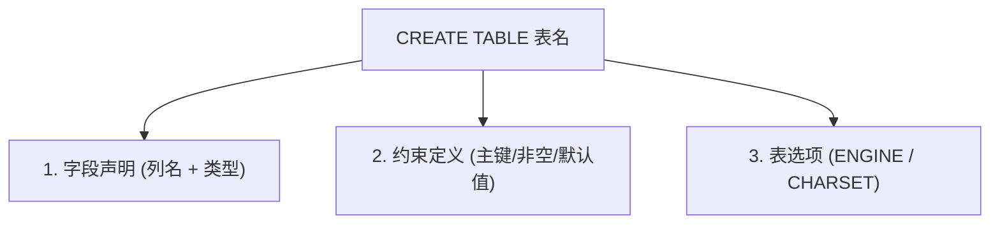

# 03.02.01. 创建表与基础约束

> **故事线与承上启下**：
> 在上一小节中，我们安全地建立了 `order_system` 数据库，划定了系统的数据疆界。接下来，我们必须开始在库中规划用于存储具体业务对象的“数据表（Table）”。作为电商系统的起点，最基础的实体就是“用户（User）”。本节我们将解构 `CREATE TABLE` 的语法骨架，并为用户表设定基础的非空（`NOT NULL`）与默认值（`DEFAULT`）约束，亲手建起系统的第一张表。

## ⚡ 速查摘要

### 方式1：全新创建
```sql
-- 创建表并指定基础约束的标准语法
CREATE TABLE IF NOT EXISTS 表名 (
    列名 数据类型 [列约束],
    ...
    [表约束]
) ENGINE=InnoDB DEFAULT CHARSET=utf8mb4;
```
- **核心约束**：
  - `PRIMARY KEY`：主键，唯一标识一行，不允许为 NULL。
  - `NOT NULL`：必填，防止产生空值（NULL）引发的逻辑漏洞。
  - `DEFAULT`：默认值，当插入数据未指定该列时自动填入的值。

### 方式2： 根据已有的表创建
```sql
-- 通过其他表查询数据作为新的表
CREATE TABLE users_copy 
AS
SELECT id, username
FROM users;
```
根据users表， 使用字段 id, username 创建一个新的表 叫做users_copy，这种创建方式，会通过SELECT查询出来的所有数据一起放到新的表中，也就是说  users_copy 拥有数据

```sql
-- 通过其他表查找字段， 通过WHERE过滤数据，由于 WHERE 1 > 2 永远不为TRUE， 素以这种写法最终创建的只有表结构，不包含表数据
CREATE TABLE users_copy 
AS
SELECT id, username
FROM users
WHERE 1 > 2;
```

---

## 🎯 学习目标与验收标准

**学习目标：**
- 掌握 `CREATE TABLE` 的语法骨架与建表步骤。
- 深入理解主键（`PRIMARY KEY`）的定义与物理特征（InnoDB 聚簇索引底座）。
- 熟练运用 `NOT NULL` 与 `DEFAULT` 约束来守卫数据完整性。
- 建立对 `AUTO_INCREMENT` 属性和其工作原理的直觉。

**验收标准：**
- [ ] 能在 DDL 中编写正确的表创建逻辑，并精确配置字段约束。
- [ ] 能清楚解释为什么将状态类字段默认设为 `NOT NULL DEFAULT 1` 比允许为 `NULL` 更优秀。
- [ ] 在项目练习中创建出基础 `users` 表，并通过本地测试脚本验证。

---

## 📖 概念全景

### 1. CREATE TABLE 语法大树

创建表是 DDL 里最常用的操作之一。一个健壮的表定义除了声明字段和类型，更核心的是确立约束：



### 2. 核心约束详解

- **主键约束 (`PRIMARY KEY`)**：
  在关系型数据库中，表是一个“实体的集合”，而每一行必须能够被唯一标识。主键就是起这个作用的。
  > 💡 **架构师视角**：
  > 在 InnoDB 存储引擎中，表是按照主键的顺序在磁盘上物理组织存储的（称为**聚簇索引表**）。因此，**每张表都必须有且仅有一个主键**。强烈推荐使用自增整型（`AUTO_INCREMENT`）或分布式 ID 作为主键。
  
- **非空约束 (`NOT NULL`)**：
  声明该列绝对不能存放 `NULL` 值。
  > 💣 **安全警告**：
  > 尽可能让所有字段都设为 `NOT NULL`。允许 `NULL` 会导致以下问题：
  > 1. 三值逻辑混乱（如 `NULL = NULL` 的结果是 `UNKNOWN` 而不是 `TRUE`）。
  > 2. 索引和存储空间在底层的物理结构会多占用额外的 Mark 标记位。
  
- **默认值约束 (`DEFAULT`)**：
  在录入数据时，如果不输入某个字段，数据库会自动将其设定为预设的默认值。这常用于状态字段（如：状态默认正常 `DEFAULT 1`）、计数器等。

---

## 💻 SQL 语法

### 1. 基础建表模板

```sql
CREATE TABLE IF NOT EXISTS users (
    -- 1. 自增整型主键
    id INT AUTO_INCREMENT PRIMARY KEY,
    
    -- 2. 必填字符串
    username VARCHAR(50) NOT NULL,
    
    -- 3. 必填，且默认值为 1 (正常)
    status TINYINT NOT NULL DEFAULT 1
) ENGINE=InnoDB DEFAULT CHARSET=utf8mb4 DEFAULT COLLATE=utf8mb4_unicode_ci;
```

### 2. 约束的使用注意

- **`AUTO_INCREMENT` 必须作用在 PRIMARY KEY 或 UNIQUE 键上**，否则 MySQL 会报错。
- 如果定义了 `DEFAULT` 但插入时显式传入了 `NULL`，若该列没有 `NOT NULL` 约束，则**仍然会存入 NULL**，默认值不会生效。只有在插入时完全忽略该列，默认值才起作用。

---

## 🛒 订单系统实战

**业务场景：**
我们要为我们的电商系统落地第一个实体表——用户表 `users`。
在这个阶段，我们的需求是极简的：用户包含唯一的自增主键、用户名、邮箱、密码哈希、以及账号状态。
我们将暂时不在这里设置唯一性索引（`UNIQUE`），这一高级特性留待我们在下一模块 **03.02 关系建模与约束** 中单独进行实操演进。

**实战 SQL：**

```sql
-- 创建极简用户表
CREATE TABLE IF NOT EXISTS users (
    id INT AUTO_INCREMENT,
    username VARCHAR(50) NOT NULL,
    email VARCHAR(100) NOT NULL,
    password_hash VARCHAR(255) NOT NULL,
    status TINYINT NOT NULL DEFAULT 1,
    PRIMARY KEY (id)
) ENGINE=InnoDB DEFAULT CHARSET=utf8mb4 DEFAULT COLLATE=utf8mb4_unicode_ci;
```

---

## ⚠️ 常见坑点

- 💣 **坑点 1：把金额、库存等关键字段默认为 NULL**
  - **现象**：在进行账目汇总时，`SELECT SUM(price) FROM orders;`。由于有些行是 `NULL`，导致结果完全偏离预期；或者在计算 `100 - NULL` 时直接得到 `NULL` 造成计算错误。
  - **对策**：对数值列、金额列、状态列强制声明 `NOT NULL DEFAULT 0`。
- 💣 **坑点 2：主键类型选用过小**
  - **现象**：日志表主键使用了 `INT` (带符号最大 21 亿)，随着高并发写入，很快达到上限。再次写入时抛出主键冲突，导致系统崩溃。
  - **对策**：可能随着时间大批量膨胀的表（订单明细、日志等），主键务必声明为 `BIGINT`。

---

## 🧠 主动回忆

请在不看上文的情况下，尝试回答以下问题：

1. 声明 `DEFAULT` 默认值约束后，如果我们在 `INSERT` 时显式为该列插入 `NULL` 值，数据库会填入默认值吗？
不会， 只有在完全没有填这一列的时候，才会采用默认值

2. 为什么说在 InnoDB 引擎中创建表时必须指定主键？如果不指定，MySQL 底层会怎么处理？

3. 在建表语句中，`NOT NULL` 的主要工程作用是什么？
设置该字段不能为空，避免后面计算出现问题

## 🧭 进阶路线提示

> 本主题后续还会在以下章节继续展开：

| 后续章节 | 会继续解决什么问题 |
|---|---|
| 03.02.02 表结构变更 | 讲解如何在已经建好的表中新增、修改和删除列（ALTER TABLE）。 |
| 03.02.03 唯一键与业务唯一性 | 正式为 `users` 的邮箱和用户名加上唯一约束（UNIQUE KEY），从数据库物理层面杜绝重复账号注册。 |
| 04.01 索引基础 | 深入底层剖析聚簇索引（主键索引）与辅助索引在 B+ 树物理结构上的差异和检索性能差异。 |

---

# 扩展和延伸
## 为什么说在 InnoDB 引擎中创建表时必须指定主键？如果不指定，MySQL 底层会怎么处理？

在 MySQL 的 InnoDB 存储引擎中，“必须指定主键”是一条铁律。这与 InnoDB 的底层存储架构——聚簇索引（Clustered Index）有直接关系。

---

### 1. 为什么“必须”有主键？（底层物理架构决定）

在 InnoDB 中，**表即索引，索引即表**。

InnoDB 的数据文件（`.ibd`）是完全基于 **B+Tree** 结构组织的。每一行完整的数据，并不是随意堆放在磁盘上的，而是必须作为叶子节点（Leaf Nodes）挂载在这棵 B+Tree 上。

而这棵 B+Tree 的主键（Key），就是用来决定数据行在磁盘上物理排列顺序的唯一依据。如果没有主键，这棵 B+Tree 就无法建立，数据也就无处安放。

---

### 2. 如果不指定主键，MySQL 底层会怎么处理？

如果你在建表时偷懒，没有显式定义 `PRIMARY KEY`，InnoDB 并不会报错拒绝，而是会在后台启动**替代策略**，强制生成一个隐藏主键：

#### 策略一：寻找唯一非空索引（Unique NOT NULL）

InnoDB 会按顺序扫描表中的所有字段定义，寻找第一个被定义为 `UNIQUE` 且所有列都为 `NOT NULL` 的索引。如果找到了，就会将这个索引直接“提拔”为聚簇索引的主键。

#### 策略二：隐式生成单调递增行 ID（RowID）

如果表中连合格的 `UNIQUE NOT NULL` 索引也没有，InnoDB 就会在后台自动创建一个名为 **`DB_ROW_ID`** 的隐藏字段。

* 这个字段占 **6 个字节**。
* 它是一个由 InnoDB 引擎全局维护、单调递增的数值。
* 你的数据将基于这个隐藏的 `DB_ROW_ID` 来构建 B+Tree。

---

### 3. 架构师视角：为什么不能依赖底层的自动处理？（致命失效点）

依靠 MySQL 底层自动生成的 `DB_ROW_ID` 存在严重的性能与架构隐患：

#### 致命点一：全局全局锁竞争（Dict Sys Mutex）

这是最严重的性能瓶颈。
所有没有指定主键的 InnoDB 表，在后台都**共享同一个全局序列号发生器**。这意味着，当你有多个未定义主键的表同时进行高并发的 `INSERT` 操作时，所有表都需要去争抢同一个全局锁（`dict_sys->mutex`）来获取下一个 `DB_ROW_ID`。

> **后果**：原本属于不同业务表的并行写入，在底层变成了**串行排队**，数据库的吞吐量（TPS）会发生断崖式下跌，CPU 会因为锁等待而飙升。

#### 致命点二：浪费磁盘空间与内存

* `DB_ROW_ID` 占用 6 字节。而我们通常推荐的 `INT` 占 4 字节，`BIGINT` 占 8 字节。
* 关键在于，这个隐藏的 ID 你在应用层**无法直接感知和使用**。你在做二级索引（辅助索引）查询时，二级索引的叶子节点存放的是主键值，此时它存的就是 `DB_ROW_ID`。你无法用它来加速你的业务查询，白白浪费了 Buffer Pool 内存和磁盘空间。

#### 致命点三：对分布式架构（如 Canal/数据同步）极不友好

在进行分库分表、大数据同步（如通过 Canal 监听 Binlog 同步到 Elasticsearch 或数据仓库）时，数据同步工具强依赖明确的主键来定位冲突和保证幂等。没有显式主键，数据同步的准确性和效率会大打折扣。

---

### 结论与最佳实践

在 InnoDB 中，**显式指定自增主键（或分布式全局唯一 UUID/雪花 ID 映射的整数）是不可妥协的底线**。

* **立即停止的琐事**：不要再创建任何不带主键的临时表或日志表。
* **立即开始的核心**：建表语句必须以 `id BIGINT NOT NULL AUTO_INCREMENT PRIMARY KEY` 或同等效力的主键定义作为标配，彻底释放并发写入性能。
