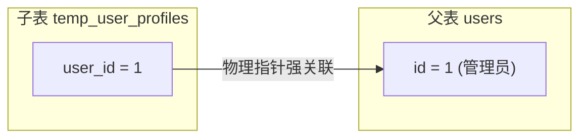

# 03.02.04. 外键、参照完整性与逻辑外键

> **故事线与承上启下**：
> 在上一节中，我们为用户表 `users` 筑起了用户名和邮箱的唯一性物理防线，确保了单个实体的独立性。然而在电商系统中，实体不是孤立的。例如，用户的角色（Roles）与用户存在授权关系，用户的个人资料（Profiles）与用户存在归属关系。为了防止出现“用户被删除了，但其资料依然残留在库里”这种脏数据，我们必须引入表与表之间的关系连接纽带——外键（`FOREIGN KEY`）。

## ⚡ 速查摘要

- **外键约束**：声明子表中的某列引用了父表中的某列（通常是父表的主键）。
- **增加外键语法**：
  ```sql
  ALTER TABLE <子表名> 
    ADD CONSTRAINT <约束名> 
    FOREIGN KEY (<外键列>) REFERENCES <父表名>(<父表主键列>)
    [ON DELETE <动作>] [ON UPDATE <动作>];
  ```
- **核心级联选项**：
  - `ON DELETE CASCADE`：级联删除。父表记录被删除时，子表关联行**自动被同步删除**。
  - `ON DELETE SET NULL`：置空。父表记录被删除时，子表关联列**自动被设为 NULL**。
  - `ON DELETE RESTRICT` / `NO ACTION`：限制。只要子表还有关联数据，**绝对禁止删除父表记录**。

---

## 🎯 学习目标与验收标准

**学习目标：**
- 掌握外键（`FOREIGN KEY`）与数据参照完整性（Referential Integrity）的本质。
- 理解外键的级联动作，重点掌握 `ON DELETE CASCADE`、`SET NULL` 与 `RESTRICT` 的应用场景。
- 深入理解“物理外键”与“逻辑外键”的优劣与工业界选型取舍。

**验收标准：**
- [ ] 能在建表语句或修改语句中正确编写物理外键约束及级联规则。
- [ ] 能清楚解释为什么在互联网大厂的高并发分布式系统（如阿里/腾讯/字节）开发规范中，通常禁止使用物理外键。
- [ ] 能够成功完成练习：在库中创建角色表 `roles`，并创建关联 `users` 的个人资料表 `temp_user_profiles` 且实现级联删除。

---

## 📖 概念全景

### 1. 物理外键与参照完整性

关系型数据库的核心在于“关系”。当我们说“订单明细属于某个订单”，在物理上，订单明细表（子表）中必须有一列 `order_id` 存放对应订单（父表）的 `id`。
但是，如果没有任何限制，应用层由于 Bug 可能会往 `order_items` 里插入一条 `order_id = 9999` 的数据，而这个订单在 `orders` 表里根本不存在。这就破坏了**“参照完整性”**，制造了“孤儿数据（Orphaned Row）”。
物理外键是数据库提供的强一致性大闸：



### 2. ON DELETE 级联行为的精妙控制

当父表的某行记录被 `DELETE` 移除时，子表里那些关联的行该何去何从？MySQL 允许我们进行精确配置：
1. **`CASCADE` (级联)**：极其霸道。如果删除了用户 `id = 1`，那么该用户对应的所有个人资料、登录日志等，凡是挂载了外键的子表关联行，都会被 MySQL **在底层自动删除**。
2. **`SET NULL` (置空)**：如果删除了用户 `id = 1`，但我们想把其资料保留归档，只把归属人清空。子表关联的 `user_id` 会被**自动更新为 NULL**（前提是该列允许为 NULL）。
3. **`RESTRICT` / `NO ACTION` (限制，MySQL 默认值)**：坚硬。如果用户 `id = 1` 在个人资料表里还有记录，那么任何人执行 `DELETE FROM users WHERE id = 1` 都会**直接报错被拦截**。必须先手动删完子表里的关联资料，才能删父表用户。

### 3. 逻辑外键 vs 物理外键：工业界的终极妥协

在大学教程里，外键是必讲的。但是在实际的互联网生产环境开发规范中（例如《阿里 Java 开发手册》），通常有一条硬性铁律：
> **【强制】不得使用外键与级联，一切外键概念必须在应用层解决（即“逻辑外键”）。**

为什么互联网大厂要禁用物理外键？

1. **并发与性能瓶颈**：
   在执行 `INSERT` 或 `UPDATE` 子表时，为了确保外键引用合法，MySQL 必须去父表检索校验，这会在父表上自动加共享锁（S 锁）。在高并发写入场景下，这会引发庞大的**锁等待延迟**甚至**死锁（Deadlock）**。
2. **分库分表困难**：
   当数据库体积过大，需要将 `users` 和 `orders` 拆分到不同的数据库服务器（分库分表）时，物理外键将直接失效，因为物理外键无法跨数据库服务器进行约束。
3. **级联雪崩风险**：
   大表上如果配置了 `ON DELETE CASCADE`，当误删一个父表大客户时，会引发底层无数张关联表的链式删除，导致海量锁竞争和 CPU 暴涨，直接拖垮整台数据库。

> 💡 **架构师总结**：
> - **物理外键**：适用于**传统企业级管理系统**、后台系统，数据量小但对一致性要求极高、并发低的场景。
> - **逻辑外键**：适用于**互联网、高并发、微服务架构**。在代码逻辑层进行校验和删除，在数据库层仅使用普通字段连接，保障最大吞吐。

---

## 💻 SQL 语法

### 1. 创建表时定义物理外键

```sql
CREATE TABLE temp_user_profiles (
    profile_id INT AUTO_INCREMENT PRIMARY KEY,
    user_id INT NOT NULL,
    real_name VARCHAR(50) NOT NULL,
    -- 定义外键
    CONSTRAINT fk_profiles_user_id 
      FOREIGN KEY (user_id) REFERENCES users(id) 
      ON DELETE CASCADE
) ENGINE=InnoDB;
```

### 2. 追加外键

```sql
ALTER TABLE temp_user_profiles 
  ADD CONSTRAINT fk_profiles_user_id 
  FOREIGN KEY (user_id) REFERENCES users(id) 
  ON DELETE CASCADE;
```

---

## 🛒 订单系统实战

**业务场景：**
虽然工业界高并发推荐使用逻辑外键，但为了系统学习，我们在订单系统的局部进行实操：
1. **角色表 `roles`**：后续用来授权用户角色。我们先创建这张主线表。
2. **个人资料表 `temp_user_profiles`**：这是一个 1:1 的辅助信息表，我们在此表上建立物理外键关联 `users`，并配置 `ON DELETE CASCADE` 级联删除，以防止出现孤儿账号数据。

**实战 SQL：**

```sql
-- 1. 创建主线角色表
CREATE TABLE IF NOT EXISTS roles (
    id INT AUTO_INCREMENT PRIMARY KEY,
    role_name VARCHAR(50) NOT NULL,
    created_at TIMESTAMP DEFAULT CURRENT_TIMESTAMP,
    UNIQUE KEY uk_roles_role_name (role_name)
) ENGINE=InnoDB DEFAULT CHARSET=utf8mb4 DEFAULT COLLATE=utf8mb4_unicode_ci;

-- 2. 创建关联 users 的个人资料表，并指定级联删除外键
CREATE TABLE IF NOT EXISTS temp_user_profiles (
    profile_id INT AUTO_INCREMENT PRIMARY KEY,
    user_id INT NOT NULL,
    real_name VARCHAR(50) NOT NULL,
    CONSTRAINT fk_profiles_users 
      FOREIGN KEY (user_id) REFERENCES users(id) 
      ON DELETE CASCADE
) ENGINE=InnoDB DEFAULT CHARSET=utf8mb4 DEFAULT COLLATE=utf8mb4_unicode_ci;
```

---

## ⚠️ 常见坑点

- 💣 **坑点 1：外键关联的两个字段类型不完全一致**
  - **现象**：执行 `FOREIGN KEY` 建表时，MySQL 抛出极其隐晦的错误 `ERROR 1215 (HY000): Cannot add foreign key constraint`。
  - **对策**：外键列与被引用列的**数据类型和符号属性必须 100% 一致**。例如 `users.id` 是 `INT UNSIGNED`，那么子表的 `user_id` 也必须是 `INT UNSIGNED`；如果一个是 `INT` 另一个是 `BIGINT`，或者一个是带符号另一个是无符号，都会导致外键建立失败。
- 💣 **坑点 2：忽略外键在更新时的级联成本**
  - **现象**：虽然 `ON DELETE CASCADE` 很方便，但在主表更新主键时若没有配置 `ON UPDATE CASCADE`，会导致更新主表主键时报错。
  - **对策**：在有外键的系统里，严禁修改主键值。事实上，推荐使用技术自增 ID 做主键本身就天然规避了修改主键的需要。

---

## 🧠 主动回忆

请在不看上文的情况下，尝试回答以下问题：

1. 物理外键的主要作用是什么？它解决了什么脏数据问题？
2. 阿里《Java 开发手册》中为什么强制禁止在生产环境中使用物理外键和级联删除？请列举三条理由。
3. `ON DELETE CASCADE` 和 `ON DELETE RESTRICT` 在父表记录删除时的处理行为有什么本质不同？

## 🧭 进阶路线提示

> 本主题后续还会在以下章节继续展开：

| 后续章节 | 会继续解决什么问题 |
|---|---|
| 03.02.05 多对多关系与关联表设计 | 学习如何使用多对多关联表以及联合外键将用户表与角色表桥接起来。 |
| 04.03 事务与并发控制 | 详解外键约束下的 S 锁加锁过程，以及大并发下它为什么是引发死锁的罪魁祸首。 |

---

# 扩展与延伸

## 为什么在实际开发过程中禁止使用武力外键，而是使用逻辑外键

阿里《Java 开发手册》中强制禁止使用物理外键（`FOREIGN KEY`）和级联删除（`ON DELETE CASCADE`），在行业内是几乎所有大厂的共识。

这并非否定外键在理论上的数据一致性保障，而是因为在高并发、大规模、微服务架构下，物理外键会带来**灾难性的性能瓶颈、死锁风险以及架构耦合**。

以下是底层的四大致命缺陷：

---

### 1. 高并发下的“锁延展”与死锁地狱（性能与安全）

这是最核心的崩溃点。外键的本质是：**当你操作子表时，数据库会自动去锁主表；当你操作主表时，数据库会自动去锁子表。**

#### 底层锁路径：

假设有主表 `orders`（订单表）和子表 `order_items`（订单明细表），通过 `order_id` 建立了物理外键。
当你执行 `INSERT INTO order_items ...` 插入一条明细时，InnoDB 引擎为了防止主表中的 `order_id` 被人同时删掉，**会自动、隐式地去给 `orders` 表对应的行加一个共享读锁（S锁）**。

#### 致命后果：

1. **并发吞吐量腰斩**：原本不相关的两个子表写入，因为都要去主表“对暗号”加锁，导致数据库底层出现大量的锁等待。
2. **死锁（Deadlock）飙升**：当 A 线程在改主表同时想改子表，B 线程在写子表同时触发了主表的隐式锁，双方互相等待对方释放，极易引发高频死锁，导致接口大面积超时。

---

### 2. “级联删除”引发的异步 IO 暴涨与全表死锁（多米诺骨牌）

级联删除（`ON DELETE CASCADE`）表面上很省事（删了主订单，明细自动清空），但在大表上是**线上高危毒药**。

* **物理层变化**：当你 `DELETE FROM orders WHERE id = 1;` 时，MySQL 会在底层自动展开变成：`DELETE FROM order_items WHERE order_id = 1;`，甚至如果还有下级关联，会一直蔓延下去。
* **致命失效场景**：如果一个商家账号（主表）下关联了 100 万条业务明细（子表）。你无意间执行了删除该商家的操作，MySQL 会在底层**瞬间触发 100 万行数据的物理删除**。
这会导致：
* **Buffer Pool 极其剧烈地污染**。
* **Undo/Redo Log 瞬间被打爆**，引发磁盘 IO 持续 100% 暴涨。
* 整个级联涉及的所有表全部被行锁/间隙锁锁死，后续所有的线上的正常读写全部被堵死。


---

### 3. 微服务架构下的“逻辑越界”（架构耦合）

大厂架构演进的必然趋势是**微服务化**和**分库分表（Sharding）**。

* **微服务解耦**：在微服务架构中，订单服务和商品服务应该是独立的，甚至使用不同的数据库实例。如果使用物理外键，意味着订单库和商品库必须在同一个物理数据库实例中，这**直接锁死了服务拆分的可能性**。
* **分库分表失效**：当数据量大到需要分库分表时，主表的数据可能在 `DB_0`，子表的数据可能被路由到了 `DB_1`。**MySQL 的物理外键完全无法跨越物理节点存在**，外键直接失效。

---

### 4. 无法进行“软删除（逻辑删除）”

现代互联网业务为了留存数据用于大数据分析，或者留存证据，基本全量采用**逻辑删除**（即通过 `is_deleted = 1` 标记删除，不执行物理 `DELETE`）。

一旦使用了逻辑删除，组件之间的关联完全变成了状态值的判断。而物理外键只认物理的 `DELETE` 和 `UPDATE`，在逻辑删除的体系下，物理外键直接变成了没有任何技术价值的“摆设”，反而白白浪费了每次写入时的外键校验开销。

---

### 顶尖开发者的替代路径：逻辑外键

大厂不是不要外键的约束逻辑，而是将约束**上移到应用层（Java/Go 代码中）**：

* **立即停止的琐事**：严禁在 `CREATE TABLE` 语句中出现 `FOREIGN KEY` 关键字。
* **立即开始的核心**：
1. 保证表与表之间有字段关联（如 `order_id`），但只做逻辑关联，不建物理索引约束。
2. 数据的完整性由业务代码的事务（TSM）来保证。在删除主表数据前，由 Java 代码显式查询并处理子表数据（或通过 MQ 异步清理）。
3. 通过应用层的**分布式锁**或**两阶段提交/大事务拆分**来解决并发一致性问题，把计算和校验的压力从昂贵的数据库剥离，留给可无限扩展的应用服务器。
