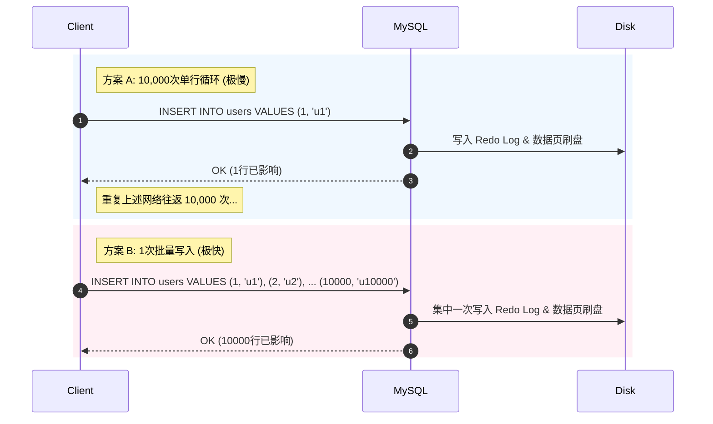

# 03.03.00. 数据插入

> **故事线与承上启下**：
> 在之前的学习中，我们设计了用户表、角色表以及多对多关联表，建立了关系型数据库的骨架。但一个没有数据的数据库是无法支撑任何业务运作的。现在，为了让订单系统能够跑通最基础的“用户登录与角色授权”逻辑，我们需要往系统里录入第一批测试账号与初始系统角色。本节我们将探讨如何使用 `INSERT INTO` 语句将数据持久化写入表中，并深入理解单行插入与批量插入在 InnoDB 底层的性能差异。

## ⚡ 速查摘要

- **单行插入**：`INSERT INTO 表名 (字段1, 字段2) VALUES (值1, 值2);`
- **批量插入**：`INSERT INTO 表名 (字段1, 字段2) VALUES (值1, 值2), (值3, 值4);`（生产环境推荐，可显著减少网络 RTT 与事务开销）。
- **子查询导入**：`INSERT INTO 目标表 (字段1) SELECT 字段2 FROM 来源表;`（常用于数据迁移）。

---

## 🎯 学习目标与验收标准

**学习目标：**
- 掌握 `INSERT INTO` 的单行、多行批量插入语法及注意事项。
- 理解批量插入相比多次单行插入在网络交互、事务提交及索引树分裂上的物理性能优势。
- 掌握 `INSERT ... SELECT` 语法，实现跨表数据的快速迁移。
- 明确自增主键 (`AUTO_INCREMENT`) 的插入规则与锁机制直觉。

**验收标准：**
- [ ] 能解释为什么在大数据量插入时，一条批量 `INSERT` 语句比几千条单行 `INSERT` 快得多。
- [ ] 能写出在有外键约束的多对多关联场景下（如给用户分配角色），数据的正确写入顺序。
- [ ] 能够成功完成练习：向 `users`、`roles`、`user_roles` 表写入测试数据并跑通测试脚本。

---

## 📖 概念全景

### 1. 单行插入 vs 批量插入底层差异

当需要向数据库中写入 10,000 条记录时，我们有两种基本的选择：
- **方案 A (单行循环)**：在循环中执行 10,000 次 `INSERT`。
- **方案 B (批量写入)**：执行 1 次包含 10,000 行数据的批量 `INSERT`。



在 InnoDB 底层，两者的性能差距通常在 **10 到 100 倍** 之间，根本原因在于：
1. **网络往返时间 (RTT)**：单行循环会产生 10,000 次网络请求包和响应包的交互开销，而批量插入仅需 1 次。
2. **事务提交代价**：如果未显式开启事务，MySQL 默认的 `autocommit` 机制会将每条 SQL 语句视作一个独立的事务。每次事务提交都必须强制将 Redo Log 物理刷盘 (`fsync`)。方案 A 意味着 10,000 次磁盘 I/O 刷盘；方案 B 仅需 1 次。
3. **B+Tree 索引树分裂**：单行乱序插入会导致 B+ 树的物理页面频繁发生拆分与重组。批量顺序插入能让 InnoDB 在内存中更高效地连续填充数据页面，减少页分裂带来的随机磁盘 I/O。

### 2. 外键关联写入顺序

因为我们的 `user_roles` 关联表对 `users` 表和 `roles` 表存在物理外键依赖：
- `user_roles.user_id` 外键关联了 `users.id`
- `user_roles.role_id` 外键关联了 `roles.id`

所以在向关联表写入数据时，**必须先确保被关联的父表行记录已经存在**，否则 MySQL 将抛出外键约束错误 (`Error Code: 1452. Cannot add or update a child row: a foreign key constraint fails`)。

```
【写入顺序链条】
Step 1: INSERT INTO users (用户数据)
Step 2: INSERT INTO roles (角色数据)
Step 3: INSERT INTO user_roles (关联关系数据)
```

---

## 💻 SQL 语法

### 1. 标准插入语法

```sql
INSERT INTO table_name (column1, column2, column3)
VALUES (value1, value2, value3);
```

- 指定插入列是最佳工程实践，这可以使你的 SQL 语句在表结构新增其他具有默认值的字段时仍保持向下兼容。
- 如果省略字段列表，`VALUES` 后面的值必须**严格按照表定义的字段顺序**填满所有列：
  ```sql
  -- 不推荐写法：一旦 users 表加了列，这句 SQL 就会报错
  INSERT INTO users VALUES (NULL, 'admin', 'admin@example.com', 'pwd_hash', 1, NOW(), NOW());
  ```

### 2. 批量插入语法

```sql
INSERT INTO table_name (column1, column2)
VALUES 
(value1_1, value1_2),
(value2_1, value2_2),
(value3_1, value3_2);
```

### 3. 从子查询导入 (INSERT ... SELECT)

用于在数据库内部进行表复制或数据统计沉淀：

```sql
INSERT INTO vip_users (id, username, email)
SELECT id, username, email 
FROM users 
WHERE status = 2; -- 筛选活跃级别高的用户复制到贵宾表
```

---

## 🛒 订单系统实战

**业务场景：**
我们要为后台系统初始化三个基础角色（`Admin`、`Operator`、`Customer`），同时录入一个管理员账号 `'system_admin'` 和一个普通用户账号 `'guest_user'`，并将这两个账号与刚才的角色进行多对多绑定。

**实战 SQL：**

```sql
-- 1. 写入角色数据 (主键自增)
INSERT INTO roles (role_name, description) VALUES 
('Admin', '系统超级管理员，拥有完整权限'),
('Operator', '后台运营人员，负责订单审核与发货'),
('Customer', '普通终端消费者');

-- 2. 写入用户数据
INSERT INTO users (username, email, password_hash, status) VALUES 
('system_admin', 'admin@order.com', 'pbkdf2_admin_secret', 1),
('guest_user', 'guest@order.com', 'pbkdf2_guest_secret', 1);

-- 3. 建立多对多绑定 (假设我们确定前面插入产生的 id，Admin=1, Customer=3; admin用户=1, guest用户=2)
INSERT INTO user_roles (user_id, role_id) VALUES 
(1, 1), -- system_admin 拥有 Admin 角色
(2, 3); -- guest_user 拥有 Customer 角色
```

---

## ⚠️ 常见坑点

- 💣 **坑点 1：列数与值个数不匹配**
  * **现象**：`Error Code: 1136. Column count doesn't match value count at row 1`
  * **对策**：仔细检查前括号的字段数量与后括号的值数量是否完全一一对应。

- 💣 **坑点 2：忽略字段类型导致隐式截断**
  * **现象**：向 `VARCHAR(50)` 字段插入 100 字节的字符串，在非严格 SQL 模式下数据会被无警告截断，在严格模式下直接报错。
  * **对策**：设计时确保字段长度上限充足；插入前对应用层输入做长度校验。

---

## 🧠 主动回忆

请在不看上文的情况下，尝试回答以下问题：

1. 为什么在大批量导入时，如果使用自增主键，顺序写入会比随机 UUID 写入快得多？
   - *答案：自增主键是单调递增的，这使得新插入的数据行总是追加到 B+Tree 叶子节点的末尾，几乎不会引起页拆分（Page Split）和历史数据的物理重排。而随机 UUID 会把数据插入到树的随机位置，产生高频的物理页分裂和大量的磁盘随机 I/O。*
2. 如果你在一个事务中执行了 `INSERT ... SELECT`，这会产生什么锁？会对源表有性能影响吗？
   - *答案：在 InnoDB 中，默认隔离级别（RR）下，`INSERT ... SELECT` 语句会对源表的读取页加上共享读锁（S-Lock），以确保在 Binlog 复制时的数据一致性。这意味着其他并发事务此时如果尝试对源表执行 `UPDATE` 或 `DELETE` 写入，将被阻塞，可能会导致高并发下的连接积压。*

---

## 🧭 进阶路线提示

| 后续章节 | 会继续解决什么问题 |
|---|---|
| [03.03 数据导入导出] | 学习使用 `LOAD DATA` 和批量导入工具，解决几十万到几百万级数据极速进库的工程难题。 |
| [04.03 事务与并发控制] | 探讨并发插入时的唯一性冲突（Duplicate Key）与死锁防范。 |

---

## ✅ 项目练习

去 `exercises/03.03.00-insert` 目录下，完成你的第一个 DML 数据插入实操任务！

**任务描述：**
1. 请在 `exercise.sql` 中编写 SQL，向 `roles` 表批量插入两个角色：`'Administrator'` (id=1) 和 `'User'` (id=2)。
2. 向 `users` 表批量插入两个用户：`'root_user'` (id=1) 和 `'dev_user'` (id=2)。
3. 向 `user_roles` 关联表中插入记录，让 `'root_user'` 拥有 `'Administrator'` 角色，`'dev_user'` 拥有 `'User'` 角色。

**运行验证：**
在终端进入该练习目录，执行自动化测试脚本：
```bash
bash test.sh
```
