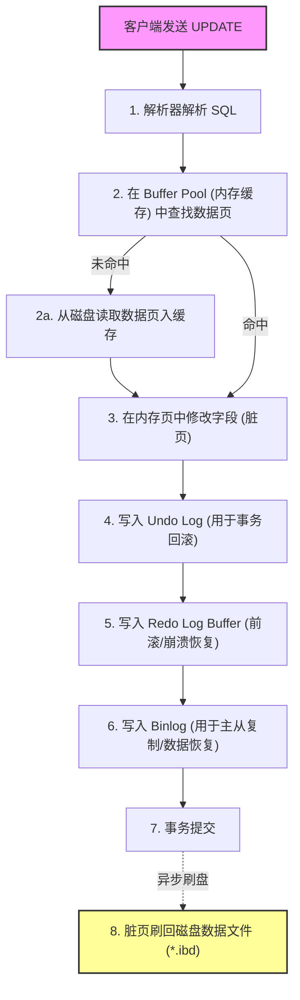

# 03.03.01. 数据更新与删除

> **故事线与承上启下**：
> 在上节课中，我们已经成功将初始用户和角色批量插入了数据库。然而在电商系统的日常运转中，数据不是静止的。用户会更改密码、更换邮箱、注销账户，客服人员也需要根据业务合规性冻结或清理违规账户。本节我们将探讨如何使用 `UPDATE` 和 `DELETE` 安全地更改与删除数据，以及为什么你应该时刻警惕那些不带 `WHERE` 条件的操作。

## ⚡ 速查摘要

- **更新数据**：`UPDATE 表名 SET 列1 = 值1, 列2 = 值2 WHERE 过滤条件;`（多列修改用逗号分隔，切勿在 `SET` 中误用 `AND`）。
- **删除数据**：`DELETE FROM 表名 WHERE 过滤条件;`（逐行标记删除，记录 Undo Log，速度较慢，能回滚）。
- **极速清表**：`TRUNCATE TABLE 表名;`（物理重建表，直接释放空间，不记 Undo Log，速度极快，**不可回滚**）。
- **安全拦截**：设置 `SET sql_safe_updates = 1;` 可以在没有使用主键或索引过滤时，拦截全表的 `UPDATE/DELETE`。也就是说，好的习惯，不管有没有设置安全模式(生产环境推荐设置)，在 使用 update / delete的时候，必须有过滤条件where，同时过滤条件必须包含索引字段

---

## 🎯 学习目标与验收标准

**学习目标：**
- 掌握 `UPDATE` 和 `DELETE` 语句的编写规范与多列修改语法。
- 理解 `DELETE` 与 `TRUNCATE` 在底层机制上的本质区别。
- 掌握安全更新模式 (`sql_safe_updates`) 的工作原理与开启方式。
- 能够在电商业务场景中安全地进行状态流转和过期数据清理。

**验收标准：**
- [ ] 能解释为什么在 `UPDATE` 时使用 `AND` 代替逗号会产生灾难性的更新逻辑错误。
- [ ] 能使用表格对比 `DELETE`、`TRUNCATE` 和 `DROP` 的优劣及适用场景。
- [ ] 能独立编写安全删除僵尸用户的 SQL 语句并通过自动化测试。

---

## 📖 概念全景

### 1. UPDATE 执行物理流程

在 InnoDB 存储引擎中，`UPDATE` 并不是直接去修改物理磁盘上的文件，而是经历了一套高度复杂的内存与日志写入过程以保障 ACID 特性。



### 2. DELETE vs TRUNCATE 对比

如果要把表中的数据完全清空，我们可以使用 `DELETE FROM users;` 或是 `TRUNCATE TABLE users;`。它们在底层存储和性能上有着天壤之别。

| 维度 | DELETE FROM table | TRUNCATE TABLE | DROP TABLE |
| :--- | :--- | :--- | :--- |
| **操作分类** | DML (数据操纵语言) | DDL (数据定义语言) | DDL (数据定义语言) |
| **物理本质** | 逐行标记删除，保留空间 | 释放数据空间并重建空表结构 | 彻底从磁盘删除表结构及数据文件 |
| **磁盘空间释放** | ❌ 页面被标记为可重用，磁盘文件不减小 | ✅ 释放并重置高水位，磁盘文件瞬间缩小 | ✅ 空间立刻释放并彻底移除文件 |
| **事务回滚支持** | ✅ 支持 (通过 Undo Log 回滚) | ❌ 不支持 (立刻隐式提交事务) | ❌ 不支持 (立刻隐式提交事务) |
| **自增计数器** | ❌ 不变 (下一次插入延续之前计数) | ✅ 重置为初始值 (通常为 1) | ❌ 整个表直接消失 |
| **触发器支持** | ✅ 触发 `BEFORE/AFTER DELETE` | ❌ 不触发任何触发器 | ❌ 不触发任何触发器 |
| **执行速度** | 慢 (数据量大时耗费大量 I/O 与日志) | 极快 (瞬间重置秒级完成) | 极快 |

> [!IMPORTANT]
> 在生产环境中，对于具有高频变更的表（如订单流水表），**严禁在无索引支撑的前提下执行大批量 `DELETE`**。这会锁死全表（升级为表锁），并产生大量的 Binlog 和 Undo Log，拖垮主从复制。

### 3. 安全更新模式 (`sql_safe_updates`)

为了避免由于研发人员疏忽导致的“全表更新”或“全表删除”（例如忘了写 `WHERE`，或者写错了条件），MySQL 提供了安全更新模式：

```sql
-- 开启安全模式
SET sql_safe_updates = 1;
```

开启该模式后，MySQL 会对 `UPDATE` 和 `DELETE` 做出以下限制：
1. **必须在 `WHERE` 条件中使用索引列**（如主键或二级索引）进行过滤定位。
2. 如果未使用索引列过滤，MySQL 将拒绝执行并抛出错误：
   `Error Code: 1175. You are using safe update mode and you tried to update a table without a WHERE that uses a KEY column.`

---

## 💻 SQL 语法

### 1. UPDATE 语法

```sql
UPDATE [LOW_PRIORITY] [IGNORE] table_reference
    SET assignment_list
    [WHERE where_condition]
    [ORDER BY ...]
    [LIMIT row_count];
```

- `assignment_list`：这里表示设置列字段的值, 支持一次性写入多个字段的值
```
col_name = expr [, col_name = expr] ...
```
- `WHERE`: 筛选条件
- `ORDER BY`: 排序，通常与LIMIT一起使用
- `LIMIT` 子句：可限制只更新符合条件的前几行数据，避免一次性在大事务中更新太多行导致锁表。

```sql
-- 更新示例：禁用特定邮箱的用户
UPDATE users 
SET status = 0, updated_at = NOW() 
WHERE email = 'alice@example.com';
```

### 2. DELETE 语法

```sql
DELETE [LOW_PRIORITY] [QUICK] [IGNORE] FROM tbl_name
    [PARTITION (partition_names, ...)]
    [WHERE where_condition]
    [ORDER BY ...]
    [LIMIT row_count];
```

- `QUICK`：只针对 MyISAM 表起作用，加速数据文件的空间合并。
- `LIMIT`：常用于批量分批删除，如 `DELETE FROM logs WHERE log_date < '2026-01-01' LIMIT 5000;` 循环删除，防止单次大事务导致的死锁或复制延迟。

-- 错误示范：一次性删除 100 万条历史数据（导致锁表、长事务、主从延迟）
```sql
DELETE FROM logs WHERE create_time < '2026-01-01';
```

-- 正确示范：通过程序循环执行小批次删除，每次只锁 5000 行，执行完立即释放锁
```sql
DELETE FROM logs 
WHERE create_time < '2026-01-01' 
ORDER BY id ASC 
LIMIT 5000;
```
---

## 🛒 订单系统实战

**业务场景：**
我们的订单系统中，有一批处于冻结或未激活的僵尸用户。系统管理后台提出了两项自动化任务：
1. 定位用户名包含 `'guest_'` 的临时注册账号，将他们的 `status` 置为 `0` (表示禁用)。
2. 为了节省存储，每隔 30 天要将所有 `status = 0` 且其 `created_at` 超过 30 天的已禁用账户从物理上予以删除。

**实战 SQL：**

```sql
-- 启用安全模式以防错改
SET sql_safe_updates = 1;

-- 任务 1：更新临时账号状态
-- 由于 username 是唯一键 (uk_users_username)，满足索引列定位要求
UPDATE users 
SET status = 0
WHERE username LIKE 'guest_%';

-- 任务 2：分批删除过期的禁用用户 (created_at 已经建立了辅助索引 idx_users_created_at)
DELETE FROM users 
WHERE status = 0 
  AND created_at < DATE_SUB(NOW(), INTERVAL 30 DAY)
LIMIT 1000;
```

---

## ⚠️ 常见坑点

- 💣 **坑点 1：在 SET 中错误地使用 AND 链接更新列**
  * **错误演示**：
    ```sql
    UPDATE users SET status = 0 AND password_hash = 'new_hash' WHERE id = 123;
    ```
  * **惨痛后果**：你以为你在同时修改 status 和密码？然而这句 SQL 相当于 `status = (0 AND password_hash = 'new_hash')`。这个逻辑与表达式求值的结果是一个布尔值（通常为 `0`），最终**只修改了 status 且密码并没有被成功修改！**
  * **正确做法**：字段之间必须使用**逗号**隔开。

- 💣 **坑点 2：忽略 sql_safe_updates 带来的开发调试盲区**
  * **现象**：在本地开发环境用 DBeaver/DataGrip 执行 `UPDATE users SET status = 1` 时直接报错，但在生产代码里执行却没有被拦截。
  * **原因**：`sql_safe_updates` 通常是客户端工具默认在会话 (Session) 级帮你打开的。一旦你跑程序代码（如 Spring/Python 后端），默认连接并没有开启此安全选项，这就极易产生因全表扫描修改带来的生产事故。
  * **对策**：全局配置写在主库的配置项中，或者在程序数据库初始化时显式设置会话级变量。

---

## 🧠 主动回忆

请在不看上文的情况下，尝试回答以下问题：

1. 如果在 `UPDATE` 语句中没有使用主键，但是使用了其他建立了普通二级索引的列作为过滤条件，当 `sql_safe_updates = 1` 时会被拒绝执行吗？
   - *答案：不会。只要使用了满足 Key 属性 of 索引列 (无论是主键 Primary Key、唯一键 Unique 还是二级普通索引 Index) 作为过滤条件，就不会被安全更新模式拦截。*
2. 正在执行一个长达一小时的事务，中间有人对表调用了 `TRUNCATE TABLE`。如果你的事务最后回滚了，那个被清空的表会被恢复吗？为什么？
   - *答案：不会恢复。TRUNCATE 是 DDL 语句，其底层实现不经过 Undo Log 且不可用于事务回滚。在 MySQL 中，执行任何 DDL 语句都会隐式强制提交当前连接的所有活动事务 (Implicit Commit)，一旦执行便覆水难收。*
3. 假设你的 `users` 表里有 5000 万行数据。现在需要删除 1000 万行过期的记录。你直接运行 `DELETE FROM users WHERE created_at < '2026-01-01';`，作为架构师你认为可能带来什么风险？
   - *答案：单次事务涉及 1000 万行数据的删除会产生巨量的行锁竞争，可能使整张表拦截阻塞；大量写入 Undo Log 和 Redo Log 会对磁盘 I/O 造成极其严重的负载冲击；主从节点之间会出现巨大的同步延迟。应当使用 `LIMIT` 采取分批（如每次 5000 行）循环删除。*

---

## 🧭 进阶路线提示

| 后续章节 | 会继续解决什么问题 |
|---|---|
| [04.03 事务与锁] | 探讨在并发场景下对同一行数据执行 `UPDATE` 时行级排他锁 (X-Lock) 的行为与死锁。 |
| [05.02 备份与数据恢复] | 针对误执行 DML 导致的数据污染，如何通过 Binlog 进行点位恢复 (Point-in-Time Recovery)。 |

---

## ✅ 项目练习

去 `exercises/03.03.01-update-delete` 目录下，完成你的第一个修改与删除实操任务！

**任务描述：**
1. 请在 `exercise.sql` 中编写 `UPDATE` 语句，将临时创建的用户 `'alice'` 的状态 `status` 更新为 `0` (表示禁用)。
2. 编写 `DELETE` 语句，在不需要禁用安全模式的前提下，物理删除所有 `status = 0` 的用户记录。

**运行验证：**
在终端进入该练习目录，执行自动化测试脚本：
```bash
bash test.sh
```

---

## 🚀 延伸学习

- [MySQL 官方文档对安全模式的解释](https://dev.mysql.com/doc/refman/8.4/en/mysql-tips.html#safe-updates)
- [思考] 当删除数据行时，MySQL 是立刻将对应的物理页磁盘数据清空吗？（选读：探究 InnoDB 页结构中 `delete_mask` 标志位和 Purge 线程的异步清理原理）
