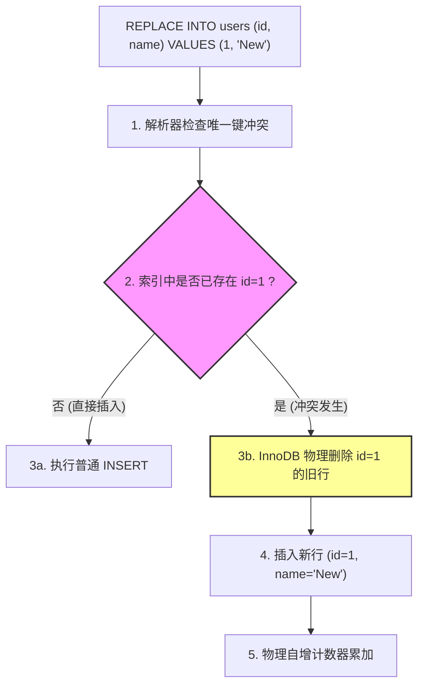

# 03.03.02. Upsert、REPLACE 与 INSERT IGNORE

> **故事线与承上启下**：
> 在学会基础数据写入与安全删除后，我们已经能够应付大部分单线程业务。但在真实的电商订单系统中，高并发是常态。当多个微服务同时为同一个订单推送“支付成功”回调，或者用户连续快速点击“提交”按钮时，如果不加处理，并发写入会高频引发主键或唯一键冲突（`Duplicate entry` 报错）。如何优雅、高效、不报错地处理这些写入冲突？这就是本节要解决的核心问题：Upsert 幂等写入、替换写入 (REPLACE) 和忽略冲突 (INSERT IGNORE)。

## ⚡ 速查摘要

- **Upsert 幂等更新**：（最推荐，并发安全，如果存在冲突则转为更新指定字段）。
```sql
INSERT INTO table_name (列字段, 列字段) 
values (列值， 列值)
AS values_name
ON DUPLICATE KEY UPDATE 
  字段 = values_name.列名;
```
- **忽略冲突**：`INSERT IGNORE INTO ...`（主键或唯一键冲突时不报错，只产生 Warning，跳过冲突数据）。
- **删除替换**：`REPLACE INTO ...`（**慎用， 禁止使用**！物理上先执行 `DELETE` 再执行 `INSERT`，有重置自增主键和外键级联删除副作用）。

---

## 🎯 学习目标与验收标准

**学习目标：**
- 掌握 `ON DUPLICATE KEY UPDATE`、`REPLACE` 和 `INSERT IGNORE` 的语法区别。
- 深刻理解 `REPLACE` 先删后写的物理机理及其在生产环境中带来的并发死锁和外键级联灾难。
- 能够在高并发支付回调、接口重试等幂等写入场景下设计出零报错的 SQL 语句。

**验收标准：**
- [ ] 能解释 `REPLACE INTO` 在遇到唯一性冲突时对 `AUTO_INCREMENT` 自增计数器的物理影响。
- [ ] 能说出在生产环境中，为什么优先选择 `ON DUPLICATE KEY UPDATE` 而非 `REPLACE`。
- [ ] 能够成功完成练习：在支付回调表中实现幂等 Upsert 写入并通过测试脚本验证。

---

## 📖 概念全景

### 1. 三种冲突写入机制物理对比

在遇到主键（`PRIMARY KEY`）或唯一约束（`UNIQUE KEY`）冲突时，这三种命令的底层行为有着显著的不同：

| 维度 | INSERT IGNORE | REPLACE INTO | INSERT ... ON DUPLICATE KEY UPDATE |
| :--- | :--- | :--- | :--- |
| **冲突行为** | 放弃当前写入，保留原数据 | **物理删除 (DELETE) 旧行**，再插入新行 | 保留旧行，**仅更新 (UPDATE) 指定列** |
| **自增计数器** | 不增加（除非大批量插入时可能预分配浪费） | **继续累加增加**（删去后新插的行占用新自增值） | 正常情况下不增加（只执行 UPDATE） |
| **外键级联影响**| 无影响 | ⚠️ **毁灭性**：如果该表是主表且有 `ON DELETE CASCADE` 级联删除，会把子表关联数据一并删光！ | 安全：仅修改数据，不会触发级联删除 |
| **触发器触发** | 不触发插入触发器 | 触发 `DELETE` 和 `INSERT` 触发器 | 触发 `UPDATE` 触发器 |
| **并发死锁风险**| 低 | ⚠️ 高（多表索引级锁竞争） | 中等（在有多个唯一索引时仍可能产生死锁） |
| **适用场景** | 批量导入时忽略脏数据行 | 纯粹的覆盖写，表无任何外键与关联 | 支付幂等、访问计数累加、并发 Upsert |

### 2. REPLACE 底层删除替换的物理本质

我们来看一下 `REPLACE` 遇到冲突时的物理过程：



> [!WARNING]
> 因为 `REPLACE` 底层包含了 `DELETE` 操作，如果目标表包含自增主键，它的主键值（或是没有显式指定主键时重新分配的自增值）会飞速上涨。更危险的是，如果别的子表外键指向此表并设定了级联删除，`REPLACE` 会导致**子表里好端端的数据瞬间灰飞烟灭！** 生产中几乎全面禁止使用 `REPLACE INTO`。

### 3. ON DUPLICATE KEY UPDATE (Upsert) 机制

在 MySQL 8.0 之前，我们通常使用 `VALUES(col_name)` 引用新输入的值：

```sql
INSERT INTO stats (id, clicks) VALUES (10, 1)
ON DUPLICATE KEY UPDATE clicks = clicks + VALUES(clicks);
```

而在 MySQL 8.0+ 中，官方推荐了为新输入行定义别名的新语法（更具可读性，避免 `VALUES()` 函数被废弃）：

```sql
INSERT INTO stats (id, clicks) VALUES (10, 1) AS new_row
ON DUPLICATE KEY UPDATE clicks = stats.clicks + new_row.clicks;
```

#### values 数据 别名 AS
这里的 AS new_row 相当于给这里插入的这条(批量多条)数据起了个别名，通过这个别名可以拿到即将要插入的新值

比如这里如果主键id出现冲突， 那么只更新指定字段的值 clicks, 这个字段的新值 等于 旧值(stats.clicks) + 新值(new_row.clicks, 通过别名的方式取values值)


---

## 💻 SQL 语法

### 1. INSERT IGNORE 语法

```sql
INSERT IGNORE INTO tbl_name (col1, col2) VALUES (val1, val2);
```

### 2. REPLACE 语法

```sql
REPLACE INTO tbl_name (col1, col2) VALUES (val1, val2);
```

### 3. ON DUPLICATE KEY UPDATE 语法 (Upsert)

```sql
INSERT INTO tbl_name (col1, col2) VALUES (val1, val2) AS alias_name
ON DUPLICATE KEY UPDATE target_col = alias_name.source_col;
```

---

## 🛒 订单系统实战

**业务场景：**
在支付模块中，系统有一张第三方支付回调通知记录表 `payment_callbacks`。当用户支付成功后，微信或支付宝支付网关会向后台发起多次重试回调（保证通知必达）。
- 我们需要设计一条 SQL，当第一次收到回调时（`payment_no` 不存在），往表中写入支付单号、交易金额和回调次数（初始为 1）。
- 当并发第二次或重试收到回调时（`payment_no` 唯一键冲突），系统不报错，而是将回调次数在原有基础上加 1，并更新最新的回调时间。

**实战 SQL：**

```sql
-- 创建回调表结构 (本节练习在exercises目录下执行，这里作为示例)
CREATE TABLE IF NOT EXISTS payment_callbacks (
    id INT AUTO_INCREMENT PRIMARY KEY,
    payment_no VARCHAR(64) NOT NULL UNIQUE,
    amount DECIMAL(10,2) NOT NULL,
    callback_count INT DEFAULT 1,
    last_callback_time TIMESTAMP DEFAULT CURRENT_TIMESTAMP ON UPDATE CURRENT_TIMESTAMP
);

-- 执行幂等写入
INSERT INTO payment_callbacks (payment_no, amount, callback_count)
VALUES ('pay_202607090001', 99.00, 1) AS new_cb
ON DUPLICATE KEY UPDATE 
    callback_count = payment_callbacks.callback_count + 1;
```

---

## ⚠️ 常见坑点

- 💣 **坑点 1：REPLACE 引起唯一索引连锁冲突死锁**
  * **现象**：在高并发下对拥有多个唯一索引（如既有主键 `id`，又有唯一键 `email`）的表使用 `REPLACE` 时，极易抛出死锁错误 (`Deadlock found when trying to get lock; try restarting transaction`)。
  * **原因**：`REPLACE` 需要同时加排他锁锁住多条冲突记录所在的索引分支，且释放与加锁顺序由于多索引交叉无序，极易环形死锁。
  * **对策**：高并发下统一使用 `ON DUPLICATE KEY UPDATE`，且尽最大可能合并或减少冗余的唯一索引。

- 💣 **坑点 2：忽略 INSERT IGNORE 隐藏的截断报错**
  * **现象**：当使用 `INSERT IGNORE` 时，除了主键冲突被忽略外，数据字段超长截断、类型不匹配转换等致命错误也会被强行降级为 `Warning` 写入，从而进库了“垃圾数据”。
  * **对策**：仅在能够确信应用层对字段值已做完格式校验、只想屏蔽主键重复的导入中使用它。

---

## 🧠 主动回忆

请在不看上文的情况下，尝试回答以下问题：

1. 如果一张表上没有任何主键 (PRIMARY KEY) 或唯一索引 (UNIQUE INDEX)，我们调用 `REPLACE INTO` 或 `ON DUPLICATE KEY UPDATE` 时，如果插入重复的数据，会触发冲突更新吗？
   - *答案：不会。因为不管是 REPLACE 还是 ON DUPLICATE KEY UPDATE，都必须依赖表中已定义的唯一约束（主键或唯一索引）来进行冲突检测。如果没有唯一约束，MySQL 会把每一次写入都当成全新的行直接 INSERT，从而产生冗余的重复行。*
2. 在 `ON DUPLICATE KEY UPDATE` 语句中，如果冲突触发了，影响行数 (Affected Rows) 返回的结果是多少？
   - *答案：在 MySQL 客户端中，如果插入了一条新行，返回的受影响行数为 1；如果由于冲突而更新了已有行，返回的受影响行数为 2；如果冲突发生但更新的内容与旧内容完全相同（没有发生实质修改），返回的受影响行数为 0。这常用于在业务代码中判断 Upsert 到底执行了插入还是更新。*

---

## 🧭 进阶路线提示

| 后续章节 | 会继续解决什么问题 |
|---|---|
| [04.03 事务与锁] | 深入探讨在高并发下批量 Upsert (ON DUPLICATE KEY UPDATE) 导致的唯一键间隙锁锁等待与死锁成因分析。 |
| [06.01 高可用表设计方法论] | 探讨在分布式分库分表下，唯一键冲突策略（如全局 ID 发生器）在架构上的处理逻辑。 |

---

## ✅ 项目练习

去 `exercises/03.03.02-upsert-replace-ignore` 目录下，完成你的高并发幂等写入实操任务！

**任务描述：**
1. 请在 `exercise.sql` 中编写 SQL，为回调记录表 `payment_callbacks` 写入一条回调数据。
2. 写入要求：使用 `ON DUPLICATE KEY UPDATE`。若 `payment_no` 未发生冲突，则正常插入；若 `payment_no` 冲突，则将该条记录的 `callback_count` 字段加 `1`，同时修改 `amount` 为新传入的回调金额。

**运行验证：**
在终端进入该练习目录，执行自动化测试脚本：
```bash
bash test.sh
```
