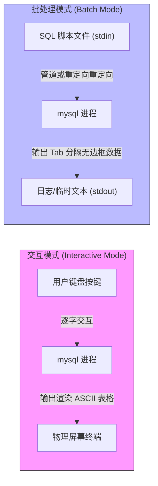

# 03.03.03. 批处理 SQL 文件

> **故事线与承上启下**：
> 在过去的小节中，我们一直是在 MySQL 交互式终端（CLI）下一行一行地敲入 SQL 语句来操作数据。但在真实的软件生命周期中，无论是自动化部署、表结构升级升级，还是定时清理过期数据的定时脚本，都不可能依赖人工交互。我们需要将成百上千行的 SQL 封装进一个脚本文件中，让命令行工具自动加载并静默运行。这就是本节要探讨的：使用 `mysql` 客户端的批处理模式（Batch Mode）高效运行 SQL 脚本文件。

## ⚡ 速查摘要

- **外部导入执行 (重定向)**：`mysql -u 用户名 -p 数据库名 < 脚本文件.sql` (在系统 shell 终端中运行)。
- **内部导入执行 (source)**：`mysql> source /路径/脚本文件.sql;` (在已连接的 mysql 会话交互终端中运行)。
- **命令行单条执行**：`mysql -u 用户名 -p -e "SQL语句" 数据库名`。
- **格式化批处理输出**：默认批处理模式下，MySQL 会隐去华丽的 ASCII 表格边框，转而输出使用制表符 (`\t`) 分隔的纯文本，方便 Linux 系统管道命令（如 `awk`、`grep`）直接处理。

---

## 🎯 学习目标与验收标准

**学习目标：**
- 掌握使用交互式连接内部的 `source` 命令与外部 Shell 的 `stdin` 重定向模式执行 SQL 文件的异同。
- 理解批处理模式（Batch Mode）下客户端输出格式的底层物理优化（免除 ASCII 边框绘制以提升大量查询时的渲染性能）。
- 掌握命令行 `-e`、`-N`、`-s` 和 `-B` 参数在编写 Shell 数据库自动化运维脚本时的应用。

**验收标准：**
- [ ] 能写出在 Linux 系统命令行下，一键将本地 SQL 脚本导入容器内运行的完整 Bash 指令。
- [ ] 能分辨出当 `mysql` 检测到输出目的地是 `stdout` 终端还是重定向文件时，输出字符排版的物理差异。
- [ ] 能够成功完成练习：编写并执行升级种子数据的批处理，使得自动化测试通过。

---

## 📖 概念全景

### 1. 交互式模式 vs 批处理模式数据流

`mysql` CLI 客户端可以根据当前的 `stdin` (标准输入) 和 `stdout` (标准输出) 是否绑定在物理终端上，自动切换两种运行状态：



当 `mysql` 检测到输入流来自重定向文件时，它会自动在内部优化数据渲染逻辑：
1. **摒弃 ASCII 表格边框**：不绘制类似 `+----+-----+` 的边框线，直接以 `字段值\t字段值\n` 格式输出。
2. **静默执行**：不打印如 `Query OK, 1 row affected (0.01 sec)` 等交互式统计信息，除非发生致命报错。

这大大节省了网络传输带宽以及终端屏幕刷新所造成的 CPU 损耗，使执行海量查询的脚本时速度飞速提升。

### 2. 常用命令行控制参数

在编写自动化 Shell 脚本时，我们往往不需要表头或繁琐的输出，这就需要搭配以下控制参数：

| 参数选项 | 全称形式 | 物理作用 |
| :--- | :--- | :--- |
| **`-e`** | `--execute=statement` | 直接执行传入的 SQL 字符串，执行完毕瞬间退出，不进入交互式会话。 |
| **`-N`** | `--skip-column-names` | **隐藏列名表头**。输出中不打印第一行的字段名称。 |
| **`-s`** | `--silent` | **静默模式**。进一步去除多余的空格，减少噪音。常用多个 `-s` (如 `-ss`) 实现纯净值输出。 |
| **`-B`** | `--batch` | 强制开启批处理格式输出（即以 Tab 分隔字段），即使输出绑定在终端屏幕上。 |

---

## 💻 SQL 语法与客户端指令

### 1. 交互式 CLI 连接内的加载 (source)

```sql
mysql> USE order_system;
mysql> SOURCE /var/lib/mysql-files/update_schema.sql;
-- source 是客户端命令，末尾不需要加分号，但加上也无妨
```

### 2. 系统终端直接重定向 (Shell Redirection)

```bash
# 语法结构
mysql -h 主机 -u 用户 -p密码 数据库名 < /路径/到/脚本.sql
```

> [!TIP]
> 运行非常巨大的 SQL 文件（如 5GB 恢复备份）时，如果在 Shell 里直接运行，可能会因为网络间断导致中途断连。建议配合 `nohup` 或 `screen` 在后台跑，并重定向错误输出：
> `nohup mysql -uroot -p'pwd' my_db < restore.sql > restore.log 2>&1 &`

---

## 🛒 订单系统实战

**业务场景：**
电商系统正在执行一次数据库 DDL 的微版本发布。我们需要在后台服务器上一键执行一个升级脚本 `v007_patch.sql`（其内容为：创建一个记录商品类目的新表 `categories`，并插入几条初始分类数据）。

**实战 SQL：**

*假设我们编写的 `v007_patch.sql` 内容如下：*
```sql
CREATE TABLE IF NOT EXISTS categories (
    id INT AUTO_INCREMENT PRIMARY KEY,
    category_name VARCHAR(50) NOT NULL UNIQUE,
    parent_id INT DEFAULT 0
) ENGINE=InnoDB DEFAULT CHARSET=utf8mb4;

INSERT IGNORE INTO categories (category_name) VALUES 
('Electronics'),
('Clothing'),
('Books');
```

*运维人员在宿主机 Shell 终端一键将其下发至 Docker 内的 MySQL 容器执行：*
```bash
docker exec -i mysql-learn mysql -u root -p'root123' order_system < v007_patch.sql
```
*不需要手动进入容器、连接数据库再去粘贴执行，瞬间完成结构升级。*

---

## ⚠️ 常见坑点

- 💣 **坑点 1：明文密码泄露隐患**
  * **错误演示**：`mysql -u root -p123456 < script.sql`
  * **安全漏洞**：在多用户共享的 Linux 服务器中，任何其他普通用户只要执行 `ps -ef | grep mysql` 就能在进程树里清晰看到你的 `-p123456` 明文密码。此外，这还会被记录在你的 `~/.bash_history` 历史文件中。
  * **对策**：使用配置密码环境变量 `MYSQL_PWD`（仅当前进程可见），或者在 `~/.my.cnf` 文件中安全地设置 `[client]` 凭据并赋予 `600` 权限。

- 💣 **坑点 2：大脚本执行中途报错导致“半挂状态”**
  * **现象**：一个 SQL 文件里有 10 条 `CREATE TABLE`，执行到第 5 条报错退出了。数据库只建好了前 4 张表，处于半截子尴尬境地。
  * **对策**：非 DDL 的 DML 操作，最好在 SQL 文件头部写上 `START TRANSACTION;`，尾部写上 `COMMIT;` 包裹为单个事务。一旦中途出错，让连接自动 ROLLBACK 回滚。

---

## 🧠 主动回忆

请在不看上文的情况下，尝试回答以下问题：

1. `SOURCE` 语句可以在系统的终端 shell 界面 (如 Bash) 直接运行吗？
   - *答案：不能。`SOURCE` 是 mysql 客户端命令行解析器特有的内部会话命令（client command），在操作系统 Shell (如 Bash, Zsh) 下，系统是无法识别该指令的。在系统 Shell 下必须使用输入流重定向 `<` 指向 SQL 文件传给 `mysql` 进程。*
2. 如果你在编写 Bash 监控脚本，想要获取 `users` 表里当前注册用户的总数并赋值给 Shell 变量 `COUNT`。你想让输出结果里只有数字，没有任何表格框线和“count(*)”表头，你的 mysql 命令行应当如何编写？
   - *答案：应当使用 `-N` 隐藏表头，使用 `-s` 开启静默输出（可以叠加 `-ss`），结合 `-e` 执行查询。命令示例如下：*
     `COUNT=$(mysql -u root -p'root123' -ss -N -e "SELECT count(*) FROM users;" order_system)`
     *此时返回的变量 `COUNT` 里仅有纯数字字符串。*

---

## 🧭 进阶路线提示

| 后续章节 | 会继续解决什么问题 |
|---|---|
| [05.05 备份与数据迁移] | 详解如何使用 `mysqldump` 自动产生一个逻辑的批处理 SQL 脚本，以及如何配置 `my.cnf` 客户端凭据。 |

---

## ✅ 项目练习

去 `exercises/03.03.03-batch-sql` 目录下，完成你的第一个批处理 SQL 实操任务！

**任务描述：**
1. 请在 `exercise.sql` 中编写一条 `SOURCE` 语句，调用并执行同级目录下的 `seed.sql` 升级分类数据。
2. 内部的 `seed.sql` 路径建议直接写相对当前工作位置的相对路径 `./seed.sql` 或者是 `/var/lib/mysql-files/...`？（提示：在本地 Docker 运行中，由于 `test.sh` 会在宿主机环境下被拉起，并在终端把 SQL 直接灌入容器，为了兼容容器内外执行，本次练习的 `test.sh` 会在当前目录下将数据以批处理输入流重定向方式传递。你只需在 `exercise.sql` 里直接编写一段普通的 `INSERT` SQL 即可，这与 `README.md` 中的批处理说明一致）。

**运行验证：**
在终端进入该练习目录，执行自动化测试脚本：
```bash
bash test.sh
```
