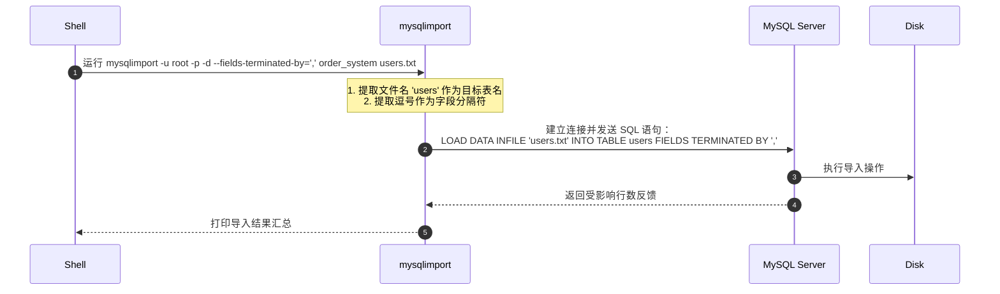

# 03.03.05. mysqlimport 与基础导出

> **故事线与承上启下**：
> 在学会了高速数据载入指令 `LOAD DATA` 之后，我们已经具备了将外部 CSV/文本加载进数据库的底层能力。但在实际的 Linux 系统运维中，直接手写冗长的 SQL 语句极不方便。为此，MySQL 官方提供了一个无需进入数据库会话、直接在系统 Shell 运行的数据加载客户端工具：`mysqlimport`。同时，数据除了“流进”还必须能够“流出”，我们同样需要将系统内的数据导出为格式化的文本以交付给第三方或离线分析系统。本节我们将探讨 `mysqlimport` 的快捷导入以及使用 `SELECT ... INTO OUTFILE` 进行基础数据导出的机制。

## ⚡ 速查摘要

- **客户端导入**：`mysqlimport [options] db_name textfile1.txt` (在系统 shell 中运行，本质上是将命令行参数在底层翻译为 `LOAD DATA` 传给服务端，且要求**文件名必须与目标表名完全一致**)。
- **数据流出**：
  ```sql
  SELECT 字段1, 字段2 
  INTO OUTFILE '安全路径/文件名.csv'
  FIELDS TERMINATED BY ',' -- 分隔符
  FROM 表名;
  ```
- **写入保护限制**：导出的目标路径必须在 `secure_file_priv` 所设定的安全目录下，且目标文件**绝不能预先存在**，否则报错以防止覆盖破坏系统文件。

---

## 🎯 学习目标与验收标准

**学习目标：**
- 掌握 `mysqlimport` 命令的使用规范及其与 `LOAD DATA` 的底层换算关系。
- 掌握 `SELECT ... INTO OUTFILE` 导出的语法和参数设置。
- 理解数据导出时，操作系统层面的文件所有者（通常为 `mysql` 用户）及目录写权限问题。

**验收标准：**
- [ ] 能解释为什么运行 `mysqlimport my_db products.csv` 会默认将数据载入到名为 `products` 的表中。
- [ ] 能排除因导出文件已存在而引发的 `ERROR 1086 (HY000): File '...' already exists` 报错。
- [ ] 能够成功完成练习：将活跃用户信息通过 `INTO OUTFILE` 导出为指定文本并通过自动化验证。

---

## 📖 概念全景

### 1. mysqlimport 客户端工作机理

`mysqlimport` 是 MySQL 提供的一个外部命令行辅助工具，它的核心价值在于**免除用户进入 MySQL CLI 去编写 SQL 的步骤**。在底层，它其实只是一个简单的“SQL 翻译器”：



> [!IMPORTANT]
> 记住 `mysqlimport` 的黄金准则：**文件名决定表名**。如果你要把数据导入到表 `orders` 中，你的数据文件绝对不能叫 `data_backup.csv`，必须重命名为 `orders.csv` 或是 `orders.txt`，否则会引发找不到表的错误。

### 2. SELECT ... INTO OUTFILE 导出的物理机制

与通过客户端（如 DBeaver、Navicat 或重定向查询输出）将数据拉回到本地电脑不同，`SELECT ... INTO OUTFILE` 是**直接在 MySQL 数据库服务器本地的磁盘上写入文件**：

1. **执行者是服务端进程**：该文件是由 MySQL 服务端进程（在 Linux 上通常是 `mysql` 系统用户）直接在服务器本地创建和写入的。因此，生成的文件所有权属于 `mysql` 组与用户，且文件的默认读写权限通常是 `640`，这需要外部读取脚本具有足够的系统权限。
2. **写权限与路径防御**：同样必须在 `secure_file_priv` 路径下，否则数据库会被拦截拒绝写入。
3. **覆盖防御机制**：为了防止 SQL 注入攻击者利用此命令重写系统的核心配置文件（如宿主机的 `/etc/hosts` 等），MySQL **禁止覆盖任何已有文件**。只要目标路径下文件已存在，就会强行报错退出。

---

## 💻 SQL 语法与客户端指令

### 1. mysqlimport 指令

```bash
mysqlimport [options] db_name textfile1 [textfile2 ...]
```

- 常用参数：
  - `--fields-terminated-by=char`：字段分隔符。
  - `--fields-enclosed-by=char`：字段包裹符。
  - `--lines-terminated-by=string`：换行符。
  - `--ignore-lines=N`：忽略文件前 N 行。
  - `--local`：从客户端本地路径上传导入。

```bash
-- 示例：从系统 shell 直接导入 CSV 文件
mysqlimport --local --ignore-lines=1 --fields-terminated-by=',' -u root -p order_system /tmp/users.csv
```

### 2. SELECT ... INTO OUTFILE 语法

```sql
SELECT col_name, ...
    INTO OUTFILE 'file_name'
        [CHARACTER SET charset_name]
        [export_options]
    FROM tbl_name
    [WHERE where_condition];
```

```sql
-- 示例：将部分活跃用户数据导出到安全目录
SELECT username, email 
INTO OUTFILE '/var/lib/mysql-files/active_users.csv'
FIELDS TERMINATED BY ',' 
LINES TERMINATED BY '\n'
FROM users 
WHERE status = 1;
```

---

## 🛒 订单系统实战

**业务场景：**
财务审计系统需要提取目前状态为 `1` (正常) 的所有用户的用户名和邮箱列表。因为数据涉及安全隐私，我们只能将导出的临时报表文件 `active_users_list.csv` 存放在服务器配置的安全物理目录 `/var/lib/mysql-files/` 下，供特定的运维进程拉取。

**实战 SQL：**

*在 MySQL 终端中执行导出：*
```sql
-- 确保如果之前生成过文件，需要先清理（MySQL自身不支持覆盖）
-- 执行数据导出
SELECT username, email 
INTO OUTFILE '/var/lib/mysql-files/active_users_list.csv'
FIELDS TERMINATED BY ',' 
LINES TERMINATED BY '\n'
FROM users
WHERE status = 1;
```

*如果想包含表头，可以通过 UNION 组合伪行来实现（虽然麻烦，但这是纯 SQL 导出的常见技巧）：*
```sql
(SELECT 'username', 'email')
UNION ALL
(SELECT username, email 
 FROM users 
 WHERE status = 1)
INTO OUTFILE '/var/lib/mysql-files/active_users_list.csv'
FIELDS TERMINATED BY ',' 
LINES TERMINATED BY '\n';
```

---

## ⚠️ 常见坑点

- 💣 **坑点 1：导出文件无法覆盖报错**
  * **现象**：`Error Code: 1086. File '/var/lib/mysql-files/data.csv' already exists`
  * **对策**：MySQL 自身没有任何选项可以强制覆盖已存在的文件（这是安全红线）。必须在操作系统 Shell 层使用命令（如 `rm -f /var/lib/mysql-files/data.csv`）先物理删除该文件，然后再在数据库中执行导出。

- 💣 **坑点 2：mysqlimport 报错 “Table 'db_name.filename' doesn't exist”**
  * **原因**：你的数据文件名与你要导入的表名不一致。例如表名是 `users`，但你运行了 `mysqlimport db_name backup_data.csv`。
  * **对策**：重命名文件为 `users.csv`，或者在执行前建立好同名的临时缓冲表。

---

## 🧠 主动回忆

请在不看上文的情况下，尝试回答以下问题：

1. `SELECT ... INTO OUTFILE` 导出的文件，默认是保存在你的个人本地开发电脑上，还是保存在 MySQL 数据库所在的宿主机服务器上？
   - *答案：保存在 MySQL 数据库服务器上。因为该文件是直接由运行在服务端的 MySQL 进程发起系统调用进行创建和写磁盘的。如果需要把数据导出到你个人电脑本地，应当在客户端工具（如 DataGrip/DBeaver）里执行普通的 `SELECT`，然后利用客户端软件提供的“Export Result”功能下载到本地。*
2. 如果你在开启了 `secure_file_priv = /var/lib/mysql-files/` 的 MySQL 中执行：
   `SELECT * INTO OUTFILE 'my_data.csv' FROM users;`
   这能成功吗？为什么？
   - *答案：不能成功。如果没有写绝对路径，MySQL 默认会尝试在当前选定的数据库对应的数据存储目录下（即 `/var/lib/mysql/data/数据库名/`）创建文件。而这与安全参数 `secure_file_priv` 所限制的安全目录冲突，因此会被直接拦截并报错。必须明确写出绝对路径，如 `/var/lib/mysql-files/my_data.csv`。*

---

## 🧭 进阶路线提示

| 后续章节 | 会继续解决什么问题 |
|---|---|
| [05.05 备份与数据迁移] | 学习大型表分片数据快速迁移、表空间物理导出以及迁移校验技术。 |

---

## ✅ 项目练习

去 `exercises/03.03.05-mysqlimport-export` 目录下，完成你的第一个数据导出实操任务！

**任务描述：**
1. 练习中，`test.sh` 脚本在执行前会预置一些测试用户。
2. 请在 `exercise.sql` 中编写 `SELECT ... INTO OUTFILE` 语句，将 `users` 表中所有 `status = 1` 的用户的 `username` 和 `email` 字段导出到安全路径 `/var/lib/mysql-files/active_users.csv` 下。
3. 字段分隔符要求使用逗号 `,`，换行符使用 `\n`。

**运行验证：**
在终端进入该练习目录，执行自动化测试脚本：
```bash
bash test.sh
```


