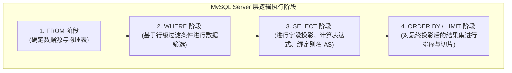

# DQL — 单表查询 / 基础查询与过滤

> **故事线与承上启下**：
> 在上一模块中，我们完成了大规模数据的导入与导出，在 `users` 表中灌入了测试数据。然而在真实的业务场景下，我们不可能每次都拉取整张表的所有数据。我们需要能够精确挑选需要的列、筛选符合特定业务规则的行，这就是关系数据库中“投影（Projection）”和“选择（Selection）”的核心能力。本节将带你进入 SQL 数据检索的起点。

## ⚡ 速查摘要

- **列选择与别名**：`SELECT col1 AS a, col2 AS b FROM table_name;`
- **等值/不等值过滤**：`WHERE status = 1`，`WHERE status <> 0`
- **逻辑组合与括号**：`WHERE (a = 1 OR b = 2) AND c = 3`（必须用括号明确优先级）
- **范围与集合**：`WHERE age BETWEEN 18 AND 30`（闭区间），`WHERE status IN (1, 2)`

---


## 🎯 学习目标与验收标准

**学习目标：**
- 理解 SQL 的逻辑执行顺序，解释为什么 `WHERE` 中不能使用 `SELECT` 中定义的别名。
- 掌握关系代数中的投影（Projection）与选择（Selection）概念。
- 能够熟练使用 `SELECT`、`AS`、`WHERE` 以及 `AND`、`OR`、`NOT`、`BETWEEN`、`IN` 构造精准的单表数据过滤条件。

**验收标准：**
- [ ] 能够通过逻辑执行顺序原理解释 `WHERE alias_name = 1` 报 `Unknown column` 的原因。
- [ ] 能够写出规避逻辑运算符优先级陷阱（`AND` 优先于 `OR`）的复合条件 SQL。
- [ ] 独立完成 `exercises/03.04.00-select-basics` 中的练习，并通过 `test.sh` 脚本验证。

---

## 📖 概念全景

在关系型数据库中，查询的本质是**关系代数运算**。从物理表（关系）出发，经过投影和选择操作，生成一个新的临时关系返回给客户端。

1. **投影 (Projection)**：即 `SELECT` 阶段，决定返回哪些列。
2. **选择 (Selection)**：即 `WHERE` 阶段，决定返回哪些行。

### SQL 逻辑执行顺序与底层机制

我们在代码中书写 SQL 时的顺序通常是：`SELECT` -> `FROM` -> `WHERE` -> `ORDER BY`。
然而，MySQL 内部解析并执行 SQL 的**逻辑执行顺序**却大不相同：



#### 为什么 `WHERE` 中不能用 `SELECT` 中的别名？
当 MySQL 解析 `WHERE` 子句时，`SELECT` 子句尚未执行。这意味着 `SELECT` 中通过 `AS` 声明的别名在 `WHERE` 阶段**根本不存在**。因此，以下 SQL 会直接抛出 `1054 - Unknown column 'u_status' in 'where clause'` 错误：
```sql
-- ❌ 错误示范
SELECT username, status AS u_status 
FROM users 
WHERE u_status = 1;
```
正确的做法是，在 `WHERE` 中重复写原始列名或表达式：
```sql
--  正确做法
SELECT username, status AS u_status 
FROM users 
WHERE status = 1;
```

#### 为什么 `ORDER BY` 中却可以使用别名？
从上面的执行顺序可以看出，`ORDER BY` 阶段在 `SELECT` 之后执行。此时别名已经绑定完毕，因此 `ORDER BY u_status` 是合法的。

---

## 💻 SQL 语法

### 1. SELECT 基本语法

```sql
SELECT [DISTINCT] column_1 [, column_2, ...]
FROM table_name;
```
- `DISTINCT`：可选，用于去除结果集中的重复行。
- 字段投影别名：`SELECT username AS name`。

### 2. WHERE 条件语法

```sql
SELECT column_list 
FROM table_name 
WHERE condition;
```

#### 逻辑运算符
运算符 | 含义 | 示例 | 底层行为与崩溃点 | 
-- | -- | -- | -- |
AND | 逻辑与（且） | status = 1 AND age > 18 | 短路求值：左边为假，右边直接不执行。优化器会优先评估走索引的条件。 | 
OR | 逻辑或（或） | status = 1 OR role = 'admin' | 致命崩溃点：如果 OR 两边的字段不全是索引，会导致索引失效转为全表扫描。 | 
NOT 或 ! | 逻辑非（取反） | NOT (status = 1) | 改变条件的真假性。通常会导致索引失效，尽量避免对索引列取反。 | 

#### 算术运算符
运算符含义 | 示例 | 架构师警告 | 
--  |  --  |  --  | 
"+, -" | 加、减 WHERE price - 10 > 100 | 严禁在索引列上直接进行算术运算！ | 
"*, /" | 乘、除,WHERE score * 2 >= 180 | 同上。 | 
% 或 MOD | 取模（求余）,WHERE id % 2 = 0, | 常用在分库分表或数据抽样场景，同样不走索引。 | 

#### 特殊比较与模糊匹配（现代工程高频）
运算符 | 含义 | 示例 | 说明与优化路径 | 
--  | --  | --  |  -- | 
IS NULL | 判断是否为空 | WHERE email IS NULL | 判断字段值是否为物理 NULL（不能用 = NULL）。 | 
IS NOT NULL | 判断是否非空 | WHERE email IS NOT NULL | 判断字段是否有值。 | 
LIKE | 模糊匹配 | WHERE name LIKE '张%' | 左前缀原则：'张%'（右模糊）走索引；'%张'（左模糊）导致索引全表失效。 | 

#### 位运算符
运算符 | 含义 | 示例 | 底层行为 | 
--  |  -- | -- | -- | 
& | 位与（AND） | WHERE (tags & 4) > 0,校验二进制特定位是否为 1（如校验是否有某权限）。 | 
"\|" | 位或（OR） | SET tags = tags | 1,通常用在 UPDATE 中用于勾选或开启某状态。 | 
^ | 位异或（XOR） | WHERE (tags ^ 1) = 0 | 两个位不同则为 1。 | 
~ | 位取反 | ~tags | 翻转所有二进制位。 | 

#### 优先级
MySQL 的底层解析优先级是：

$$\text{算术运算符}\ > \text{比较运算符} \ > \text{NOT} \ > \text{AND} \ > \text{OR}$$

---

## 🛒 订单系统实战

### 业务场景
在电商订单管理系统中，客服需要筛选状态为“活跃”（假设 `status = 1`）且注册时间在 `2026-06-01` 之后的特定用户群进行精准营销，但为了安全起见，查询结果仅需展示用户名和邮箱，且要求邮箱列重命名为 `contact_email`。

### 实战 SQL

```sql
-- 获取指定注册时间后的活跃用户
SELECT username, email AS contact_email
FROM users
WHERE status = 1 
  AND created_at >= '2026-06-01 00:00:00';
```

### 解析
1. **网络与内存优化**：我们只投影了 `username` 和 `email`，避免拉取大字段 `password_hash`，这显著减少了 MySQL 的 Buffer Pool 占用和网络传输开销。
2. **AS 的应用**：通过 `email AS contact_email`，屏蔽了后端数据库的真实列名，使得返回的结果直接满足 API 接口的字段契约。

---

## ⚠️ 常见坑点

- 💣 **坑点 1：SELECT \* 导致的“雪崩”**
  - **现象**：在业务代码中懒省事写 `SELECT *`。如果后续表加了大文本列（如 `TEXT`）或者触发了全表扫描，会导致巨大的内存消耗和网卡打满。
  - **对策**：除临时排查外，**生产环境代码必须显式指定所需列名**。
- 💣 **坑点 2：OR 运算优先级陷阱**
  - **现象**：想查询“状态为 1 或 2，且邮箱包含 gmail”的用户。误写为：
    ```sql
    -- ❌ 逻辑错误
    SELECT * FROM users WHERE status = 1 OR status = 2 AND email LIKE '%gmail.com';
    ```
    因为 `AND` 的优先级高于 `OR`，这行 SQL 的实际语义是：`(status = 1) OR (status = 2 AND email LIKE '%gmail.com')`，导致查出了很多不是 gmail 邮箱但 `status = 1` 的用户！
  - **对策**：涉及 `AND` 和 `OR` 混用时，**必须使用括号明确分组**：
    ```sql
    --  正确做法
    SELECT * FROM users WHERE (status = 1 OR status = 2) AND email LIKE '%gmail.com';
    ```

---

## 🧠 主动回忆

请在不看上文的情况下，尝试回答以下问题：

1. 为什么在 `WHERE` 子句里写 `WHERE username AS u_name` 或引用已经在 `SELECT` 阶段定义的别名是不行的？请给出底层的逻辑步骤。
2. 如果我们运行 `SELECT * FROM users WHERE id BETWEEN 10 AND 20;`，查出的记录里包含 `id = 10` 和 `id = 20` 吗？
3. `AND`、`OR` 和 `NOT` 三者的优先级是怎样的？在混合使用时最安全的编码习惯是什么？
`NOT` > `AND` > `OR`

---

## 🧭 进阶路线提示

> 本节只覆盖当前阶段需要掌握的最小知识。单表查询这个主题后续还会在以下章节继续展开：

| 后续章节 | 会继续解决什么问题 |
|---|---|
| [03.04.01-string-null](./01-string-null.md) | 解决字符模式匹配（`LIKE` / `REGEXP`）以及如何对 `NULL` 值进行条件过滤。 |
| [03.04.02-predicates-null](./02-predicates-null.md) | 深入讲解三值逻辑（3VL）及 `NOT IN` 中含有 `NULL` 时导致的空集返回灾难。 |
| [03.04.09-aggregation](./09-group-by.md) | 解决分组（`GROUP BY`）及分组后的二次行级过滤（`HAVING`）的逻辑机制。 |

---

## ✅ 项目练习

去 `exercises/03.04.00-select-basics` 目录下，完成基础单表查询过滤练习！

**任务描述：**
1. 编写查询，筛选出状态为非活跃（`status = 0`）且 ID 在 `1` 到 `10` 之间（闭区间）的用户。
2. 仅投影 `id`、`username` 字段，且将 `username` 别名定义为 `user_name`。

**运行验证：**
在终端进入本节练习目录，执行自动化测试脚本：
```bash
bash test.sh
```

---

## 🚀 延伸学习

- **官方文档阅读**：[MySQL 8.4 SELECT Statement](https://dev.mysql.com/doc/refman/8.4/en/select.html)
- **底层思考**：虽然 `WHERE` 过滤能够筛选出正确行，但如果 `users` 表有 1 亿行，且我们过滤的字段没有加索引，MySQL 内部是在什么阶段把不符合条件的行丢弃的？（提示：连接层、引擎层与服务层的数据拷贝开销，会在后面的“索引与执行引擎”章节深入探讨）。
