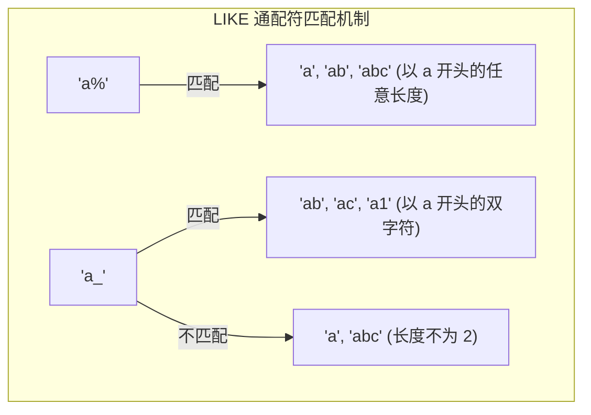
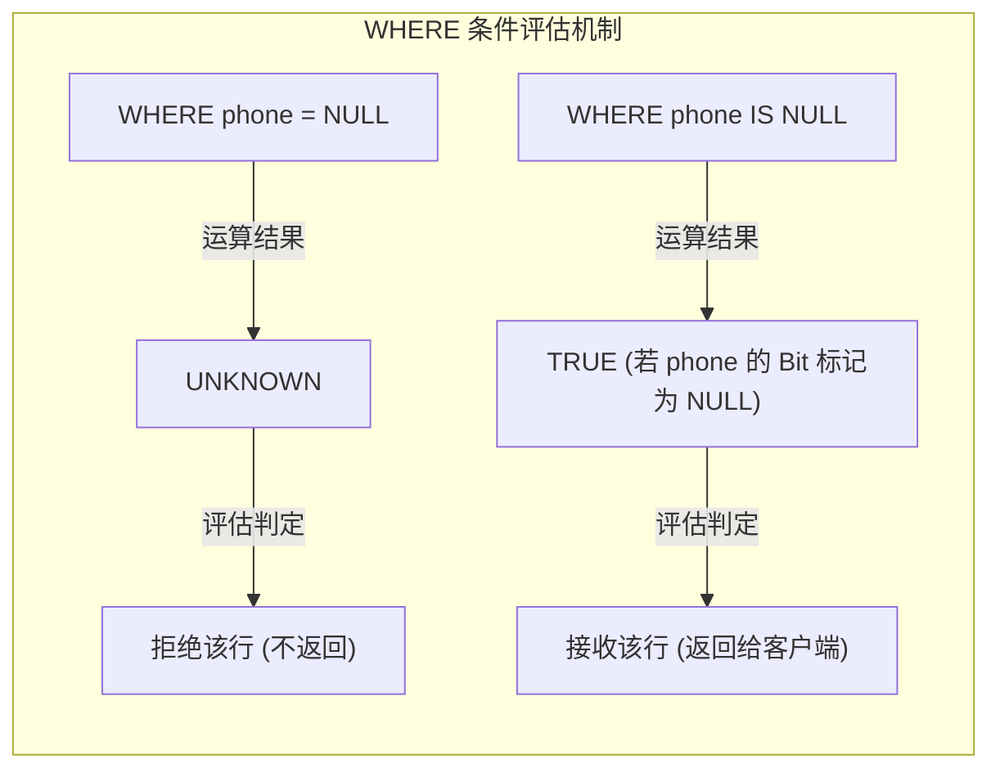

# DQL — 单表查询 / 字符串匹配与空值

> **故事线与承上启下**：
> 上一节我们学习了基于等值和范围进行行过滤。然而在日常业务中，用户检索的条件往往更加多样。例如，用户想通过“商品名称的一部分”来搜索商品，或者客服需要找出“还没有填写电话号码”的用户。这就需要用到 SQL 的字符串模糊匹配（`LIKE` / `REGEXP`）与 `NULL` 值逻辑判定。

## ⚡ 速查摘要

- **模糊匹配**：`WHERE username LIKE 'admin%'`（`%` 代表零个或多个字符；`_` 代表单个字符）
- **转义字符**：`WHERE username LIKE 'admin\_%' ESCAPE '\'`（匹配以 `admin_` 开头的字符串）
- **正则匹配**：`WHERE username REGEXP '^user_[0-9]+$'`（比 `LIKE` 更强大）
- **空值判断**：`WHERE phone IS NULL` / `WHERE phone IS NOT NULL`（**绝不能写成 `= NULL` 或 `<> NULL`**）

---

## 🎯 学习目标与验收标准

**学习目标：**
- 掌握 `%` 与 `_` 的用法差异，能熟练书写带转义符的模糊查询。
- 理解 `LIKE '%abc'` 前置通配符对 B+树索引的破坏性，掌握基本的 SQL 性能常识。
- 理解 `NULL` 在 SQL 中的“未知（Unknown）”语义，解释为什么 `= NULL` 会永远返回空集。
- 熟练运用 `IS NULL` 和 `IS NOT NULL` 进行空值筛选。

**验收标准：**
- [ ] 能够写出匹配以特定下划线（如 `test_`）开头的数据且不匹配其他字符的 `LIKE` 语句。
- [ ] 能够解释为什么 `NULL = NULL` 的计算结果在 SQL 中为 `UNKNOWN`。
- [ ] 独立完成 `exercises/03.04.01-string-null` 中的练习并通过 `test.sh` 脚本验证。

---

## 📖 概念全景

### 1. 字符串匹配：LIKE 与 REGEXP

在 MySQL 中，对文本进行部分匹配主要有两种手段：`LIKE` 和 `REGEXP`。

#### A. LIKE 模糊匹配
`LIKE` 基于通配符进行简单的模式匹配：
- `%`：代表任意长度（包括 0）的任意字符。
- `_`：代表有且仅有一个的任意字符。



#### B. 转义字符 (ESCAPE)
如果查询的文本本身就包含 `%` 或 `_`，必须进行转义。默认转义字符是 `\`。
例如，要匹配用户名以 `guest_` 开头的数据：
```sql
-- ❌ 错误做法：_ 会被当成通配符，导致匹配到 'guest1' 等不含下划线的数据
WHERE username LIKE 'guest_%';

--  正确做法：使用 \ 转义
WHERE username LIKE 'guest\_%';
```

#### C. REGEXP 正则匹配
当 `LIKE` 表达能力不足时，可以使用 `REGEXP`（或 `RLIKE`）。它支持标准的正则表达式语法（如 `^`, `$`, `[0-9]`, `+` 等）。
*注意：在大型数据集上，`REGEXP` 的 CPU 计算开销比 `LIKE` 大得多，且无法利用索引。*

---

### 2. 深入底层：NULL 值与 IS NULL

在关系数据库中，`NULL` 代表“**未知（Unknown）**”或“**缺失的值**”。它与任何其他值在概念上都有着本质区别。

#### A. NULL 与 0、空字符串的区别
- **空字符串 `''`**：是一个长度为 0 的确定字符串，它占据存储空间。
- **数字 `0`**：是一个确定的整数值。
- **`NULL`**：值未知。在 InnoDB 物理行格式中，`NULL` 值不会分配在数据列的实际存储区，而是通过行记录头部的 **Null Bitmap（空值列表）** 用 1 个 Bit 进行标记。

#### B. 为什么 `= NULL` 无法检索出数据？
根据 SQL 标准，任何值（甚至是 `NULL` 本身）与 `NULL` 进行常规比较（如 `=`, `<>`）时，其返回结果永远是 **`UNKNOWN`**。
在 `WHERE` 子句中，只有评估结果为 `TRUE` 的行才会被返回，而 `UNKNOWN` 会被当作 `FALSE` 过滤掉。

```sql
-- 以下比较的计算结果均为 UNKNOWN：
1 = NULL
'abc' = NULL
NULL = NULL  -- 即使是 NULL 自己比较，结果也是未知！
```
因此，检索 `NULL` 的**唯一正确谓词**是 `IS NULL` 和 `IS NOT NULL`。



---

## 💻 SQL 语法

### 1. LIKE 语法

```sql
SELECT column_list FROM table_name WHERE column_name LIKE 'pattern' [ESCAPE 'escape_character'];
```

### 2. REGEXP 语法

```sql
SELECT column_list FROM table_name WHERE column_name REGEXP 'pattern';
```

### 3. IS NULL / IS NOT NULL 语法

```sql
SELECT column_list FROM table_name WHERE column_name IS [NOT] NULL;
```

---

## 🛒 订单系统实战

### 业务场景
在电商订单系统中，客服系统需要进行如下筛选：
1. 找出尚未绑定手机号（假设为 `phone` 列且值为 `NULL`）的用户，以便发送系统消息提示补充信息。
2. 搜索用户名以测试账号标识 `test_` 开头且随后跟着任意数字的异常测试用户。

### 实战 SQL

```sql
-- 1. 查找手机号为空的用户
SELECT id, username, email
FROM users
WHERE phone IS NULL;

-- 2. 使用正则筛选 test_ 开头后接数字的用户名
SELECT id, username, email
FROM users
WHERE username REGEXP '^test_[0-9]+$';
```

---

## ⚠️ 常见坑点

- 💣 **坑点 1：前置通配符导致索引失效**
  - **现象**：`WHERE username LIKE '%alice'`。因为通配符 `%` 在前面，B+树索引无法定位前缀，MySQL 只能做昂贵的**全表扫描**（Full Table Scan）。
  - **对策**：如果业务必须支持双向模糊查询，应在架构上引入 Elasticsearch 等搜索引擎，避免在 MySQL 中高频使用前置通配符查询。
- 💣 **坑点 2：在逻辑非 `NOT` 查询中漏掉 NULL**
  - **现象**：你想查询所有“手机号不是 138 开头”的用户，写了 `WHERE phone NOT LIKE '138%'`。然而，**那些 `phone` 为 `NULL` 的行将不会被包含在结果中**！因为 `NULL NOT LIKE '138%'` 依然是 `UNKNOWN`。
  - **对策**：如果需要包含空值，必须显式加上 `OR phone IS NULL`。

---

## 🧠 主动回忆

请在不看上文的情况下，尝试回答以下问题：

1. 如果在 `users` 表里执行 `SELECT COUNT(*) FROM users WHERE email = NULL;`，会得到什么结果？为什么？

2. 比较 `LIKE 'admin_'` 和 `LIKE 'admin\_'`，它们在匹配时的具体区别是什么？
3. `LIKE '%test%'` 能利用到我们在 `users` 表上建立的索引吗？

---

## 🧭 进阶路线提示

> 本节只覆盖当前阶段需要掌握的最小知识。单表查询这个主题后续还会在以下章节继续展开：

| 后续章节 | 会继续解决什么问题 |
|---|---|
| [03.04.02-predicates-null](./02-predicates-null.md) | 深入探讨由 `UNKNOWN` 引起的三值逻辑运算律，以及 `NOT IN` 遇到 `NULL` 时为什么会导致整个查询结果集为空的灾难。 |
| [04.01.00-index-basics](../../../04-engineering/01-index-query-plan/00-index-basics.md) | 从 B+ 树的物理有序性出发，深入剖析为什么前导模糊匹配（`%abc`）无法走索引的原理。 |

---

## ✅ 项目练习

去 `exercises/03.04.01-string-null` 目录下，完成模糊查询与空值检索练习！

**任务描述：**
1. 编写查询，筛选出没有绑定手机号（`phone IS NULL`）且用户名以 `test_` 开头的用户。
2. 仅投影 `id`、`username` 和 `email` 字段，并按 `id` 升序排列。

**运行验证：**
在终端进入本节练习目录，执行自动化测试脚本：
```bash
bash test.sh
```
