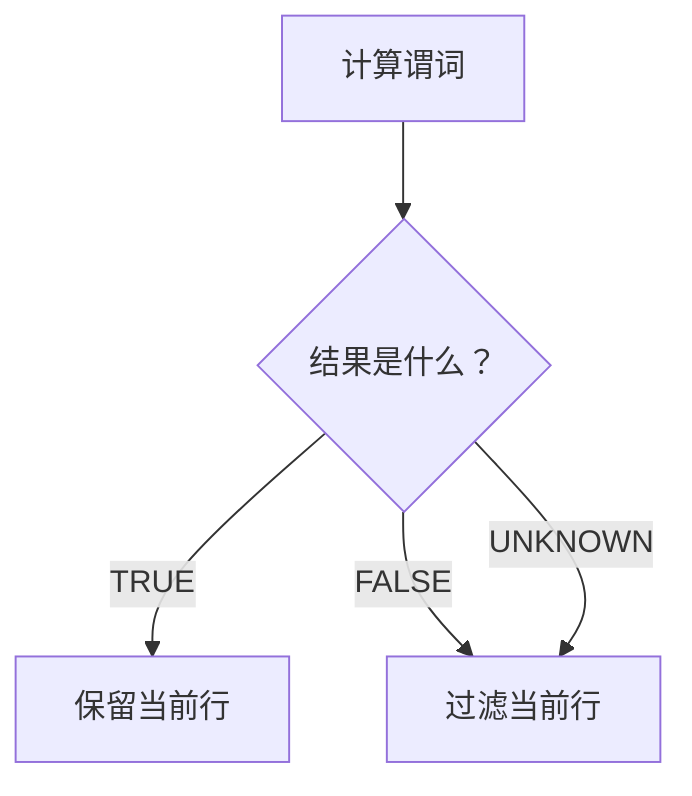
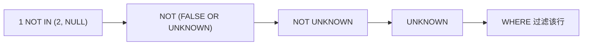

# DQL — 数据查询语言 / 谓词、三值逻辑与 NULL 陷阱

> **故事线与承上启下**：
> 上一节已经知道普通比较不能判断 `NULL`。但真正危险的问题不止 `= NULL`：当 `UNKNOWN` 进入 `AND`、`OR`、`NOT`、`IN` 或子查询后，整条过滤逻辑可能静默返回错误结果。本节把 `NULL` 从单个判断扩展到完整的 SQL 三值逻辑。

## ⚡ 速查摘要

- SQL 条件结果有 `TRUE`、`FALSE`、`UNKNOWN` 三种；`WHERE` 只保留 `TRUE`。
- `x NOT IN (1, NULL)` 对任何非 `1` 的 `x` 也会得到 `UNKNOWN`，因此可能返回空集。
- 可空列使用 `IS NULL`、`IS NOT NULL`；需要 NULL-safe 相等时，MySQL 可使用 `<=>`。
- 排除子查询优先写 `NOT EXISTS`，并在相关条件中明确列之间的比较关系。

---

## 🎯 学习目标与验收标准

**学习目标：**

- 理解 SQL 三值逻辑及其在 `WHERE` 中的筛选规则。
- 能推导 `AND`、`OR`、`NOT` 遇到 `UNKNOWN` 时的结果。
- 理解 `NOT IN` 被集合内 `NULL` 污染的原因。
- 能使用 `IS NULL`、`<=>` 和 `NOT EXISTS` 安全表达空值条件。

**验收标准：**

- [ ] 能解释为什么 `5 NOT IN (1, NULL)` 不是 `TRUE`。
- [ ] 能判断复合条件中哪些行会被 `WHERE` 保留。
- [ ] 能将存在 NULL 风险的 `NOT IN` 改写为安全的 `NOT EXISTS`。
- [ ] 能独立完成 `exercises/03.04.02-predicates-null` 并通过测试脚本。

---

## 📖 概念全景

### 1. SQL 不是二值逻辑

多数编程语言中的布尔表达式只有真和假。SQL 还必须表达“数据未知”，因此增加了 `UNKNOWN`：

| 条件示例 | 结果 | 原因 |
|---|---|---|
| `1 = 1` | `TRUE` | 两个确定值相等 |
| `1 = 2` | `FALSE` | 两个确定值不等 |
| `1 = NULL` | `UNKNOWN` | 无法判断未知值是否等于 1 |
| `NULL = NULL` | `UNKNOWN` | 两个未知值不代表同一个确定值 |
| `NULL IS NULL` | `TRUE` | `IS NULL` 判断的是空值状态 |

`WHERE`、`HAVING` 和 JOIN 过滤条件只接受结果为 `TRUE` 的行。`FALSE` 与 `UNKNOWN` 都不会进入结果集，但二者的语义不同，后续再进行逻辑运算时结果也可能不同。



### 2. UNKNOWN 如何参与逻辑运算

#### AND

只要一侧确定为 `FALSE`，整体一定为 `FALSE`；否则 `UNKNOWN` 会继续传播。

| AND | TRUE | FALSE | UNKNOWN |
|---|---:|---:|---:|
| **TRUE** | TRUE | FALSE | UNKNOWN |
| **FALSE** | FALSE | FALSE | FALSE |
| **UNKNOWN** | UNKNOWN | FALSE | UNKNOWN |

#### OR

只要一侧确定为 `TRUE`，整体一定为 `TRUE`；否则 `UNKNOWN` 会继续传播。

| OR | TRUE | FALSE | UNKNOWN |
|---|---:|---:|---:|
| **TRUE** | TRUE | TRUE | TRUE |
| **FALSE** | TRUE | FALSE | UNKNOWN |
| **UNKNOWN** | TRUE | UNKNOWN | UNKNOWN |

#### NOT

`NOT TRUE` 是 `FALSE`，`NOT FALSE` 是 `TRUE`，但 `NOT UNKNOWN` 仍是 `UNKNOWN`。否定一个未知结论，并不能把它变成确定结论。

### 3. NOT IN 为什么会被 NULL 污染

`IN` 可以理解为一组等值比较通过 `OR` 连接：

```sql
user_id IN (2, NULL)

-- 逻辑等价于
user_id = 2 OR user_id = NULL
```

相应地：

```sql
user_id NOT IN (2, NULL)

-- 逻辑等价于
NOT (user_id = 2 OR user_id = NULL)
```

假设 `user_id = 1`：

```text
1 = 2                  → FALSE
1 = NULL               → UNKNOWN
FALSE OR UNKNOWN       → UNKNOWN
NOT UNKNOWN            → UNKNOWN
WHERE UNKNOWN          → 当前行被过滤
```

因此，只要排除集合里存在一个 `NULL`，所有没有明确匹配到非 NULL 值的行都会落入 `UNKNOWN`，常见结果就是空集。



### 4. 三种安全表达方式

#### 明确判断空值状态

```sql
WHERE deleted_at IS NULL
WHERE phone IS NOT NULL
```

#### 使用 MySQL NULL-safe equality

MySQL 的 `<=>` 在两侧都为 `NULL` 时返回 `TRUE`，只有一侧为 `NULL` 时返回 `FALSE`，不会产生 `UNKNOWN`：

```sql
SELECT NULL <=> NULL;  -- 1
SELECT 1 <=> NULL;     -- 0
SELECT 1 <=> 1;        -- 1
```

`<=>` 是 MySQL 方言。需要跨数据库移植时，应优先使用标准 SQL 的 `IS NULL`，或目标数据库支持的 `IS NOT DISTINCT FROM`。

#### 排除关系使用 NOT EXISTS

`NOT EXISTS` 判断“相关子查询是否不存在匹配行”，不需要把子查询结果拼成一个可能包含 `NULL` 的值集合：

```sql
SELECT u.id, u.username
FROM users AS u
WHERE NOT EXISTS (
    SELECT 1
    FROM blocked_users AS b
    WHERE b.user_id = u.id
);
```

如果 `b.user_id` 为 `NULL`，`b.user_id = u.id` 得到 `UNKNOWN`，该行不会构成匹配，但不会污染其他用户的判断。

---

## 💻 SQL 语法

### 空值谓词

```sql
expression IS NULL
expression IS NOT NULL
```

### MySQL NULL-safe equality

```sql
left_expression <=> right_expression
```

### 安全反连接

```sql
SELECT outer_columns
FROM outer_table AS o
WHERE NOT EXISTS (
    SELECT 1
    FROM exclusion_table AS e
    WHERE e.foreign_key = o.primary_key
);
```

如果业务能严格保证子查询列为 `NOT NULL`，`NOT IN` 可以使用；只要约束不明确或数据来自外部输入，就不应依赖这种假设。

---

## 🛒 订单系统实战

**业务场景：**

运营需要找出可参加营销活动的活跃用户。排除表 `marketing_exclusions` 保存不允许触达的用户 ID，但历史导入数据中混入了一条 `NULL`。

**危险写法：**

```sql
SELECT id, username
FROM users
WHERE status = 1
  AND id NOT IN (
      SELECT user_id
      FROM marketing_exclusions
  );
```

只要子查询返回 `NULL`，即使存在大量合格用户，这条 SQL 也可能返回空集。

**安全写法：**

```sql
SELECT u.id, u.username
FROM users AS u
WHERE u.status = 1
  AND NOT EXISTS (
      SELECT 1
      FROM marketing_exclusions AS me
      WHERE me.user_id = u.id
  )
ORDER BY u.id;
```

**解析：**

- `NOT EXISTS` 按当前用户检查是否存在确定匹配的排除记录。
- 排除表中的 `NULL` 无法与任何确定 `u.id` 相等，因此不会误伤其他用户。
- 真实系统还应把 `marketing_exclusions.user_id` 定义为 `NOT NULL`；查询安全写法与 Schema 约束应同时存在。

---

## ⚠️ 常见坑点

- 💣 **坑点 1：认为 NOT 会把 UNKNOWN 变成 TRUE**
  - **错误直觉**：既然 `x = NULL` 不成立，那么 `x <> NULL` 应该成立。
  - **真实结果**：两者都是 `UNKNOWN`。
  - **正确做法**：使用 `IS NULL` 或 `IS NOT NULL`。

- 💣 **坑点 2：只在开发数据上验证 NOT IN**
  - **现象**：开发库排除列没有 NULL，查询正常；生产导入一条 NULL 后结果突然变为空集。
  - **正确做法**：列增加 `NOT NULL` 约束，同时对反连接优先使用 `NOT EXISTS`。

- 💣 **坑点 3：用 COALESCE 随意制造哨兵值**
  - **错误演示**：`COALESCE(user_id, -1)`，但未来 `-1` 可能成为合法业务值。
  - **正确做法**：只有业务域明确排除该值时才能使用哨兵值；关系排除优先使用 `NOT EXISTS`。

---

## 🧠 主动回忆

1. 为什么 `WHERE NOT (email = NULL)` 仍然无法筛选出非空邮箱？
2. 推导 `TRUE AND UNKNOWN`、`FALSE AND UNKNOWN`、`FALSE OR UNKNOWN` 的结果。
3. 为什么排除表里的一条 `NULL` 会让 `NOT IN` 返回空集，而 `NOT EXISTS` 不会？

## 🧭 进阶路线提示

| 后续章节 | 会继续解决什么问题 |
|---|---|
| 03.04.07 外连接 | 理解 `LEFT JOIN` 产生的 NULL 扩展行以及过滤条件放在 `ON` 或 `WHERE` 的差异。 |
| 04.04.00 相关子查询与派生表 | 比较 `NOT EXISTS`、`NOT IN` 和反连接的语义与执行计划。 |
| 04.03 事务与并发控制 | 区分数据值未知与并发可见性造成的“暂时看不到”。 |

---

## ✅ 项目练习

去 `exercises/03.04.02-predicates-null` 目录，完成包含 NULL 的排除查询。

**任务描述：**

1. 查询所有状态为活跃、且不在营销排除表中的用户。
2. 必须使用 `NOT EXISTS`，仅返回 `id`、`username`，并按 `id` 升序排列。

**运行验证：**

```bash
bash test.sh
```

---

## 🚀 延伸学习

- [选读] MySQL Reference Manual：Comparison Functions and Operators。
- [思考] 除了修复查询，为什么排除表的关联列还应该增加 `NOT NULL` 和索引？
