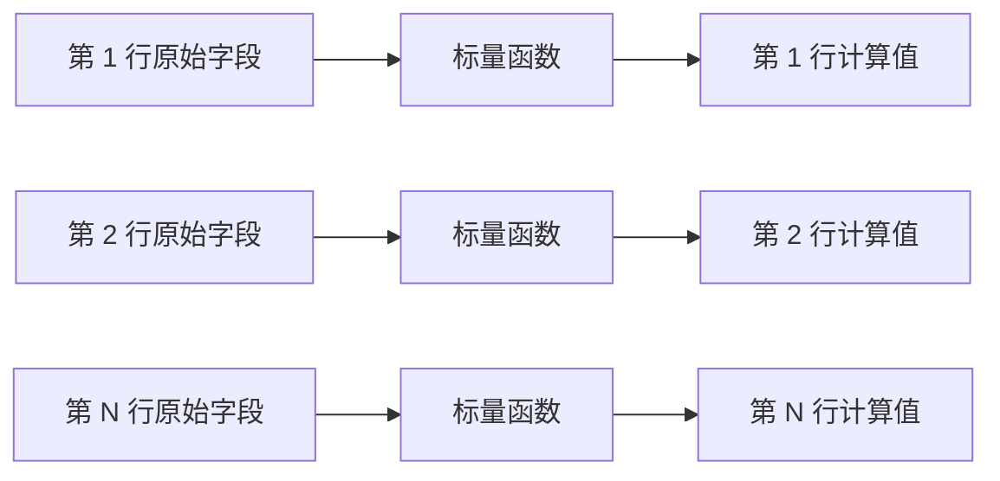

# DQL — 数据查询语言 / 标量函数

> **故事线与承上启下**：
> 前三节解决了“哪些行应该返回”。真实接口还需要把原始字段加工成可展示、可比较、可计算的值。标量函数正是这一层能力：它对每一行独立求值，每输入一行，通常输出一个值。

## ⚡ 速查摘要

- 标量函数逐行求值；它不会像聚合函数那样把多行折叠成一行。
- 字符串常用 `CONCAT`、`SUBSTRING`、`TRIM`、`REPLACE`、`LENGTH`。
- 数值常用 `ROUND`、`CEIL`、`FLOOR`、`ABS`。
- 日期常用 `NOW`、`DATE_FORMAT`、`DATEDIFF`、`DATE_ADD`。
- 在索引列上包函数可能破坏 Sargability，导致无法使用普通 B+Tree 索引定位。

---

## 🎯 学习目标与验收标准

**学习目标：**

- 理解标量函数的逐行求值模型。
- 掌握常见字符串、数值和日期函数的输入、输出与边界。
- 能组合多个函数生成接口展示字段。
- 能识别函数放在 `SELECT` 与 `WHERE` 中的性能差异。

**验收标准：**

- [ ] 能解释标量函数与聚合函数的区别。
- [ ] 能使用字符串函数清洗并拼接字段。
- [ ] 能使用数值和日期函数产生确定、可验证的计算结果。
- [ ] 能将对索引列的函数过滤改写为范围条件。
- [ ] 能独立完成 `exercises/03.04.03-scalar-funcs` 并通过测试。

---

## 📖 概念全景

### 1. 什么是标量函数

标量函数接收零个或多个表达式，针对当前行计算一个标量值：



例如：

```sql
SELECT id, UPPER(username)
FROM users;
```

结果仍然是一名用户对应一行。后续的 `SUM`、`COUNT` 等聚合函数则可能把多行合并为一个分组结果，这是两类函数的根本区别。

### 2. 字符串函数

| 函数 | 作用 | 示例 | 关键边界 |
|---|---|---|---|
| `CONCAT(a, b, ...)` | 拼接字符串 | `CONCAT('U-', id)` | 任一参数为 `NULL` 时结果为 `NULL` |
| `SUBSTRING(s, pos, len)` | 截取子串 | `SUBSTRING(order_no, 1, 8)` | MySQL 字符位置从 1 开始 |
| `TRIM(s)` | 去除首尾空格 | `TRIM(username)` | 不会删除字符串中间空格 |
| `REPLACE(s, from, to)` | 替换全部匹配片段 | `REPLACE(phone, '-', '')` | 是字面替换，不是正则 |
| `LENGTH(s)` | 返回字节数 | `LENGTH('中')` | `utf8mb4` 下字符可能占多个字节 |
| `CHAR_LENGTH(s)` | 返回字符数 | `CHAR_LENGTH('中')` | 适合计算用户可见长度 |

`LENGTH` 与 `CHAR_LENGTH` 不能混用。对 ASCII 字符，两者经常相等；对中文或 Emoji，字节数通常大于字符数。

```sql
SELECT LENGTH('订单') AS bytes,
       CHAR_LENGTH('订单') AS characters;
```

### 3. 数值函数

| 函数 | 作用 | 示例结果 |
|---|---|---|
| `ROUND(12.345, 2)` | 四舍五入到指定小数位 | `12.35` |
| `CEIL(12.01)` | 向上取整 | `13` |
| `FLOOR(12.99)` | 向下取整 | `12` |
| `ABS(-8)` | 返回绝对值 | `8` |

金额字段应使用 `DECIMAL`，再用 `ROUND` 控制展示或业务规则要求的小数位。不能用 `FLOAT/DOUBLE + ROUND` 修补二进制浮点误差，因为底层数据本身已经可能不精确。

### 4. 日期函数

| 函数 | 作用 | 示例 |
|---|---|---|
| `NOW()` | 当前会话时区下的日期时间 | `2026-07-27 15:00:00` |
| `DATE_FORMAT(dt, format)` | 格式化日期时间 | `DATE_FORMAT(created_at, '%Y-%m-%d')` |
| `DATEDIFF(a, b)` | 返回日期天数差 `a - b` | `DATEDIFF('2026-07-03', '2026-07-01') = 2` |
| `DATE_ADD(dt, INTERVAL n unit)` | 日期加指定间隔 | `DATE_ADD(created_at, INTERVAL 7 DAY)` |

`DATEDIFF` 只比较日期部分，忽略时分秒。计算精确秒差应使用 `TIMESTAMPDIFF(SECOND, start_time, end_time)`。

### 5. NULL 传播

多数标量函数接收到 `NULL` 时也返回 `NULL`：

```sql
SELECT CONCAT('email=', NULL);  -- NULL
SELECT ABS(NULL);               -- NULL
SELECT DATE_ADD(NULL, INTERVAL 1 DAY); -- NULL
```

下一节会学习 `COALESCE`、`IFNULL` 和 `CASE`，用于明确指定缺失值的替代策略。不要在不了解业务含义时随意把 `NULL` 替换成空字符串或 0。

### 6. 函数与索引

函数放在投影区通常只增加返回行的 CPU 计算：

```sql
SELECT DATE_FORMAT(created_at, '%Y-%m-%d')
FROM users;
```

函数包住 `WHERE` 中的索引列，则可能让普通索引无法直接定位范围：

```sql
-- 风险：需要逐行计算 DATE(created_at)
SELECT id
FROM users
WHERE DATE(created_at) = '2026-07-01';
```

应改为半开区间：

```sql
SELECT id
FROM users
WHERE created_at >= '2026-07-01 00:00:00'
  AND created_at <  '2026-07-02 00:00:00';
```

这类可直接转成索引范围扫描的条件称为 Sargable 条件。

---

## 💻 SQL 语法

### 字符串加工

```sql
SELECT CONCAT(
           TRIM(username),
           '#',
           CHAR_LENGTH(TRIM(username))
       ) AS user_label
FROM users;
```

### 数值计算

```sql
SELECT ROUND(ABS(actual_amount - expected_amount), 2) AS amount_gap;
```

### 日期计算

```sql
SELECT DATE_FORMAT(created_at, '%Y-%m-%d') AS created_date,
       DATEDIFF('2026-07-31', created_at) AS age_days,
       DATE_ADD(created_at, INTERVAL 7 DAY) AS expires_at
FROM users;
```

### 字符串截取与替换

```sql
SELECT SUBSTRING(email, 1, 3) AS email_prefix,
       REPLACE(email, '@', '[at]') AS masked_email
FROM users;
```

---

## 🛒 订单系统实战

**业务场景：**

客服列表需要展示清洗后的用户名标签、注册日期以及用户注册距活动锚点日的天数。接口只消费加工后的结果，不应把格式化逻辑复制到多个调用方。

**实战 SQL：**

```sql
SELECT
    id,
    CONCAT(TRIM(username), '#', CHAR_LENGTH(TRIM(username))) AS user_label,
    DATE_FORMAT(created_at, '%Y-%m-%d') AS registered_date,
    ABS(DATEDIFF(created_at, '2026-07-01')) AS days_from_anchor
FROM users
ORDER BY id;
```

**解析：**

- `TRIM` 先清理首尾空格，`CHAR_LENGTH` 再计算用户可见字符数。
- 固定锚点日期使报表可重复计算；若使用 `NOW()`，结果会随执行时间变化。
- 格式化函数位于 `SELECT`，没有包裹过滤索引列。

---

## ⚠️ 常见坑点

- 💣 **坑点 1：混淆 LENGTH 与 CHAR_LENGTH**
  - `LENGTH` 返回字节数，`CHAR_LENGTH` 返回字符数。
  - 用户名长度、短信长度等面向用户的规则通常应按字符数计算。

- 💣 **坑点 2：CONCAT 被 NULL 污染**
  - `CONCAT('phone=', phone)` 在 `phone IS NULL` 时整体返回 `NULL`。
  - 是否替换为特定文案必须由业务规则决定，下一节用 `COALESCE` 处理。

- 💣 **坑点 3：在索引列上调用函数过滤**
  - `WHERE DATE(created_at) = '2026-07-01'` 可能失去普通索引定位能力。
  - 使用 `[当天零点, 次日零点)` 的半开范围条件。

- 💣 **坑点 4：依赖 NOW() 做固定报表验收**
  - `NOW()` 会受执行日期和会话时区影响。
  - 可重复报表应把统计时点作为显式参数传入。

---

## 🧠 主动回忆

1. `LENGTH('订单')` 与 `CHAR_LENGTH('订单')` 为什么可能不同？
2. 为什么 `DATEDIFF` 不适合计算两个时间戳之间相差多少秒？
DATEDIFF只计算日期部分，会忽略时分秒

3. 如何把 `WHERE DATE(created_at) = '2026-07-01'` 改写成索引友好的条件？

## 🧭 进阶路线提示

| 后续章节 | 会继续解决什么问题 |
|---|---|
| 03.04.04 控制流与转换 | 使用 `CASE`、`IFNULL`、`COALESCE` 处理 NULL 和条件分支。 |
| 04.01 索引基础与查询计划 | 用 `EXPLAIN` 验证函数包裹索引列对访问路径的影响。 |
| 04.02 索引工程化与优化器 | 学习函数索引、生成列与表达式优化边界。 |

---

## ✅ 项目练习

去 `exercises/03.04.03-scalar-funcs`，完成用户展示字段加工查询。

**任务描述：**

1. 使用字符串函数生成用户标签。
2. 使用数值函数计算距离分数。
3. 使用日期函数输出注册日期和距固定锚点日的天数。

**运行验证：**

```bash
bash test.sh
```

---

## 🚀 延伸学习

- [选读] MySQL Reference Manual：Built-In Function and Operator Reference。
- [思考] 哪些格式化逻辑应该留在 SQL，哪些应该由 API 展示层负责？判断标准是什么？
