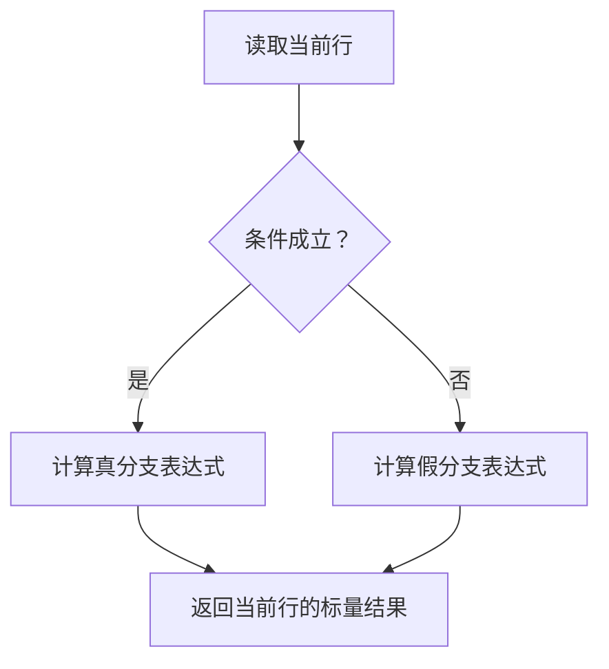

# DQL — 数据查询语言 / 控制流与转换

> **故事线与承上启下**：
> 上一节使用标量函数加工确定值，但真实数据经常包含缺失字段、状态码和文本型数字。此时需要明确表达“条件成立时返回什么”“空值用什么替代”“输入应该转换成什么类型”，这就是控制流与类型转换的职责。

## ⚡ 速查摘要

- `CASE` 是标准 SQL 条件表达式，适合多分支规则；`IF()` 是 MySQL 方言，适合简单二选一。
- `IFNULL(x, fallback)`: 如果x是NULL，返回 fallback， 如果不是， 返回x
- `NULLIF(value_a, value_b)`: 如果 value_a = value_b, 返回NULL， 否则，返回 value_a
- `COALESCE(a, b, c)` 返回第一个非 NULL 值。
- 空字符串不是 `NULL`，可先用 `NULLIF(TRIM(x), '')` 把空白值归一化为 `NULL`。
- `CAST(expr AS type)` 和 `CONVERT(expr, type)` 用于显式类型转换；转换失败可能报错或产生警告。
- 控制流表达式的各分支应返回兼容类型，避免隐式转换和结果类型漂移。

---

## 🎯 学习目标与验收标准

**学习目标：**

- 掌握 `IF()`、`IFNULL()`、`NULLIF()`、`COALESCE()` 的差异。
- 掌握简单 `CASE` 与搜索 `CASE` 两种写法。
- 能使用 `CAST()`、`CONVERT()` 显式转换数据类型。
- 能为 NULL、空字符串和非法输入设计明确边界。

**验收标准：**

- [ ] 能根据分支数量选择 `CASE` 或 `IF()`。
- [ ] 能解释 `NULL` 与空字符串为何需要分别处理。
- [ ] 能把字符串数字显式转换后参与数值比较。
- [ ] 能独立完成 `exercises/03.04.04-control-flow` 并通过测试。

---

## 📖 概念全景

### 1. SQL 表达式中的控制流

控制流函数不会改变 SQL 的执行流程，也不是编程语言里的循环或跳转。它们针对当前行，根据条件选择一个返回值：



因此，`CASE` 可以出现在 `SELECT`、`ORDER BY`、`GROUP BY` 等表达式位置，但它不能代替完整 SQL 语句。

### 2. IF、IFNULL 与 COALESCE

| 表达式 | 语义 | 适用场景 |
|---|---|---|
| `IF(condition, yes, no)` | 条件二选一 | MySQL 内部的简单判断 |
| `IFNULL(value, fallback)` | value 为 NULL 时返回 fallback | 单层 NULL 兜底 |
| `NULLIF(value1, value2)` | value1=value2时，返回NULL, 否则返回value1 | 可用来排除空字符串等 |
| `COALESCE(a, b, c)` | 返回第一个非 NULL 值 | 多级字段回退，标准 SQL |

```sql
SELECT IF(status = 1, 'ACTIVE', 'DISABLED') AS status_label,
       IFNULL(nickname, username) AS display_name,
       COALESCE(nickname, username, 'anonymous') AS safe_name
FROM users;
```

注意：`IFNULL('', username)` 返回空字符串，因为空字符串是一个确定值，不是 `NULL`。

若业务把全空白昵称也视为缺失，应显式归一化：

```sql
COALESCE(NULLIF(TRIM(nickname), ''), username)
```

求值过程如下：

1. `TRIM` 去掉首尾空格。
2. `NULLIF(value, '')` 在结果为空字符串时返回 `NULL`。
3. `COALESCE` 选择 nickname 或 username 中第一个非 NULL 值。

### 3. CASE 的两种形式

#### 简单 CASE

简单 `CASE` 将一个表达式依次与多个值比较：

```sql
CASE status
    WHEN 0 THEN 'DISABLED'
    WHEN 1 THEN 'ACTIVE'
    ELSE 'UNKNOWN'
END
```

#### 搜索 CASE

搜索 `CASE` 的每个 `WHEN` 都是独立条件，表达力更强：

```sql
CASE
    WHEN score >= 90 THEN 'A'
    WHEN score >= 60 THEN 'PASS'
    ELSE 'FAIL'
END
```

MySQL 从上到下匹配，命中第一个为 `TRUE` 的分支后停止。条件顺序属于业务逻辑，范围通常应从严格到宽松排列。

若省略 `ELSE` 且没有分支命中，结果为 `NULL`。生产查询应确认这是否符合接口契约。

### 4. CAST 与 CONVERT

数据库列的物理类型和表达式类型决定比较、排序与计算方式。显式转换可以消除歧义：

```sql
CAST('88' AS UNSIGNED) 
CONVERT('88', UNSIGNED)
```

- CAST: SQL 标准（ANSI SQL） 统一规范
- CONVERT: MySQL 独有 / ODBC 扩展 语法

常见目标类型：

| 类型 | 示例 | 用途 |
|---|---|---|
| `SIGNED` / `UNSIGNED` | `CAST(score_text AS UNSIGNED)` | 文本转整数 |
| `DECIMAL(p, s)` | `CAST(amount_text AS DECIMAL(10,2))` | 金额文本转精确数值 |
| `CHAR` | `CAST(id AS CHAR)` | 数值转字符串 |
| `DATE` / `DATETIME` | `CAST(date_text AS DATE)` | 文本转日期 |
| `BINARY` | `CAST(name AS BINARY)` | 二进制比较 |

### 5. 转换失败与 SQL Mode

类型转换不是数据校验器。输入 `'88points'`、空字符串或越界数字时，MySQL 的行为会受到 SQL Mode 和执行上下文影响：可能返回截断值、产生 warning，或直接报错。

```sql
SELECT CAST('88points' AS UNSIGNED); -- 可能得到 88 并产生 warning
SHOW WARNINGS;
```

生产系统不能依赖宽松转换“顺便清洗数据”。外部输入应先验证格式，再转换；核心列应从 Schema 层使用正确类型。

### 6. 分支结果的类型归并

`CASE` 或 `IF` 的多个分支最终必须形成一个结果类型：

```sql
-- 数字和字符串混合，可能触发隐式转换或得到意外类型
CASE WHEN status = 1 THEN 1 ELSE 'disabled' END
```

更稳定的写法是让分支返回相同类型：

```sql
CASE WHEN status = 1 THEN '1' ELSE 'disabled' END
```

或明确转换：

```sql
CASE WHEN status = 1 THEN CAST(1 AS CHAR) ELSE 'disabled' END
```

---

## 💻 SQL 语法

### IF 与空值处理

```sql
SELECT IF(condition, true_value, false_value),
       IFNULL(nullable_value, fallback_value),
       COALESCE(value_1, value_2, value_3);
```

### CASE

```sql
CASE expression
    WHEN value_1 THEN result_1
    WHEN value_2 THEN result_2
    ELSE default_result
END
```

```sql
CASE
    WHEN condition_1 THEN result_1
    WHEN condition_2 THEN result_2
    ELSE default_result
END
```

### 类型转换

```sql
CAST(expression AS target_type)
CONVERT(expression, target_type)
```

---

## 🛒 订单系统实战

**业务场景：**

历史用户数据的昵称可能为 `NULL` 或只有空格，第三方评分以字符串形式导入。客服接口需要稳定的展示名、状态文案、数字评分和及格结果。

**实战 SQL：**

```sql
SELECT
    id,
    COALESCE(NULLIF(TRIM(nickname), ''), username) AS display_name,
    CASE
        WHEN status = 1 THEN 'ACTIVE'
        ELSE 'DISABLED'
    END AS status_label,
    CAST(score_text AS UNSIGNED) AS numeric_score,
    IF(CAST(score_text AS UNSIGNED) >= 60, 'PASS', 'FAIL') AS result_label
FROM users
ORDER BY id;
```

**解析：**

- `NULLIF + COALESCE` 同时处理 NULL 和空白昵称。
- `CASE` 将存储状态映射为接口文案。
- `CAST` 让字符串评分按数字比较，而不是按字典序比较。
- `IF` 只承担二选一规则；多级评分应使用 `CASE`。

---

## ⚠️ 常见坑点

- 💣 **坑点 1：把空字符串当 NULL**
  - `COALESCE('', username)` 仍返回空字符串。
  - 使用 `NULLIF(TRIM(value), '')` 明确归一化规则。

- 💣 **坑点 2：CASE 分支顺序错误**
  - 先写 `score >= 60`，后写 `score >= 90`，90 分会提前命中 PASS。
  - 重叠范围必须从更严格条件开始。

- 💣 **坑点 3：字符串按数字直觉比较**
  - 字符串 `'100'` 与 `'60'` 按字符规则比较可能不符合数值大小。
  - 输入合法后使用 `CAST(... AS UNSIGNED)`。

- 💣 **坑点 4：用 CAST 掩盖错误 Schema**
  - 高频数值列长期存成 `VARCHAR` 会增加 CPU、失去数值约束并影响索引。
  - 类型转换适合边界适配，不是长期数据模型替代品。

---

## 🧠 主动回忆

1. `IFNULL` 与 `COALESCE` 的能力边界有什么区别？
2. 为什么 `COALESCE(nickname, username)` 无法处理只包含空格的 nickname？
3. 搜索 `CASE` 的条件为什么通常要从严格范围写到宽松范围？

## 🧭 进阶路线提示

| 后续章节 | 会继续解决什么问题 |
|---|---|
| 03.04.05 JSON 函数基础 | JSON 提取结果的类型、NULL 与显式转换。 |
| 03.04.09 聚合函数与分组 | 在报表中使用 `CASE` 实现条件聚合。 |
| 04.02 索引工程化与优化器 | 分析类型转换和函数表达式对索引访问的影响。 |

---

## ✅ 项目练习

去 `exercises/03.04.04-control-flow`，完成用户数据归一化查询。

**任务描述：**

1. 处理 NULL 和空白昵称。
2. 映射用户状态。
3. 将文本评分转换为数字并判定是否及格。

**运行验证：**

```bash
bash test.sh
```

---

## 🚀 延伸学习

- [选读] MySQL Reference Manual：Flow Control Functions、Cast Functions and Operators。
- [思考] 如果 `score_text` 包含非法字符串，应该由导入层、SQL 还是应用服务负责拒绝？
