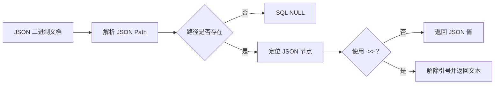

# DQL — 数据查询语言 / JSON 函数基础

> **故事线与承上启下**：
> 上一节解决了普通标量值的分支、空值回退与类型转换。商品的颜色、容量、材质等属性却经常以半结构化 JSON 保存；要让这些属性可查询、可判断、可更新，必须理解 MySQL JSON 的路径、返回类型和函数边界。

## ⚡ 速查摘要

- `JSON_EXTRACT(document, path)` 与 `document -> path` 返回 JSON 值；`document ->> path` 返回解除引号后的文本。
- JSON Path 从 `$` 根节点开始，使用 `$.key` 访问成员、`$[index]` 访问数组元素。
- 路径不存在通常返回 SQL `NULL`；JSON 文档中的 `null` 是 JSON 值，两者语义不同。
- `JSON_CONTAINS(target, candidate[, path])` 判断候选 JSON 是否被目标包含，参数必须是合法 JSON。
- `JSON_SET` 返回修改后的新 JSON 文档；在 `SELECT` 中不会持久化，持久化必须配合 `UPDATE`。

---

## 🎯 学习目标与验收标准

**学习目标：**

- 掌握 JSON Path 的根节点、对象成员和数组下标语法。
- 能使用 `JSON_EXTRACT`、`->`、`->>` 提取商品属性。
- 能区分 JSON 标量、SQL 字符串、SQL `NULL` 与 JSON `null`。
- 能使用 `JSON_CONTAINS` 判断标签或对象片段是否存在。
- 能使用 `JSON_SET` 构造更新后的 JSON 文档。

**验收标准：**

- [ ] 能解释 `->` 与 `->>` 返回值的区别。
- [ ] 能正确为 `JSON_CONTAINS` 构造 JSON candidate。
- [ ] 能在一次查询中提取属性、判断数组成员并构造新 JSON。
- [ ] 能独立完成 `exercises/03.04.05-json-functions-basic` 并通过测试。

---

## 📖 概念全景

### 1. MySQL JSON 不是普通字符串

`JSON` 列写入时会验证文档合法性，并以适合随机访问的内部二进制格式保存。它适合结构不完全固定、但仍需由数据库检索的扩展属性；稳定且高频过滤的核心字段仍应建成独立列。

| 数据形态 | 推荐建模 | 原因 |
|---|---|---|
| 商品名称、价格、库存 | 普通列 | 类型稳定，需要约束、排序和索引 |
| 颜色、材质、接口规格 | JSON 扩展属性 | 不同品类字段差异较大 |
| 任意日志原文 | JSON 或专用日志系统 | 取决于检索和保留策略 |
| 多对多标签体系 | 关联表优先 | 需要完整性、统计和高效关联 |

JSON 查询的数据流如下：



### 2. JSON Path

JSON Path 用字符串描述文档内的位置：

| Path | 含义 |
|---|---|
| `$` | 整个文档 |
| `$.color` | 根对象的 `color` 成员 |
| `$.spec.weight` | 嵌套对象成员 |
| `$.tags[0]` | `tags` 数组第一个元素 |
| `$.*` | 根对象所有成员 |
| `$[1 to 3]` | 数组切片 |

成员名包含空格或特殊字符时应加双引号，例如 `$.\"display-name\"`。数组下标从 `0` 开始。

### 3. JSON_EXTRACT、-> 与 ->>

三种提取方式的核心差异是结果类型：

```sql
SELECT
    JSON_EXTRACT(attributes, '$.color') AS color_json,
    attributes -> '$.color' AS color_json_short,
    attributes ->> '$.color' AS color_text
FROM products;
```

假设值为字符串 `"black"`：

- `JSON_EXTRACT` 和 `->` 返回 JSON 字符串 `"black"`。
- `->>` 等价于 `JSON_UNQUOTE(JSON_EXTRACT(...))`，返回 SQL 文本 `black`。
- 需要展示、比较普通字符串时通常用 `->>`；需要继续作为 JSON 参数时保留 JSON 类型。

### 4. SQL NULL、JSON null 与路径缺失

以下状态不能混为一谈：

| 状态 | 示例 | 典型判断 |
|---|---|---|
| SQL `NULL` | 整列没有值 | `attributes IS NULL` |
| JSON `null` | `{"color": null}` | `JSON_TYPE(attributes -> '$.color') = 'NULL'` |
| 路径不存在 | `{}` 中读取 `$.color` | `attributes -> '$.color' IS NULL` |
| 空字符串 | `{"color": ""}` | `attributes ->> '$.color' = ''` |

路径不存在与 JSON `null` 在部分提取结果上容易混淆。需要严格区分时，使用 `JSON_CONTAINS_PATH` 检查路径是否存在，再结合 `JSON_TYPE` 判断节点类型。

### 5. JSON_CONTAINS

`JSON_CONTAINS` 判断 candidate 是否包含在 target 中：

```sql
SELECT JSON_CONTAINS(attributes, '"wireless"', '$.tags')
FROM products;
```

第二个参数 `'"wireless"'` 是“SQL 字符串中装着一个 JSON 字符串”。若直接写 `'wireless'`，它不是合法 JSON 文档。

也可以判断对象片段：

```sql
JSON_CONTAINS(attributes, '{"color": "black"}')
```

返回值通常为 `1`、`0` 或 `NULL`。参数为 SQL `NULL`、路径不存在或发生错误时，应明确验证实际语义。

### 6. JSON_SET

`JSON_SET(document, path, value)` 会覆盖已有路径，或在路径可创建时新增成员：

```sql
SELECT JSON_SET(attributes, '$.warranty_months', 24)
FROM products;
```

函数本身是表达式，只返回新文档，不修改原列：

```sql
UPDATE products
SET attributes = JSON_SET(attributes, '$.warranty_months', 24)
WHERE id = 1;
```

值的类型取决于传入表达式。数字 `24` 写成 JSON number；字符串 `'24'` 写成 JSON string。数组或对象文本需要 `CAST(... AS JSON)`，否则可能被当作普通字符串。

### 7. 查询性能边界

直接在 `WHERE attributes ->> '$.color' = 'black'` 上过滤，普通 JSON 列本身没有可直接利用的路径索引。数据量大且过滤频繁时，应使用 generated column 或 functional index；这属于后续索引工程化范围。

---

## 💻 SQL 语法

```sql
JSON_EXTRACT(json_document, path[, path] ...)
json_column -> path
json_column ->> path
JSON_CONTAINS(target, candidate[, path])
JSON_SET(json_document, path, value[, path, value] ...)
```

常用组合：

```sql
SELECT
    id,
    attributes ->> '$.color' AS color,
    JSON_CONTAINS(attributes, '"wireless"', '$.tags') AS is_wireless,
    JSON_SET(attributes, '$.reviewed', TRUE) AS reviewed_attributes
FROM products
ORDER BY id;
```

---

## 🛒 订单系统实战

**业务场景：**

商品表使用 `attributes JSON` 保存不同品类的扩展属性。运营后台需要展示颜色，判断商品是否带有 `wireless` 标签，并预览增加质保月数后的 JSON，但不能在查询阶段修改原数据。

**实战 SQL：**

```sql
SELECT
    id,
    name,
    attributes ->> '$.color' AS color,
    JSON_CONTAINS(attributes, '"wireless"', '$.tags') AS is_wireless,
    JSON_SET(attributes, '$.warranty_months', 24) AS attributes_preview
FROM products
ORDER BY id;
```

**解析：**

- `->>` 直接提供无双引号的展示文本。
- `JSON_CONTAINS` 针对数组判断标签成员。
- `JSON_SET` 只构造预览结果，不会持久化。
- `ORDER BY id` 保证测试和接口输出稳定。

---

## ⚠️ 常见坑点

- 💣 **把 `->` 的 JSON 字符串当普通文本**
  - `attributes -> '$.color'` 可能显示为 `"black"`。
  - 展示或普通字符串比较使用 `->>`。

- 💣 **candidate 不是合法 JSON**
  - 错误：`JSON_CONTAINS(attributes, 'wireless', '$.tags')`。
  - 正确：`JSON_CONTAINS(attributes, '"wireless"', '$.tags')`。

- 💣 **认为 JSON_SET 会自动保存**
  - `SELECT JSON_SET(...)` 只返回计算值。
  - 需要持久化时必须执行受控的 `UPDATE`。

- 💣 **把所有变化字段都塞入 JSON**
  - 高频过滤、排序、关联字段塞入 JSON，会弱化 Schema 约束并提高索引设计成本。
  - 核心字段使用普通列，JSON 只承载真正稀疏的扩展属性。

---

## 🧠 主动回忆

1. `attributes -> '$.color'` 与 `attributes ->> '$.color'` 的返回类型有何差异？
2. 为什么 `JSON_CONTAINS(tags, 'wireless')` 会报错或不符合预期？
3. 如何区分 JSON 路径不存在与路径存在但值为 JSON `null`？

## 🧭 进阶路线提示

| 后续章节 | 会继续解决什么问题 |
|---|---|
| 03.04.09 聚合函数与分组 | 对 JSON 提取值进行分组统计。 |
| 04.02 索引工程化与优化器 | 使用 generated column 或 functional index 优化 JSON 路径过滤。 |
| 06.01 架构视角的表设计方法论 | 判断普通列、JSON、关联表之间的建模边界。 |

---

## ✅ 项目练习

去 `exercises/03.04.05-json-functions-basic`，完成商品扩展属性查询。

**任务描述：**

1. 提取商品颜色文本。
2. 判断 `tags` 是否包含 `wireless`。
3. 构造加入 `warranty_months` 的 JSON 预览。

**运行验证：**

```bash
bash test.sh
```

---

## 🚀 延伸学习

- [选读] MySQL Reference Manual：JSON Functions、JSON Path Syntax。
- [思考] 哪些商品属性值得提升为 generated column 并建立索引？
