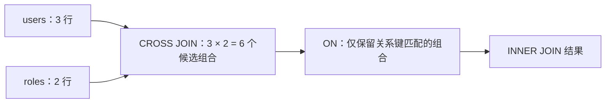
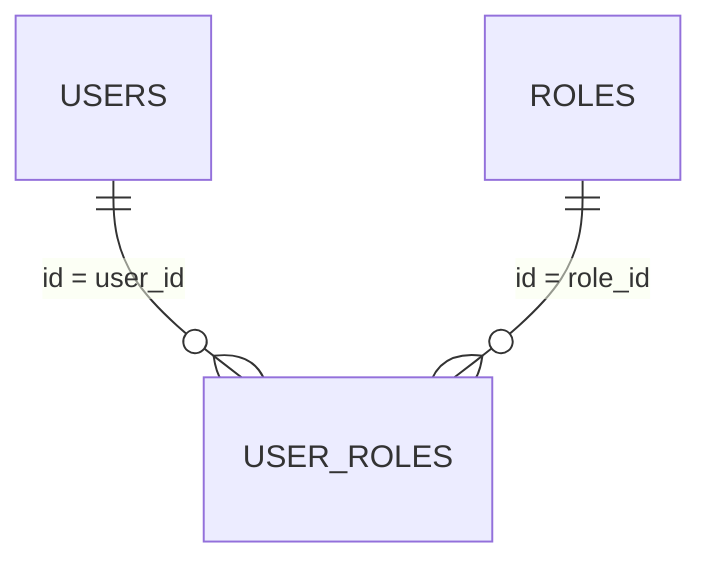

# DQL — 数据查询语言 / 内连接

> **故事线与承上启下**：
> 前面的查询都围绕一张表或单个 JSON 文档展开。但订单系统会把用户、角色、订单等实体拆表保存；要重新组合业务视图，就必须通过关系键进行 `JOIN`。

## ⚡ 速查摘要

- `CROSS JOIN` 产生笛卡尔积；其他 Join 可理解为“笛卡尔积 + 匹配条件”，但优化器通常不会真的生成完整中间积。
- `INNER JOIN` 只保留 `ON` 条件匹配成功的行，两侧未匹配行都会被丢弃。
- `ON` 描述表之间如何匹配，`WHERE` 描述匹配后保留哪些业务数据。
- 多表查询必须使用清晰别名并限定同名列，如 `u.id`、`r.id`。
- `USING` 仅适合同名且同义的连接列；`NATURAL JOIN` 会隐式使用所有同名列，生产代码应避免。

---

## 🎯 学习目标与验收标准

**学习目标：**

- 理解笛卡尔积是关系组合的逻辑起点。
- 掌握 `INNER JOIN ... ON` 的语法和匹配语义。
- 能通过关联表完成多对多关系查询。
- 能区分 `ON` 连接条件与 `WHERE` 业务过滤条件。
- 理解 `USING` 的适用边界和 `NATURAL JOIN` 的维护风险。

**验收标准：**

- [ ] 能预测一对多、多对多 Join 后的行数变化。
- [ ] 能正确连接 `users`、`user_roles`、`roles` 三张表。
- [ ] 能解释缺少 `ON` 条件为何导致结果膨胀。
- [ ] 能独立完成 `exercises/03.04.06-inner-join` 并通过测试。

---

## 📖 概念全景

### 1. 从笛卡尔积到等值连接

两张表进行 `CROSS JOIN` 时，左表每行都会与右表每行组合。若左表有 `m` 行、右表有 `n` 行，结果为 `m × n` 行。



逻辑上，`INNER JOIN` 可以理解为先组合、再按 `ON` 过滤；物理执行时，优化器会选择 Nested-Loop Join、Hash Join 等算法，通常不会物化完整笛卡尔积。

### 2. INNER JOIN 的保留规则

```sql
SELECT u.id, u.username, r.role_name
FROM users AS u
INNER JOIN user_roles AS ur ON ur.user_id = u.id
INNER JOIN roles AS r ON r.id = ur.role_id;
```

对每个候选组合，`ON` 表达式按 SQL 三值逻辑求值：

| `ON` 结果 | `INNER JOIN` 是否保留 |
|---|---|
| `TRUE` | 保留 |
| `FALSE` | 丢弃 |
| `UNKNOWN` | 丢弃 |

因此，连接键为 `NULL` 时不会通过普通等值条件。当前 `user_roles` 的外键列为 `NOT NULL`，从 Schema 层消除了该歧义。

### 3. 多对多关系为什么需要两次 JOIN

`users` 与 `roles` 是多对多关系，中间表 `user_roles` 保存两端主键：



第一次 Join 从用户定位关联记录，第二次 Join 再从关联记录定位角色。一个用户拥有两个角色时，结果中会出现两行用户数据；这是关系展开，不是重复数据错误。

### 4. ON 与 WHERE 的职责

推荐把关系条件放在 `ON`，业务过滤放在 `WHERE`：

```sql
FROM users AS u
INNER JOIN user_roles AS ur ON ur.user_id = u.id
WHERE u.status = 1
```

对 `INNER JOIN` 而言，很多条件放在 `ON` 或 `WHERE` 最终结果可能相同，优化器也可能重写。但职责分离能降低审查成本，并为下一节 `OUTER JOIN` 建立正确习惯——外连接中二者会直接改变语义。

### 5. 别名与列歧义

多张表经常都有 `id`、`created_at`：

```sql
SELECT id FROM users JOIN roles ...; -- id 含义不明确
```

使用短而稳定的别名：

```sql
SELECT u.id AS user_id, r.id AS role_id
FROM users AS u
INNER JOIN roles AS r ...;
```

别名不是为了省字符，而是明确列的所有权。业务接口需要稳定字段名时，再用 `AS` 定义输出契约。

### 6. USING 与 NATURAL JOIN

当两张表的连接列同名时，可以使用：

```sql
SELECT *
FROM table_a
INNER JOIN table_b USING (shared_id);
```

`USING` 会把同名连接列合并为一个输出列。它不适用于当前 `users.id = user_roles.user_id` 这种异名连接。

`NATURAL JOIN` 会自动选择两表所有同名列。新增一个同名字段就可能悄悄改变查询语义，属于高维护风险语法，生产代码应使用显式 `ON`。

### 7. 行数膨胀与性能直觉

Join 结果行数取决于关系基数，不取决于表数量本身：

- 1:1：通常不增加行数。
- 1:N：一侧行会按匹配数量展开。
- M:N：可能显著放大，必须经过关联表。
- 条件缺失：接近笛卡尔积，`10 万 × 10 万` 理论上可产生 `100 亿` 个组合。

外键不会自动让查询变快。连接性能主要依赖连接列类型一致、索引可用和过滤选择性；后续查询计划模块会用 `EXPLAIN` 验证。

---

## 💻 SQL 语法

```sql
SELECT column_list
FROM left_table AS l
INNER JOIN right_table AS r
    ON r.foreign_key = l.primary_key
WHERE business_condition
ORDER BY stable_columns;
```

`INNER` 可以省略，但初学阶段建议显式写出：

```sql
FROM users AS u
JOIN user_roles AS ur ON ur.user_id = u.id
```

多表连接按关系逐步展开：

```sql
FROM users AS u
INNER JOIN user_roles AS ur ON ur.user_id = u.id
INNER JOIN roles AS r ON r.id = ur.role_id
```

---

## 🛒 订单系统实战

**业务场景：**

后台需要列出所有启用用户及其角色。用户基础信息在 `users`，角色定义在 `roles`，授权关系在 `user_roles`。

**实战 SQL：**

```sql
SELECT
    u.id AS user_id,
    u.username,
    r.role_name
FROM users AS u
INNER JOIN user_roles AS ur ON ur.user_id = u.id
INNER JOIN roles AS r ON r.id = ur.role_id
WHERE u.status = 1
ORDER BY u.id, r.role_name;
```

**解析：**

- 两个 `ON` 分别表达关联表与两端实体的关系。
- `WHERE` 只筛选启用用户。
- 一个用户拥有多个角色时返回多行。
- 排序同时指定用户和角色，保证多角色结果稳定。

---

## ⚠️ 常见坑点

- 💣 **遗漏连接条件**
  - 结果可能从万级瞬间膨胀到亿级。
  - 每引入一张表，都必须能指出其关系键和基数。

- 💣 **连接字段类型不一致**
  - `INT` 与 `VARCHAR` 比较会触发隐式转换，可能使索引失效并产生错误匹配。
  - 主键与外键必须使用一致类型和符号属性。

- 💣 **把一对多展开误判为重复**
  - 先确认业务基数，再决定是否聚合；不要用 `DISTINCT` 掩盖错误 Join。

- 💣 **使用 NATURAL JOIN**
  - Schema 新增同名列即可改变查询结果，风险不可见。
  - 生产查询使用显式 `ON`。

---

## 🧠 主动回忆

1. 为什么 `3` 行与 `4` 行表的 `CROSS JOIN` 会产生 `12` 行？
2. `INNER JOIN` 的 `ON` 条件得到 `UNKNOWN` 时，该组合是否保留？
3. 一个用户有三个角色时，三表 Join 为什么会返回三行用户记录？

## 🧭 进阶路线提示

| 后续章节 | 会继续解决什么问题 |
|---|---|
| 03.04.07 外连接 | 保留未匹配行，并理解 `ON` 与 `WHERE` 的语义差异。 |
| 04.01 索引基础与查询计划 | 使用 `EXPLAIN` 判断 Join 顺序和索引访问方式。 |
| 04.02 索引工程化与优化器 | 深入驱动表、Join 算法和成本估算。 |

---

## ✅ 项目练习

去 `exercises/03.04.06-inner-join`，完成启用用户及角色查询。

**任务描述：**

1. 使用两个显式 `INNER JOIN` 连接三张表。
2. 仅保留启用用户。
3. 按用户 ID、角色名稳定排序。

**运行验证：**

```bash
bash test.sh
```

---

## 🚀 延伸学习

- [选读] MySQL Reference Manual：JOIN Clause。
- [思考] 如果一个用户有上百个角色，接口是否应直接返回扁平行集？
