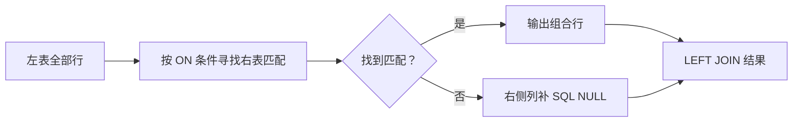

# DQL — 数据查询语言 / 外连接

> **故事线与承上启下**：
> 上一节的 `INNER JOIN` 只返回两侧都匹配的记录，这会让“尚未分配角色的启用用户”从结果中消失。业务审计恰恰需要发现这些缺失关系，因此必须使用能保留未匹配行的外连接。

## ⚡ 速查摘要

- `LEFT JOIN` 保留左表全部行；右侧未匹配列使用 SQL `NULL` 补齐。
- `RIGHT JOIN` 保留右表全部行，可通过交换表顺序改写为 `LEFT JOIN`，团队代码通常统一使用后者。
- 外连接中，右表过滤放在 `ON` 与放在 `WHERE` 语义不同：`WHERE` 可能消灭 NULL 扩展行，使查询退化为内连接。
- 查找“没有关联记录”的左表行，使用 `LEFT JOIN ... WHERE right_key IS NULL`。
- 多表外连接按语法形成嵌套 Join，顺序、括号和每个 `ON` 的归属都会影响结果。

---

## 🎯 学习目标与验收标准

**学习目标：**

- 掌握 `LEFT JOIN`、`RIGHT JOIN` 的保留规则。
- 理解未匹配行如何被 NULL 扩展。
- 能区分 `ON` 连接过滤和 `WHERE` 最终结果过滤。
- 能使用反连接模式定位缺失关系。
- 能判断多表外连接的保留侧和 Join 顺序。

**验收标准：**

- [ ] 能预测外连接中哪些行被保留、哪些列变为 `NULL`。
- [ ] 能查询全部启用用户，包括尚未分配角色的用户。
- [ ] 能解释右表条件放入 `WHERE` 后为何可能丢失未匹配行。
- [ ] 能独立完成 `exercises/03.04.07-outer-join` 并通过测试。

---

## 📖 概念全景

### 1. 外连接解决什么问题

`INNER JOIN` 的结果是两侧匹配集合的交集。外连接在此基础上，额外保留指定一侧未匹配的行：



对于：

```sql
SELECT *
FROM users AS u
LEFT JOIN user_roles AS ur ON ur.user_id = u.id
```

`users` 是保留侧。即使某个用户在 `user_roles` 中没有记录，该用户仍然输出一次，`ur.*` 为 `NULL`。

### 2. LEFT JOIN 与 RIGHT JOIN

| Join | 无条件保留哪一侧 | 常见用途 |
|---|---|---|
| `LEFT JOIN` | 左表 | 从核心实体出发，补充可选关系 |
| `RIGHT JOIN` | 右表 | 语义等价，但阅读方向容易反转 |

下面两条查询可以等价改写：

```sql
SELECT u.id, r.role_name
FROM users AS u
LEFT JOIN roles AS r ON r.id = u.default_role_id;
```

```sql
SELECT u.id, r.role_name
FROM roles AS r
RIGHT JOIN users AS u ON r.id = u.default_role_id;
```

工程实践通常统一使用 `LEFT JOIN`，让 SQL 从主要业务实体向可选关系按从左到右阅读。

MySQL 不直接支持 `FULL OUTER JOIN`。若确有“两侧未匹配行都保留”的需求，通常使用 `LEFT JOIN` 与反向反连接通过 `UNION ALL` 组合；这不是本节练习重点。

### 3. NULL 扩展行

外连接未匹配时产生的 `NULL` 不是表中真实存储的一行，而是结果集阶段的占位：

| user_id | username | role_name |
|---:|---|---|
| 1 | alice | admin |
| 4 | dave | `NULL` |

这意味着：

- `r.role_name = 'admin'` 对 NULL 扩展行求值为 `UNKNOWN`。
- `WHERE` 只保留 `TRUE`，因此该行会被过滤。
- 检查未匹配应使用稳定且非空的右表键，如 `r.id IS NULL`，不要依赖业务列是否可空。

### 4. ON 与 WHERE 是外连接的语义分界线

考虑只关联 `admin` 角色，但仍保留所有用户。

正确写法：

```sql
SELECT u.id, r.role_name
FROM users AS u
LEFT JOIN user_roles AS ur ON ur.user_id = u.id
LEFT JOIN roles AS r
    ON r.id = ur.role_id
   AND r.role_name = 'admin';
```

`r.role_name = 'admin'` 只限制右侧哪些行可以匹配；用户仍由左连接保留。

改变语义的写法：

```sql
SELECT u.id, r.role_name
FROM users AS u
LEFT JOIN user_roles AS ur ON ur.user_id = u.id
LEFT JOIN roles AS r ON r.id = ur.role_id
WHERE r.role_name = 'admin';
```

此处 `WHERE` 在 Join 结果形成后过滤，未匹配行的 `r.role_name` 为 `NULL`，条件结果为 `UNKNOWN`，因此被删除。最终效果接近 `INNER JOIN`。

经验规则：

- 表之间如何匹配、右表哪些记录允许参与匹配：放 `ON`。
- 最终结果集必须满足的业务条件：放 `WHERE`。
- 但不要机械套规则；先明确“未匹配左行是否必须保留”。

### 5. 反连接：查找缺失关系

查找未分配任何角色的用户：

```sql
SELECT u.id, u.username
FROM users AS u
LEFT JOIN user_roles AS ur ON ur.user_id = u.id
WHERE ur.user_id IS NULL;
```

执行逻辑：

1. `LEFT JOIN` 保留所有用户。
2. 有授权关系的用户得到真实 `ur.user_id`。
3. 无授权关系的用户得到 NULL 扩展行。
4. `WHERE ur.user_id IS NULL` 只保留未匹配用户。

这类写法称为 Anti Join 模式。后续高级查询还会比较它与 `NOT EXISTS` 的 NULL 安全性和优化器行为。

### 6. 多表外连接的顺序

三表查询：

```sql
FROM users AS u
LEFT JOIN user_roles AS ur ON ur.user_id = u.id
LEFT JOIN roles AS r ON r.id = ur.role_id
```

可理解为：

```text
(users LEFT JOIN user_roles) LEFT JOIN roles
```

第一步保留全部用户，第二步再为已有授权关系补充角色信息。若第二步改成 `INNER JOIN roles`，没有 `user_roles` 的 NULL 扩展行无法匹配角色，会被删除，破坏“保留全部用户”的目标。

`INNER JOIN` 在满足条件时可被优化器较自由地重排；外连接存在保留侧语义，重排限制更多。SQL 中每个 `JOIN` 必须紧邻自己的 `ON`，必要时使用括号明确组合边界。

### 7. 行数与性能边界

外连接不会保证“一条左表记录只返回一行”。若一个用户拥有三个角色，该用户仍展开为三行；只有完全未匹配时才补一行 NULL。

性能风险主要包括：

- 连接键缺少索引，导致对右表重复扫描。
- 一对多关系造成结果集放大，增加网络与应用内存消耗。
- 在连接键上使用函数或隐式类型转换，破坏索引访问。
- 用 `DISTINCT` 掩盖错误 Join，增加排序或临时表成本。

---

## 💻 SQL 语法

### LEFT JOIN

```sql
SELECT column_list
FROM left_table AS l
LEFT JOIN right_table AS r
    ON r.foreign_key = l.primary_key;
```

### RIGHT JOIN

```sql
SELECT column_list
FROM left_table AS l
RIGHT JOIN right_table AS r
    ON r.primary_key = l.foreign_key;
```

### 查找未匹配记录

```sql
SELECT l.id
FROM left_table AS l
LEFT JOIN right_table AS r ON r.left_id = l.id
WHERE r.left_id IS NULL;
```

---

## 🛒 订单系统实战

**业务场景：**

权限审计需要列出全部启用用户及其角色。没有角色的用户不能消失，而应显示 `NULL`，以便后台识别权限配置缺口。

**实战 SQL：**

```sql
SELECT
    u.id AS user_id,
    u.username,
    r.role_name
FROM users AS u
LEFT JOIN user_roles AS ur ON ur.user_id = u.id
LEFT JOIN roles AS r ON r.id = ur.role_id
WHERE u.status = 1
ORDER BY u.id, r.role_name;
```

**解析：**

- 两次均使用 `LEFT JOIN`，确保无授权记录的用户不会在第二次 Join 中丢失。
- `WHERE u.status = 1` 过滤的是保留侧，符合“全部启用用户”的业务边界。
- 无角色用户的 `role_name` 为 SQL `NULL`。
- 若只想找无角色用户，再增加 `AND ur.user_id IS NULL`。

---

## ⚠️ 常见坑点

- 💣 **右表过滤写入 WHERE**
  - `WHERE r.role_name = 'admin'` 会删除未匹配产生的 NULL 行。
  - 需要保留左表时，将右表匹配限制写入对应 `ON`。

- 💣 **三表 Join 中混入 INNER JOIN**
  - 第二次改为 `INNER JOIN roles`，会再次丢失无角色用户。
  - 沿着可选关系链通常需要持续使用 `LEFT JOIN`。

- 💣 **使用可空业务列判断未匹配**
  - `WHERE r.description IS NULL` 可能同时命中真实记录中的空描述。
  - 使用右表主键或 `NOT NULL` 外键判断。

- 💣 **认为 LEFT JOIN 不会放大行数**
  - 一对多匹配仍会展开多行。
  - 先确认关系基数，再决定是否聚合。

---

## 🧠 主动回忆

1. `LEFT JOIN` 未匹配时，右表字段为什么会变成 SQL `NULL`？
2. 为什么 `WHERE r.id IS NOT NULL` 会让 `LEFT JOIN` 的结果接近 `INNER JOIN`？
3. 查找没有角色的用户时，为什么应判断 `ur.user_id IS NULL` 而不是某个可空业务字段？

## 🧭 进阶路线提示

| 后续章节 | 会继续解决什么问题 |
|---|---|
| 03.04.08 自连接与层级关系 | 同一张表扮演父子两个角色时如何连接。 |
| 03.04.12 基础子查询 | 使用 `NOT EXISTS` 表达缺失关系。 |
| 04.02 索引工程化与优化器 | 外连接重排限制、驱动表与 Join 成本。 |

---

## ✅ 项目练习

去 `exercises/03.04.07-outer-join`，完成启用用户权限审计查询。

**任务描述：**

1. 使用两次 `LEFT JOIN` 保留全部启用用户。
2. 返回用户及其角色，无角色时保留 `NULL`。
3. 按用户 ID、角色名稳定排序。

**运行验证：**

```bash
bash test.sh
```

---

## 🚀 延伸学习

- [选读] MySQL Reference Manual：JOIN Clause。
- [思考] 在一对多结果中，接口应该返回扁平行集还是在应用层组装嵌套角色数组？
