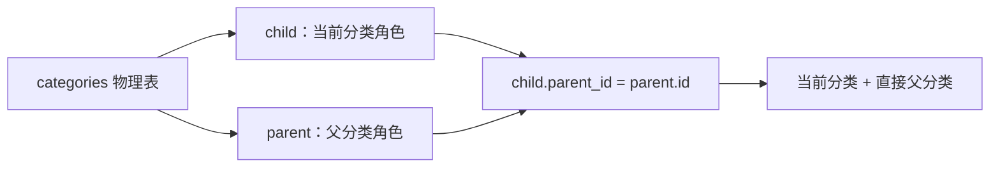
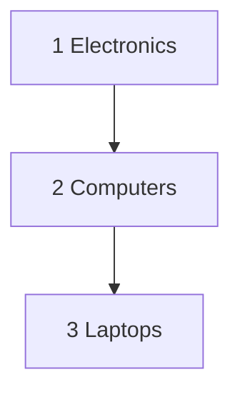

# DQL — 数据查询语言 / 自连接与层级关系

> **故事线与承上启下**：
> 前两节连接的是不同表，但商品分类的父级和子级都存放在 `categories` 中。同一张表需要同时扮演“当前分类”和“父分类”两个角色，这就是 Self Join 的典型场景。

## ⚡ 速查摘要

- Self Join 不是独立 SQL 关键字，而是同一张表以不同别名参与多次 Join。
- 层级表通常用 `parent_id` 指向本表 `id`；根节点的 `parent_id` 为 `NULL`。
- 查询全部分类及父分类应使用 `LEFT JOIN`，否则根节点会被丢弃。
- Self Join 适合固定层级或单层父子查询；未知深度树应使用 Recursive CTE。
- `parent_id` 应建立索引，并通过应用约束防止自指和循环引用。

---

## 🎯 学习目标与验收标准

**学习目标：**

- 理解同表不同别名代表的逻辑角色。
- 掌握 `categories.parent_id = parent.id` 的父子连接方式。
- 能使用 `LEFT JOIN` 保留根分类。
- 理解固定层级 Self Join 的能力边界和性能成本。
- 识别自指、孤儿节点和循环引用风险。

**验收标准：**

- [ ] 能解释为什么 Self Join 必须使用两个不同别名。
- [ ] 能查询每个分类及其直接父分类。
- [ ] 能说明 `INNER JOIN` 为什么会丢失根节点。
- [ ] 能独立完成 `exercises/03.04.08-self-join` 并通过测试。

---

## 📖 概念全景

### 1. Self Join 的本质

Self Join 仍然是普通 Join，只是左右两侧引用同一张物理表：

```sql
FROM categories AS child
LEFT JOIN categories AS parent ON parent.id = child.parent_id
```

别名为同一份数据赋予不同逻辑角色：



数据库不会复制整张表。优化器为两个表引用分别规划访问路径，执行时根据连接键查找匹配记录。

### 2. 邻接表模型

使用 `parent_id` 保存直接父节点称为 Adjacency List：

| id | name | parent_id |
|---:|---|---:|
| 1 | Electronics | `NULL` |
| 2 | Computers | 1 |
| 3 | Laptops | 2 |



优点是写入简单、结构直观；缺点是读取完整祖先链或子树需要递归。

### 3. 为什么根节点需要 LEFT JOIN

根分类的 `parent_id` 为 `NULL`：

```sql
SELECT child.id, child.name, parent.name AS parent_name
FROM categories AS child
LEFT JOIN categories AS parent ON parent.id = child.parent_id;
```

`LEFT JOIN` 保留所有 `child`。根节点无法匹配 `parent`，因此 `parent_name` 为 SQL `NULL`。

若改为 `INNER JOIN`，`parent.id = NULL` 的判断结果为 `UNKNOWN`，根节点不会进入结果集。

### 4. 固定层级展开

如果业务明确只需要三层，可以连续自连接：

```sql
SELECT
    leaf.name AS leaf_name,
    parent.name AS parent_name,
    grandparent.name AS grandparent_name
FROM categories AS leaf
LEFT JOIN categories AS parent ON parent.id = leaf.parent_id
LEFT JOIN categories AS grandparent ON grandparent.id = parent.parent_id;
```

每增加一级就增加一次 Join。这适合层级上限固定且较小的模型；层级未知时，SQL 长度和访问成本随深度增长，不应继续手写 Join。

### 5. Self Join 与 Recursive CTE 的边界

| 需求 | 推荐方案 |
|---|---|
| 查询直接父节点 | Self Join 一次 |
| 固定三层分类 | Self Join 两次 |
| 查询任意深度祖先链 | Recursive CTE |
| 查询完整子树 | Recursive CTE 或专用层级模型 |
| 高频整棵树读取 | 缓存、Closure Table、Materialized Path 等 |

Recursive CTE 会在高级查询表达模块展开。本节只建立直接父子关系的可靠查询能力。

### 6. 数据完整性风险

层级表容易出现三类问题：

- **自指**：`parent_id = id`。
- **循环**：A 的父级是 B，B 的父级又是 A。
- **孤儿节点**：`parent_id` 指向不存在的分类。

外键只能阻止孤儿节点，不能自动阻止任意长度循环。应用服务在移动节点前必须检查目标父节点不在当前节点的子树中。

根节点的 `parent_id` 允许 `NULL` 是合理语义，不应为了“禁止 NULL”强行写成 `0`。虚拟父节点 `0` 会破坏外键语义并引入不存在的实体。

### 7. 索引与性能边界

`id` 通常是主键，父节点查找可直接使用主键索引。反向查询“某父分类的所有直接子类”依赖：

```sql
CREATE INDEX idx_categories_parent_id ON categories (parent_id);
```

缺少该索引时，按父级展开子节点可能扫描整表。对于深层递归，即使单步有索引，总访问次数仍取决于节点数量和树深度；应限制最大深度、返回节点数和查询超时。

---

## 💻 SQL 语法

### 查询分类与直接父级

```sql
SELECT
    child.id AS category_id,
    child.name AS category_name,
    parent.name AS parent_name
FROM categories AS child
LEFT JOIN categories AS parent ON parent.id = child.parent_id
ORDER BY child.id;
```

### 查询某父级的直接子分类

```sql
SELECT child.id, child.name
FROM categories AS parent
INNER JOIN categories AS child ON child.parent_id = parent.id
WHERE parent.id = 1
ORDER BY child.id;
```

---

## 🛒 订单系统实战

**业务场景：**

商品后台需要展示分类列表，并在每一行显示直接父分类。根分类也必须显示，父分类名称留为 `NULL`。

**实战 SQL：**

```sql
SELECT
    child.id AS category_id,
    child.name AS category_name,
    parent.name AS parent_name
FROM categories AS child
LEFT JOIN categories AS parent ON parent.id = child.parent_id
ORDER BY child.id ASC;
```

**解析：**

- `child` 和 `parent` 是同一张表的两个逻辑角色。
- `child.parent_id` 指向 `parent.id`。
- `LEFT JOIN` 保留根分类。
- 本查询只展开直接父级，不递归读取完整路径。

---

## ⚠️ 常见坑点

- 💣 **不写别名或别名含义模糊**
  - 同表字段会产生歧义，SQL 难以审查。
  - 使用 `child`、`parent` 等角色名，而不是 `a`、`b`。

- 💣 **使用 INNER JOIN 查询完整分类列表**
  - 根节点没有父级，会被过滤。
  - 需要保留根节点时使用 `LEFT JOIN`。

- 💣 **用 0 代替根节点 NULL**
  - `0` 是一个具体值，却没有对应父实体。
  - 根节点使用 `parent_id IS NULL`。

- 💣 **用多次 Self Join 模拟无限层级**
  - 每次只能多展开一级，深度变化就要改 SQL。
  - 未知深度使用 Recursive CTE。

---

## 🧠 主动回忆

1. Self Join 为什么必须给同一张表定义不同别名？
2. 为什么查询全部分类时应使用 `LEFT JOIN` 而不是 `INNER JOIN`？
3. 外键为什么无法阻止 A → B → A 这种循环？

## 🧭 进阶路线提示

| 后续章节 | 会继续解决什么问题 |
|---|---|
| 04.04 高级查询表达 | 使用 Recursive CTE 查询任意深度祖先链和子树。 |
| 04.02 索引工程化与优化器 | 分析 `parent_id` 索引与多次 Self Join 的执行计划。 |
| 06.01 架构视角的表设计方法论 | 比较 Adjacency List、Closure Table、Materialized Path。 |

---

## ✅ 项目练习

去 `exercises/03.04.08-self-join`，完成分类与直接父分类查询。

**任务描述：**

1. 将 `categories` 分别作为 `child` 和 `parent`。
2. 使用 `LEFT JOIN` 保留根分类。
3. 返回分类 ID、名称和直接父分类名称。

**运行验证：**

```bash
bash test.sh
```

---

## 🚀 延伸学习

- [选读] MySQL Reference Manual：JOIN Clause、WITH (Common Table Expressions)。
- [思考] 分类树被频繁读取但很少修改时，是否应该把完整路径预计算并缓存？
