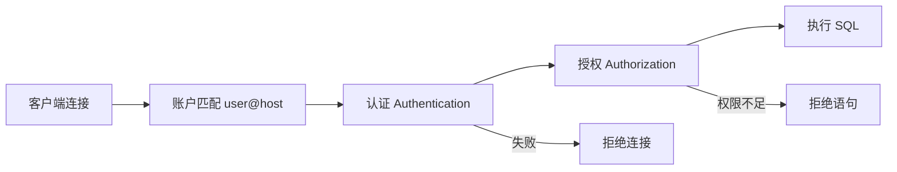

# DCL — 数据控制语言 / 账户与权限管理

> **故事线与承上启下**：DQL 模块已经可以生成订单报表，但如果报表服务使用 `root` 连接，一个凭据泄露就可能获得整个实例的控制权。本节将查询能力收敛为独立只读账户。

## ⚡ 速查摘要

- MySQL 账户由用户名和来源主机共同标识：`'user'@'host'`。
- `CREATE USER` 创建身份，`GRANT` 授权，`REVOKE` 回收权限。
- 权限范围从全局、数据库、表到列逐级收窄。
- `SHOW GRANTS` 用于检查账户当前授权事实。
- 应用账户遵循 Least Privilege，不使用 `root`，不授予 `ALL PRIVILEGES`。

## 🎯 学习目标与验收标准

**学习目标：**

- 理解账户匹配与认证、授权的分工。
- 掌握账户创建、授权、回收和审计命令。
- 区分全局、数据库、表和列级权限。
- 能为订单报表服务设计只读账户。

**验收标准：**

- [ ] 能解释 `'reporter'@'localhost'` 与 `'reporter'@'%'` 的区别。
- [ ] 能创建账户并只授予指定数据库的 `SELECT`。
- [ ] 能回收误授予的 `INSERT`，并使用 `SHOW GRANTS` 验证。
- [ ] 能独立完成 `exercises/03.05.00-user-privileges` 并通过测试。

## 📖 概念全景

### 1. 认证与授权是两道边界



认证回答“连接者是谁”，授权回答“该身份可以做什么”。密码正确只代表能登录，不代表能读取订单表。

### 2. `'user'@'host'` 账户模型

MySQL 账户不是单独的用户名，而是 `(User, Host)` 组合：

```text
'reporter'@'localhost'
'reporter'@'10.%'
'reporter'@'%'
```

三者是不同账户，可拥有不同认证信息和权限。`%` 允许更广泛的来源匹配，会扩大网络暴露面；生产环境应结合网络边界使用明确的来源范围。

### 3. 权限范围

| 范围 | 写法 | 影响边界 | 典型用途 |
|---|---|---|---|
| 全局 | `*.*` | 整个实例 | DBA 管理权限，应用账户通常不应拥有 |
| 数据库 | `order_system.*` | 指定数据库 | 服务对单个业务库的读写 |
| 表 | `order_system.orders` | 指定表 | 报表或数据交换账户 |
| 列 | `SELECT(order_no, status)` | 指定列 | 极窄读取边界，维护成本较高 |

权限越宽，凭据泄露或程序缺陷的爆炸半径越大。最小权限不是“尽量少给”，而是只授予完成当前职责所需的动作和对象范围。

### 4. 权限变更生命周期


`REVOKE` 只回收权限，不删除账户；`DROP USER` 删除账户。账户管理语句可能触发 Implicit Commit，不应假设可以通过普通业务事务回滚。

### 5. 认证插件

`CREATE USER ... IDENTIFIED BY` 会由服务器默认认证插件处理密码。不同 MySQL 版本、客户端驱动和部署环境可能使用不同插件。不要在业务 SQL 中硬编码插件选择，除非兼容性要求已被验证；密码应通过 Secret 管理系统分发，而不是提交到仓库。

## 💻 SQL 语法

```sql
CREATE USER 'reporter'@'10.%' IDENTIFIED BY 'replace-with-secret';

GRANT SELECT ON order_system.* TO 'reporter'@'10.%';

SHOW GRANTS FOR 'reporter'@'10.%';

REVOKE SELECT ON order_system.* FROM 'reporter'@'10.%';

DROP USER 'reporter'@'10.%';
```

MySQL 8 中 `CREATE USER` 与 `GRANT` 职责分离：先创建账户，再授权。不要依赖旧版本中 `GRANT` 隐式创建用户的行为。

## 🛒 订单系统实战

**业务场景：** 报表服务只需要读取订单库，不应修改订单，也不应访问其他数据库。

```sql
CREATE USER 'order_reporter'@'10.%' IDENTIFIED BY 'managed-secret';

GRANT SELECT ON order_system.* TO 'order_reporter'@'10.%';

SHOW GRANTS FOR 'order_reporter'@'10.%';
```

如果误授予写权限，应精确回收：

```sql
REVOKE INSERT ON order_system.* FROM 'order_reporter'@'10.%';
```

不要用重新创建账户代替权限回收，这会引入凭据轮换、连接中断和审计链断裂。

## ⚠️ 常见坑点

- **应用使用 `root`**：单个凭据泄露可影响整个实例，爆炸半径从一个库扩大到全部库。
- **忽略 Host 部分**：给 `'user'@'localhost'` 授权不会自动作用于 `'user'@'%'`。
- **滥用 `ALL PRIVILEGES`**：开发方便换来长期越权，尤其不应授予 `FILE`、`SUPER` 类高危权限。
- **只执行 GRANT 不审计**：历史授权会叠加，应通过 `SHOW GRANTS` 验证最终状态。
- **把密码提交到 Git**：练习密码仅用于本地隔离环境，生产凭据必须使用 Secret 管理。

## 🧠 主动回忆

1. 为什么 MySQL 中用户名相同仍可能是两个不同账户？
2. 数据库级 `SELECT` 与全局 `SELECT` 的风险边界有什么差异？
3. 回收权限为什么应该使用 `REVOKE`，而不是直接删除并重建账户？

## 🧭 进阶路线提示

| 后续章节 | 会继续解决什么问题 |
|---|---|
| 05.03 用户权限与安全 | 密码策略、角色、TLS、审计、动态权限与生产安全基线。 |
| 04.05 视图与查询封装 | 通过视图进一步裁剪报表账户可见的行列边界。 |

## ✅ 项目练习

去 `exercises/03.05.00-user-privileges`，创建报表账户、模拟误授权并精确回收写权限。

```bash
bash test.sh
```

## 🚀 延伸学习

- [选读] MySQL Reference Manual：CREATE USER、GRANT、REVOKE、SHOW GRANTS。
- [思考] 当报表服务需要跨多个数据库读取时，应授予多个库级权限，还是直接授予全局 `SELECT`？

