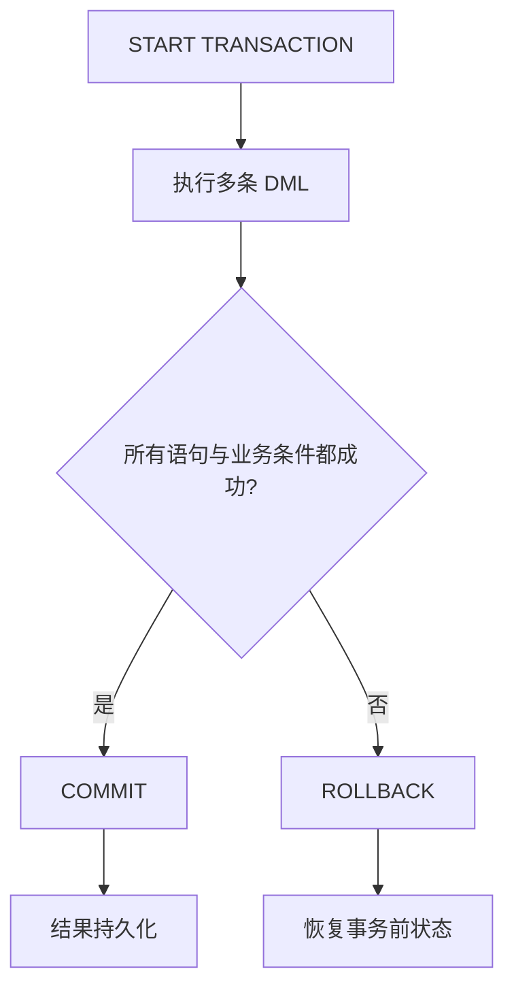

# TCL — 事务控制语言 / ACID 与事务控制

> **故事线与承上启下**：权限控制解决了“谁能写”。接下来要解决“多条写操作如何一起成功或一起失败”：一次下单至少涉及扣库存、创建订单和写入明细，任何一步单独成功都会制造脏数据。

## ⚡ 速查摘要

- 事务把多条语句组成一个原子工作单元。
- `COMMIT` 持久化修改，`ROLLBACK` 撤销未提交修改。
- MySQL 默认 `autocommit = 1`，每条独立 DML 通常自动提交。
- SQL 语句失败通常不会自动回滚整个事务，应用必须处理失败路径。
- 库存扣减应使用条件 `UPDATE` 并检查影响行数。

## 🎯 学习目标与验收标准

**学习目标：**

- 理解 ACID 各自解决的问题及边界。
- 掌握显式事务、提交、回滚和 Savepoint。
- 理解 `autocommit` 与 Implicit Commit。
- 能将一次下单的多表写入放入正确事务边界。

**验收标准：**

- [ ] 能解释 Atomicity 与 Consistency 的区别。
- [ ] 能使用 `START TRANSACTION`、`COMMIT` 和 `ROLLBACK`。
- [ ] 能解释为什么 SQL 报错后仍需显式处理事务。
- [ ] 能独立完成 `exercises/03.06.00-acid` 并通过测试。

## 📖 概念全景

### 1. ACID 不是四个同义词

| 属性 | 保证 | 不负责 |
|---|---|---|
| Atomicity | 一个事务内的修改全部生效或全部撤销 | 判断业务规则本身是否正确 |
| Consistency | 事务前后满足约束与业务不变量 | 自动发现所有业务不变量 |
| Isolation | 控制并发事务互相可见和干扰的程度 | 消除所有并发竞争 |
| Durability | 已提交结果在崩溃恢复后仍存在 | 跨地域容灾或永久不丢数据 |

Consistency 依赖数据库约束和应用逻辑共同维护。例如外键能阻止不存在用户的订单，但“订单金额必须等于明细合计”通常还需要应用或更复杂的数据设计保证。

### 2. 事务状态流转



`COMMIT` 和完整 `ROLLBACK` 都会结束当前事务。事务开启后长期不结束，会持有锁、Read View 和 undo 清理压力，形成 Long Transaction。

### 3. autocommit

MySQL 默认启用：

```sql
SELECT @@autocommit;
```

在 `autocommit = 1` 时，一条独立 DML 是一个事务。显式执行 `START TRANSACTION` 后，多条语句进入同一事务，直到 `COMMIT` 或 `ROLLBACK`。

不要在连接池中随意执行 `SET autocommit = 0` 后忘记恢复。连接会被复用，事务状态可能泄漏到下一个请求。

### 4. SAVEPOINT

```sql
START TRANSACTION;

UPDATE products SET stock = stock - 1 WHERE id = 1;
SAVEPOINT stock_deducted;

INSERT INTO orders (...) VALUES (...);
ROLLBACK TO SAVEPOINT stock_deducted;

COMMIT;
```

`ROLLBACK TO SAVEPOINT` 只撤销 Savepoint 之后的修改，事务仍然继续。它适合局部重试或可选步骤，但会增加控制流复杂度，不能代替清晰的小事务。

### 5. SQL 错误与失败路径

某条语句因唯一键冲突而失败时，MySQL 通常只回滚该语句，不会自动回滚整个事务。应用必须捕获异常并执行 `ROLLBACK`；如果连接直接返回池中，可能留下未结束事务和锁。

### 6. Implicit Commit

许多 DDL 与账户管理语句会在执行前后触发 Implicit Commit。以下设计不可依赖整体回滚：

```sql
START TRANSACTION;
UPDATE products SET stock = stock - 1 WHERE id = 1;
ALTER TABLE products ADD COLUMN temporary_flag TINYINT;
ROLLBACK;
```

业务事务中只放必要 DML。Schema Migration 使用独立发布流程。

## 💻 SQL 语法

```sql
START TRANSACTION;

-- DML statements

COMMIT;
```

失败路径：

```sql
START TRANSACTION;

-- DML statements

ROLLBACK;
```

局部回滚：

```sql
SAVEPOINT before_optional_step;
ROLLBACK TO SAVEPOINT before_optional_step;
RELEASE SAVEPOINT before_optional_step;
```

## 🛒 订单系统实战

**业务场景：** 用户购买 2 件商品。库存扣减、订单和明细必须作为一个事务提交。

```sql
START TRANSACTION;

UPDATE products
SET stock = stock - 2
WHERE id = 1
  AND stock >= 2;

-- 应用必须检查 ROW_COUNT() = 1；否则执行 ROLLBACK。
INSERT INTO orders (id, order_no, user_id, total_amount, status)
VALUES (100, 'ORD-TX-001', 1, 200.00, 'PENDING');

INSERT INTO order_items (id, order_id, product_id, quantity, unit_price)
VALUES (100, 100, 1, 2, 100.00);

COMMIT;
```

关键约束：条件扣减避免库存变为负数，但仅写 SQL 脚本无法可靠分支处理 `ROW_COUNT() = 0`。生产代码必须检查影响行数，失败时回滚，不能继续创建订单。

## ⚠️ 常见坑点

- **忘记提交**：事务长期占用锁和 undo，连接归还连接池后还可能污染后续请求。
- **认为报错会自动回滚**：大多数错误只回滚当前语句，应用必须显式 `ROLLBACK`。
- **先查库存再扣减**：两个事务可能同时读到充足库存，应使用条件 `UPDATE` 并检查影响行数。
- **事务过大**：一次处理数十万行会放大锁等待、undo、redo 和崩溃恢复成本。
- **事务中执行 DDL**：Implicit Commit 会打断预期原子边界。

## 🧠 主动回忆

1. Atomicity 与 Consistency 各自保证什么？
2. 为什么 `UPDATE ... WHERE stock >= quantity` 后还必须检查影响行数？
3. 某条 `INSERT` 失败后，为什么不能直接把连接放回连接池？

## 🧭 进阶路线提示

| 后续章节 | 会继续解决什么问题 |
|---|---|
| 04.03 事务与并发控制 | 隔离级别、MVCC、锁、死锁和并发库存扣减。 |
| 05.05 备份恢复与迁移 | 一致性快照、binlog 与恢复点目标。 |

## ✅ 项目练习

去 `exercises/03.06.00-acid`，在一个事务中完成库存扣减、订单创建和明细写入。

```bash
bash test.sh
```

## 🚀 延伸学习

- [选读] MySQL Reference Manual：START TRANSACTION、COMMIT、ROLLBACK、Statements That Cause an Implicit Commit。
- [思考] 支付成功发生在外部支付平台时，单库事务为什么无法覆盖整个业务链？

