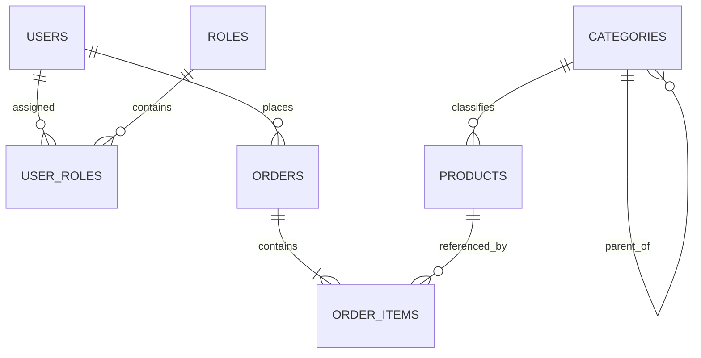

# SQL 基础闭环项目 / Schema V1 复盘

> **故事线与承上启下**：已经写过表结构、查询、权限和事务，但系统能否继续演进，取决于是否真正理解当前 Schema 契约。本节停止新增功能，从空库迁移链、主键、唯一键和关系边界四个角度审计 V1。

## ⚡ 速查摘要

- 当前 Schema V1 由 `schema/v001` 至 `v007` 按顺序演进而来。
- 主键标识行，唯一键保护业务身份，外键约束跨表引用。
- `SHOW CREATE TABLE` 适合审计单表完整 DDL。
- `INFORMATION_SCHEMA` 适合生成跨表约束清单。
- 文档是设计意图，数据库元数据才是当前实际状态。

## 🎯 学习目标与验收标准

**学习目标：**

- 能画出订单系统 V1 的核心实体关系。
- 能区分技术主键、业务唯一键与外键职责。
- 理解 `schema_version` 与 Migration 文件链的关系。
- 能使用数据库元数据审计外键依赖。

**验收标准：**

- [ ] 能解释 7 张核心业务表的职责边界。
- [ ] 能指出订单号、SPU 编号和用户名的业务唯一性。
- [ ] 能说明为什么 Migration 必须按版本顺序执行。
- [ ] 能独立完成 `exercises/03.07.00-schema-v1-review` 并通过测试。

## 📖 概念全景

### 1. Schema V1 全景



这 7 张表形成两个子图：

- 身份权限子图：`users`、`roles`、`user_roles`。
- 商品交易子图：`categories`、`products`、`orders`、`order_items`，并通过 `orders.user_id` 连接用户。

### 2. 每张表的职责

| 表 | 核心职责 | 不应承担 |
|---|---|---|
| `users` | 用户身份与基础状态 | 订单明细、角色名称 |
| `roles` | 角色字典 | 用户专属属性 |
| `user_roles` | 用户与角色的 M:N 关系 | 重复存储用户或角色详情 |
| `categories` | 商品分类层级 | 商品库存和订单状态 |
| `products` | 商品目录、价格和库存 | 某次订单成交快照 |
| `orders` | 订单头、用户、金额和状态 | 多行商品明细 |
| `order_items` | 订单商品、数量和成交单价 | 当前商品售价 |

`order_items.unit_price` 是下单时的价格快照，不能在查询历史订单时直接用 `products.price` 替代。

### 3. 主键、唯一键与外键

| 约束 | 回答的问题 | 当前示例 |
|---|---|---|
| Primary Key | 数据库如何唯一定位一行？ | `orders.id` |
| Unique Key | 哪个业务身份不能重复？ | `orders.order_no`、`products.spu_no` |
| Foreign Key | 当前值必须引用哪张表？ | `order_items.order_id → orders.id` |

技术主键稳定且短，适合内部 Join；业务唯一键保护业务语义。两者不是二选一。

### 4. 删除边界

- 删除订单时，`order_items` 使用 `ON DELETE CASCADE`，明细失去订单后没有独立意义。
- 删除分类时，商品和子分类使用 `ON DELETE SET NULL`，避免目录调整直接删除商品。
- 删除用户时，当前 `orders.user_id` 默认 `RESTRICT`，有订单的用户不能直接物理删除。

级联策略表达生命周期所有权。不能为了“删除方便”统一使用 `CASCADE`。

### 5. Migration 与 schema_version


`progress.json.schema_version = 7` 表示学习项目已演进到第 7 个 Schema 版本。它是项目进度标记，不会代替数据库 Migration 表；生产系统应由迁移工具记录每个环境实际执行过的版本和校验信息。

## 💻 SQL 语法

审计单表完整 DDL：

```sql
SHOW CREATE TABLE table_name;
```

查看当前数据库的表：

```sql
SELECT table_name
FROM information_schema.tables
WHERE table_schema = DATABASE()
ORDER BY table_name;
```

元数据查询必须限制 `table_schema`。不同数据库可拥有同名表，不限定 Schema 会混入无关结果。

## 🛒 订单系统实战

**业务场景：** 权限模块准备增加审计功能。先检查 `user_roles` 是否真正具备联合主键、两个外键和预期删除策略。

```sql
SHOW CREATE TABLE user_roles;
```

检查输出时关注：

- `PRIMARY KEY (user_id, role_id)` 是否阻止同一角色重复分配。
- `user_id`、`role_id` 是否分别引用正确父表。
- 两个外键是否使用 `ON DELETE CASCADE`。
- 是否存在从 `role_id` 开始的辅助索引，支撑按角色反查用户。

这里的输出是单表 DDL 文本，适合逐项人工审计；跨多表生成机器可比对的依赖清单，需要换用 `INFORMATION_SCHEMA`，这将由项目练习独立完成。

## ⚠️ 常见坑点

- **只看 ER 图，不看真实数据库**：图可能过期，应以元数据验证实际约束。
- **把唯一键当主键**：业务值可能变更，不一定适合作为所有外键的目标。
- **无差别使用 CASCADE**：错误删除可能从父表扩散到大量业务数据。
- **忽略 Migration 顺序**：后续脚本依赖前置表和列，跳版本无法确定性恢复。
- **把当前商品价当成交价**：历史订单必须使用明细价格快照。

## 🧠 主动回忆

1. 为什么订单同时需要 `id` 和 `order_no`？
2. `order_items` 可以级联删除，而 `orders` 不应随用户级联删除，差异来自什么？
3. `schema_version = 7` 为什么不能证明某个外部环境真的执行了全部 Migration？

## 🧭 进阶路线提示

| 后续章节 | 会继续解决什么问题 |
|---|---|
| 04.01 索引基础与查询计划 | 判断当前主键、唯一键和二级索引能否支撑真实访问路径。 |
| 06.01 表设计方法论 | 范式、反范式、生命周期、审计和容量规划。 |

## ✅ 项目练习

去 `exercises/03.07.00-schema-v1-review`，通过系统元数据生成商品—订单交易子图的外键依赖清单。

```bash
bash test.sh
```

## 🚀 延伸学习

- [选读] MySQL Reference Manual：The INFORMATION_SCHEMA KEY_COLUMN_USAGE Table。
- [思考] 如果应用声明了逻辑外键但数据库没有物理外键，应如何自动审计关系契约？

