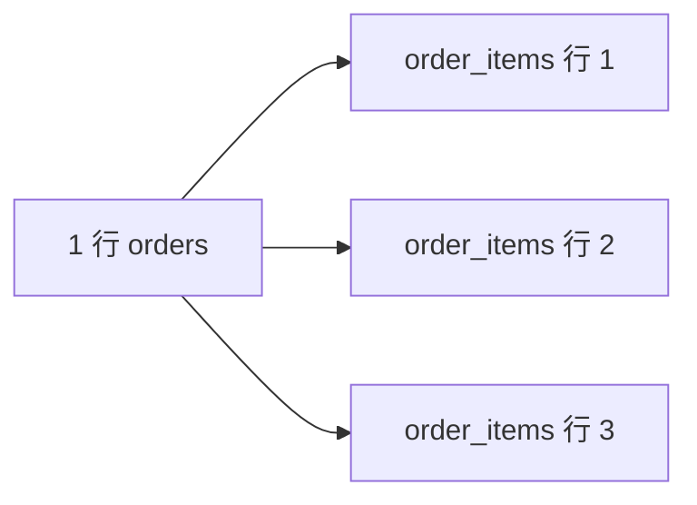
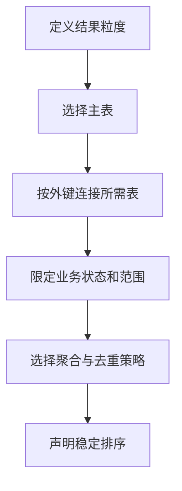

# SQL 基础闭环项目 / 订单列表、订单详情与用户消费统计

> **故事线与承上启下**：Schema V1 已确认表与关系正确。现在要把规范化的写模型组合成应用真正消费的读模型：列表关注一行一订单，详情关注一行一商品，统计关注一行一用户。

## ⚡ 速查摘要

- 写查询前先定义结果粒度：订单、明细还是用户。
- 一对多 Join 会放大行数，聚合时必须防止重复计数。
- 历史成交金额使用 `orders.total_amount` 或 `order_items.unit_price`，不能使用当前 `products.price`。
- 消费统计必须明确包含哪些订单状态。
- 稳定列表排序需要唯一 Tie-breaker。

## 🎯 学习目标与验收标准

**学习目标：**

- 能设计订单列表、订单详情和用户统计三类读模型。
- 能依据结果粒度选择 Join 与 Aggregate。
- 能避免一对多 Join 导致的重复计数。
- 能定义并实现有效消费口径。

**验收标准：**

- [ ] 能解释三类查询的结果粒度差异。
- [ ] 能用明细成交单价计算行金额。
- [ ] 能排除取消订单并按用户聚合有效消费。
- [ ] 能独立完成 `exercises/03.07.01-order-query-practice` 并通过测试。

## 📖 概念全景

### 1. 先定义结果粒度

| 读模型 | 每行代表 | 主表 | 常见字段 |
|---|---|---|---|
| 订单列表 | 一个订单 | `orders` | 订单号、用户、状态、金额、时间 |
| 订单详情 | 一个订单商品行 | `order_items` | 商品名、数量、成交单价、行金额 |
| 用户消费统计 | 一个用户 | `users` | 有效订单数、有效消费总额 |

同一组表可以产生不同粒度。没有先声明粒度，Join 后很容易把“明细行数”误写成“订单数”。

### 2. 一对多 Join 的基数放大



订单连接三条明细后会产生三行。此时：

- `COUNT(*)` 得到明细数。
- `COUNT(DISTINCT orders.id)` 才是订单数。
- `SUM(orders.total_amount)` 会把订单金额重复累计三次。

聚合字段必须与当前粒度匹配。

### 3. 历史价格快照

`products.price` 是当前目录价，`order_items.unit_price` 是成交时价格。订单详情和历史营收应使用成交快照：

```sql
order_items.quantity * order_items.unit_price
```

商品调价不应改写历史订单金额。

### 4. 指标口径

“用户消费金额”不是纯技术字段，必须定义业务口径。例如：

- `PAID`：已支付但可能未发货。
- `SHIPPED`：已发货。
- `COMPLETED`：已完成。
- `CANCELLED`：通常排除。

如果未来增加退款状态，统计口径还要处理部分退款和全额退款。SQL 正确不等于指标定义正确。

### 5. 查询组合路径



## 💻 SQL 语法

多表详情查询框架：

```sql
SELECT ...
FROM orders AS o
JOIN order_items AS oi ON oi.order_id = o.id
JOIN products AS p ON p.id = oi.product_id
WHERE ...
ORDER BY ...;
```

分组统计框架：

```sql
SELECT group_key, COUNT(...), SUM(...)
FROM ...
WHERE ...
GROUP BY group_key
ORDER BY group_key;
```

## 🛒 订单系统实战

**业务场景：** 客服工作台需要最近待处理订单列表，每行只显示一个订单及下单用户名。这个场景不展开商品明细，也不做用户消费聚合。

```sql
SELECT
    o.order_no,
    u.username,
    o.total_amount,
    o.created_at
FROM orders AS o
JOIN users AS u ON u.id = o.user_id
WHERE o.status = 'PENDING'
ORDER BY o.created_at DESC, o.id DESC
LIMIT ?;
```

关键点：

- 主表是 `orders`，所以结果保持一行一订单。
- 只连接 `users`，不会产生一对多放大。
- `created_at, id` 形成稳定排序。
- `?` 由应用 Prepared Statement 绑定，并限制最大页大小。

项目练习将切换到两个不同输出：指定订单的商品明细，以及跨订单的用户消费聚合，需要重新选择主表、Join 路径和聚合口径。

## ⚠️ 常见坑点

- **列表直接 Join 明细**：一个订单变多行，分页和订单数都会失真。
- **统计时 SUM 订单金额又 Join 明细**：金额按明细数量重复累计。
- **使用当前商品价**：调价后历史订单金额发生漂移。
- **未定义有效状态**：取消订单被计入消费。
- **使用 `SELECT *`**：同名列冲突，输出契约随 Schema 变化。

## 🧠 主动回忆

1. 为什么订单详情可以一行一商品，而订单列表必须一行一订单？
2. Join 明细后如何正确统计订单数量？
3. 用户消费统计为什么必须先定义状态口径？

## 🧭 进阶路线提示

| 后续章节 | 会继续解决什么问题 |
|---|---|
| 04.01 索引基础与查询计划 | 验证列表、详情和统计查询是否命中合适索引。 |
| 04.04 高级查询表达 | 使用 CTE 和窗口函数构建排名、累计消费等读模型。 |

## ✅ 项目练习

去 `exercises/03.07.01-order-query-practice`，独立完成订单商品明细与用户有效消费统计两个查询。

```bash
bash test.sh
```

## 🚀 延伸学习

- [选读] MySQL Reference Manual：JOIN Clause、Aggregate Function Descriptions。
- [思考] 订单列表需要展示商品摘要时，如何避免 Join 放大破坏分页？

