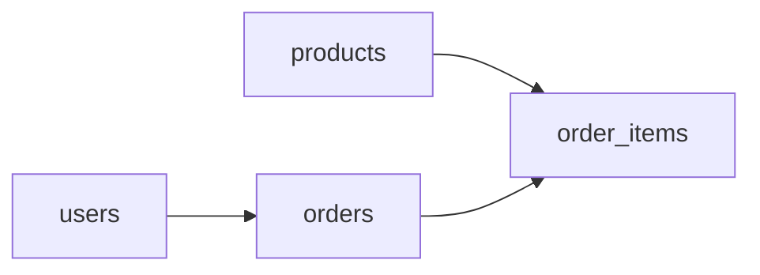

# SQL 基础闭环项目 / 基础 CRUD 综合验收

> **故事线与承上启下**：Schema、查询和事务已经分别验证。本节完成基础阶段最后一次闭环：从空库恢复结构、准备数据、执行 Create/Read/Update/Delete，并用业务不变量判断结果是否真的一致。

## ⚡ 速查摘要

- CRUD 分别对应 `INSERT`、`SELECT`、`UPDATE`、`DELETE`，但真实业务通常跨多张表组合执行。
- 测试必须从空库按 Migration 顺序重建，避免依赖本地残留状态。
- 多表写入应放入事务，并验证库存、订单和明细的不变量。
- 删除父记录前必须理解 `CASCADE`、`SET NULL` 与 `RESTRICT`。
- 验收不能只看一条查询输出，还要检查关键副作用和残留数据。

## 🎯 学习目标与验收标准

**学习目标：**

- 掌握从空库恢复 Schema V1 的确定性流程。
- 能将 CRUD 映射到业务生命周期。
- 能用事务组织跨表修改。
- 能设计查询结果与状态不变量双重验收。

**验收标准：**

- [ ] 能解释为什么测试环境必须重建而不是复用历史数据。
- [ ] 能完成跨表 Create、Update、Delete 和最终 Read。
- [ ] 能验证库存、订单状态和级联删除的一致性。
- [ ] 能独立完成 `exercises/03.07.02-crud-checkpoint` 并通过测试。

## 📖 概念全景

### 1. CRUD 是生命周期，不是四条孤立语法


以订单为例：创建订单头和明细、读取订单详情、支付后更新状态、取消草稿后删除或归档。每一步都受唯一键、外键和事务边界约束。

### 2. 从空库恢复

可靠验收从空数据库开始，并按版本顺序执行：

```text
v001 → v002 → v003 → v004 → v005 → v006 → v007
```

若测试直接复用学习库，历史表、手工数据或已存在索引可能掩盖 Migration 缺陷，产生“只在我的机器上能通过”的假成功。

### 3. Create 的跨表顺序

外键决定写入顺序：



父记录必须先存在。订单头创建后，明细才能引用订单；商品存在后，明细才能引用商品。

### 4. Update 与条件约束

更新必须表达前置状态：

```sql
UPDATE orders
SET status = 'PAID'
WHERE id = ?
  AND status = 'PENDING';
```

状态条件防止重复支付或非法逆转。应用还需检查影响行数，`0` 行可能意味着对象不存在或状态冲突。

### 5. Delete 与生命周期所有权

删除订单会级联删除明细，因为明细不能脱离订单存在。删除用户受订单外键限制，因为历史订单不应随用户物理删除。删除行为由数据生命周期决定，不能统一套用 `CASCADE`。

### 6. 双重验收

| 验收层 | 检查内容 | 防止的问题 |
|---|---|---|
| 输出契约 | 最终 `SELECT` 的字段、行和顺序 | 查询结果错误 |
| 状态不变量 | 库存、状态、残留父子记录 | 伪造输出或漏执行副作用 |

只比对最终查询，可能允许用户硬编码常量绕过真实修改；只检查状态，又可能忽略 Read 契约。两者必须同时验证。

## 💻 SQL 语法

```sql
START TRANSACTION;

INSERT INTO table_name (...) VALUES (...);
UPDATE table_name SET column_name = value WHERE ...;
DELETE FROM table_name WHERE ...;

COMMIT;

SELECT ... FROM ... WHERE ...;
```

生产代码中，任一步骤失败都应进入 `ROLLBACK` 路径；SQL 脚本无法替代应用层异常处理。

## 🛒 订单系统实战

**业务场景：** 客服修正一个测试用户的生命周期。该示例只操作 `users` 单表，演示 CRUD 职责，不涉及订单、库存、事务或级联删除。

```sql
INSERT INTO users (username, email, password_hash, status)
VALUES ('demo_user', 'demo@example.com', 'demo-hash', 1);

SELECT id, username, status
FROM users
WHERE email = 'demo@example.com';

UPDATE users
SET status = 0
WHERE email = 'demo@example.com'
  AND status = 1;

DELETE FROM users
WHERE email = 'demo@example.com'
  AND status = 0;
```

这是单表生命周期示例。项目练习要求在一个事务中处理订单、明细与库存，还要验证父表删除触发的明细级联，不能复制该示例完成。

## ⚠️ 常见坑点

- **测试复用历史数据库**：残留状态掩盖缺失 Migration 或错误 SQL。
- **无条件 UPDATE**：重复请求可能覆盖合法状态。
- **先删父表却不了解外键动作**：可能被 `RESTRICT` 阻止或触发大范围级联。
- **只验证输出**：硬编码常量也可能伪造正确结果。
- **跨表写入不使用事务**：失败后产生半完成订单。

## 🧠 主动回忆

1. 为什么 CRUD 综合测试必须从空库开始？
2. 订单状态更新为什么应包含旧状态条件？
3. 输出比对和状态不变量检查分别能发现什么问题？

## 🧭 进阶路线提示

| 后续章节 | 会继续解决什么问题 |
|---|---|
| 04.01 索引基础与查询计划 | 让已验证正确的 CRUD 和查询在数据增长后保持性能。 |
| 04.03 事务与并发控制 | 处理重复请求、锁竞争、死锁和库存并发扣减。 |

## ✅ 项目练习

去 `exercises/03.07.02-crud-checkpoint`，完成跨表订单生命周期的 CRUD 综合验收。

```bash
bash test.sh
```

## 🚀 延伸学习

- [选读] MySQL Tutorial：Creating and Using a Database。
- [思考] 生产订单为什么通常采用状态关闭或软删除，而不是物理 `DELETE`？

