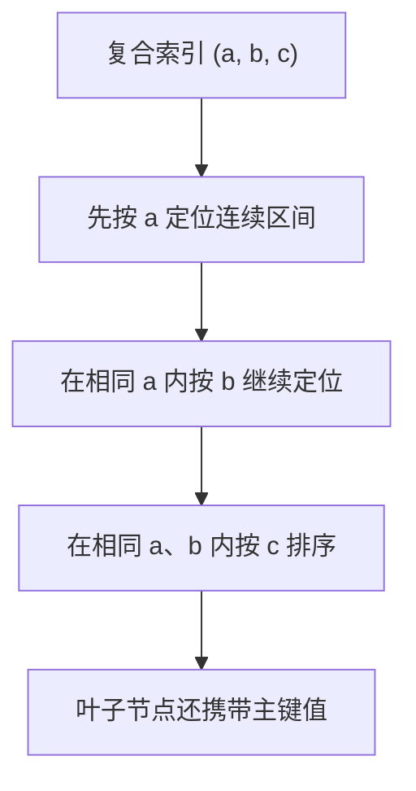
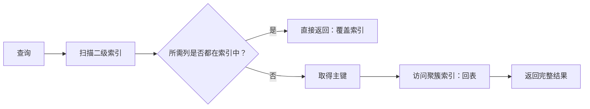

# 04.01.01. 复合索引与覆盖索引

> **故事线与承上启下**：上一节用单列索引避免了全表扫描，但真实接口通常同时过滤、排序并返回多个字段。继续为每个字段分别建索引，既不能组合利用，又会放大写入成本，因此需要理解复合索引的列顺序与覆盖能力。

## ⚡ 速查摘要

- 复合索引 `(a, b, c)` 按 `a → b → c` 排序，可利用 `(a)`、`(a, b)`、`(a, b, c)` 这些最左前缀。
- 跳过首列直接查询 `b`，通常不能用该索引完成高效定位。
- 范围条件后的列通常不能继续缩小扫描区间，但仍可能用于 Index Condition Pushdown、排序或覆盖。
- 查询所需列全部位于索引叶子节点时形成覆盖索引，`EXPLAIN Extra` 常出现 `Using index`。
- 索引列顺序由查询模式决定，不是机械地把区分度最高的列放最前。

---

## 🎯 学习目标与验收标准

**学习目标：**

- 理解复合 B+Tree 的逐列排序方式。
- 能根据等值过滤、范围过滤、排序和返回列设计索引顺序。
- 区分“使用索引定位”“使用索引排序”和“覆盖索引”。
- 能识别并移除被复合索引最左前缀完全覆盖的冗余单列索引。

**验收标准：**

- [ ] 能判断 `(user_id, status, created_at)` 支持哪些查询前缀。
- [ ] 能解释为什么覆盖索引可以避免回表。
- [ ] 能为给定查询设计复合索引，并通过自动化脚本验证列顺序和覆盖能力。

---

## 📖 概念全景

### 1. 复合索引如何排序

复合索引不是三棵独立的树。`INDEX(a, b, c)` 只有一棵 B+Tree：先按 `a` 排序；`a` 相同时按 `b` 排序；`a、b` 都相同时再按 `c` 排序。



因此，索引天然支持从最左侧开始的连续前缀：

| 查询条件 | 能否利用索引定位 | 原因 |
|---|---:|---|
| `a = ?` | 是 | 命中第一层排序 |
| `a = ? AND b = ?` | 是 | 连续使用前两列 |
| `a = ? AND b = ? AND c = ?` | 是 | 使用完整索引 |
| `b = ?` | 通常不能高效定位 | 缺少最左列 `a`，相同 `b` 分散在不同 `a` 区间 |
| `a = ? AND c = ?` | 只能先按 `a` 定位 | 跳过 `b` 后，`c` 不能继续形成连续搜索边界 |

“最左前缀”描述的是 B+Tree 的有序边界，不是要求 SQL 条件必须按索引顺序书写。优化器会规范化 `WHERE` 条件，所以 `b = ? AND a = ?` 与 `a = ? AND b = ?` 通常等价。

### 2. 等值、范围与排序的边界

设计订单列表索引时，可以使用一个实用顺序：

1. 先放稳定的等值过滤列，例如租户或用户 ID。
2. 再放其他等值过滤列，例如订单状态。
3. 然后放范围或排序列，例如创建时间。
4. 最后谨慎追加少量返回列以形成覆盖；不要把宽字段全部塞进索引。

以 `(user_id, status, created_at)` 为例，`user_id = ? AND status = ? AND created_at >= ?` 可以先锁定用户和状态，再扫描时间范围。一旦进入 `created_at >= ?` 的范围，后续索引列通常不能继续缩小 B+Tree 的扫描区间。

### 3. 覆盖索引为什么避免回表

普通二级索引叶子节点保存“索引列 + 主键”。若 `SELECT` 的全部字段都能从这些内容取得，InnoDB 无需再沿主键访问聚簇索引。



覆盖索引是某条查询与某个索引之间的关系，不是索引本身永久具有的标签。同一个索引对查询 A 可能覆盖，对多选了一个非索引列的查询 B 就需要回表。

### 4. 成本与冗余索引

复合索引 `(product_id, order_id, quantity)` 已经可以承担仅按 `product_id` 定位的用途，因此原有单列索引 `(product_id)` 往往成为冗余索引。保留冗余索引会增加磁盘占用和每次写入的 B+Tree 维护成本。

但删除前必须核对：索引是否承担外键检查、不同排序、唯一约束或线上查询计划。若旧索引支撑外键，必须先创建以外键列为最左前缀的替代索引，再删除旧索引，否则 MySQL 会报 `ERROR 1553`。生产环境不能只凭“前缀重复”直接删除。

## 💻 SQL 语法

```sql
CREATE INDEX idx_name ON table_name (column_a, column_b, column_c);

SHOW INDEX FROM table_name;

EXPLAIN
SELECT column_a, column_b
FROM table_name
WHERE column_a = ?
ORDER BY column_b;

DROP INDEX idx_name ON table_name;
```

MySQL 8 支持索引列显式指定 `ASC`、`DESC`。实际是否能免排序，取决于过滤方式、各列排序方向以及扫描方向，不能只看索引是否包含 `ORDER BY` 列。

---

## 🛒 订单系统实战

> **与项目练习的边界：** 此处只分析商家订单列表查询；项目练习处理商品关联的订单明细，并额外要求治理冗余索引，两者不能通过替换固定值互相复制。

**业务场景：**

用户中心需要按“用户 + 状态”筛选订单，并按创建时间倒序翻页，只返回订单 ID 和创建时间。单独的用户索引无法同时利用状态和时间顺序。

**设计思路：**

```sql
-- 通用示意：等值列在前，排序列在后；主键由 InnoDB 二级索引隐式携带。
CREATE INDEX idx_orders_user_status_created
    ON orders (user_id, status, created_at DESC);

EXPLAIN
SELECT id, created_at
FROM orders
WHERE user_id = <USER_ID>
  AND status = <ORDER_STATUS>
ORDER BY created_at DESC
LIMIT <PAGE_SIZE>;
```

- `user_id`、`status` 是等值条件，先缩小连续索引区间。
- `created_at DESC` 与列表排序一致，有机会避免 `Using filesort`。
- 返回的 `created_at` 是索引列，`id` 是二级索引隐式保存的主键，因此该查询有机会形成覆盖索引。
- 若接口还返回 `total_amount`，当前索引不再覆盖；是否把金额追加到索引，要依据回表量、写入频率和索引宽度权衡。

---

## ⚠️ 常见坑点

- 💣 **把多个单列索引误认为复合索引**
  - `INDEX(user_id)` 与 `INDEX(status)` 不等于 `INDEX(user_id, status)`。Index Merge 有额外合并成本，也不能自然提供复合排序。
- 💣 **跳过最左列**
  - 索引 `(user_id, status, created_at)` 不能高效支持只有 `status` 的全站订单查询。
- 💣 **把所有返回列都塞进索引**
  - 宽索引会降低单页容纳的记录数、增加树高和写放大。只为高频且收益明确的查询设计覆盖索引。
- 💣 **看到 `Using index` 就认定查询一定快**
  - 覆盖只说明不用回表；若仍扫描大量索引记录，查询依然可能很慢。
- 💣 **忽略已有前缀索引**
  - 新复合索引上线后，应基于真实负载判断旧单列索引是否冗余，避免长期重复维护。

---

## 🧠 主动回忆

1. 为什么索引 `(a, b, c)` 通常不能高效支持 `WHERE b = ?`？
2. `WHERE a = ? AND b > ? AND c = ?` 中，哪些列通常能构成连续扫描边界？
3. 为什么“查询只返回索引列”仍不等于“扫描行数一定少”？

## 🧭 进阶路线提示

| 后续章节 | 会继续解决什么问题 |
|---|---|
| 04.01.02 EXPLAIN 入门 | 系统解读 `type`、`key`、`key_len`、`rows` 和 `Extra`。 |
| 04.02 索引工程化与优化器 | 处理索引失效、统计信息、优化器选择与索引治理。 |

## ✅ 项目练习

去 `exercises/04.01.01-composite-index`，为商品维度的订单明细查询设计复合覆盖索引，并清理被其最左前缀替代的旧索引。

**运行验证：**

```bash
cd learn-mysql/exercises/04.01.01-composite-index
bash test.sh
```

---

## 🚀 延伸学习

- [选读] Index Condition Pushdown 与覆盖索引的区别。
- [思考] 当分页改成 `LIMIT 100000, 20` 时，即使索引覆盖，为什么仍可能变慢？
