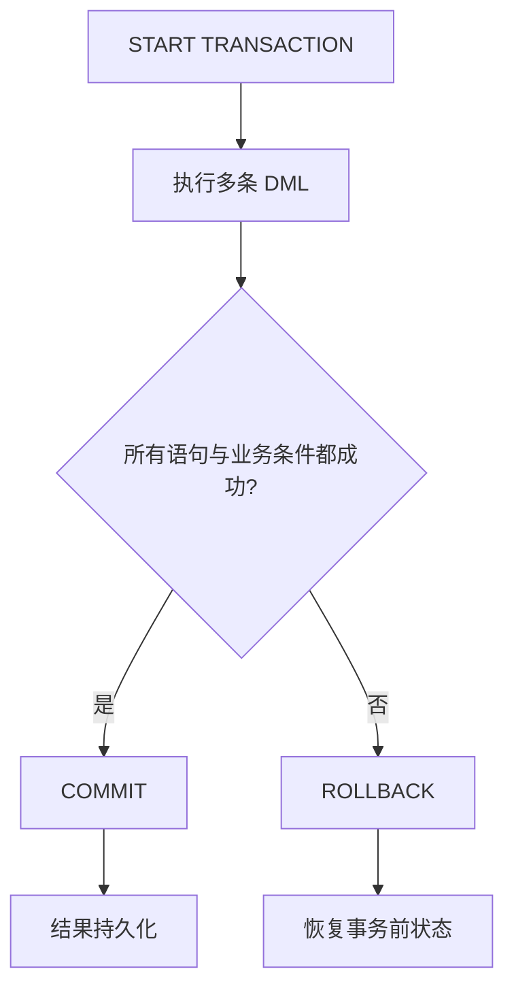

<!-- START doctoc generated TOC please keep comment here to allow auto update -->
<!-- DON'T EDIT THIS SECTION, INSTEAD RE-RUN doctoc TO UPDATE -->
**Table of Contents**  *generated with [DocToc](https://github.com/thlorenz/doctoc)*

- [一、 TCL 核心指令一览表](#%E4%B8%80-tcl-%E6%A0%B8%E5%BF%83%E6%8C%87%E4%BB%A4%E4%B8%80%E8%A7%88%E8%A1%A8)
- [二、 TCL 核心操作与代码实战](#%E4%BA%8C-tcl-%E6%A0%B8%E5%BF%83%E6%93%8D%E4%BD%9C%E4%B8%8E%E4%BB%A3%E7%A0%81%E5%AE%9E%E6%88%98)
  - [1. 标准事务处理（`BEGIN` + `COMMIT` / `ROLLBACK`）](#1-%E6%A0%87%E5%87%86%E4%BA%8B%E5%8A%A1%E5%A4%84%E7%90%86begin--commit--rollback)
  - [2. 保存点高级控制（`SAVEPOINT`）—— 局部回滚](#2-%E4%BF%9D%E5%AD%98%E7%82%B9%E9%AB%98%E7%BA%A7%E6%8E%A7%E5%88%B6savepoint-%E5%B1%80%E9%83%A8%E5%9B%9E%E6%BB%9A)
- [三、 TCL 的运行机制与隐式控制](#%E4%B8%89-tcl-%E7%9A%84%E8%BF%90%E8%A1%8C%E6%9C%BA%E5%88%B6%E4%B8%8E%E9%9A%90%E5%BC%8F%E6%8E%A7%E5%88%B6)
  - [1. 自动提交开关（`autocommit`）](#1-%E8%87%AA%E5%8A%A8%E6%8F%90%E4%BA%A4%E5%BC%80%E5%85%B3autocommit)
  - [2. 致命隐式提交（Implicit Commit / DDL 破坏事务）](#2-%E8%87%B4%E5%91%BD%E9%9A%90%E5%BC%8F%E6%8F%90%E4%BA%A4implicit-commit--ddl-%E7%A0%B4%E5%9D%8F%E4%BA%8B%E5%8A%A1)
- [四、 事务隔离级别与锁的配合（TCL 运行环境）](#%E5%9B%9B-%E4%BA%8B%E5%8A%A1%E9%9A%94%E7%A6%BB%E7%BA%A7%E5%88%AB%E4%B8%8E%E9%94%81%E7%9A%84%E9%85%8D%E5%90%88tcl-%E8%BF%90%E8%A1%8C%E7%8E%AF%E5%A2%83)

<!-- END doctoc generated TOC please keep comment here to allow auto update -->

**TCL（Transaction Control Language，事务控制 Language）** 是 SQL 中专门用来管理数据库事务（Transaction）的指令集合。

在 MySQL（InnoDB 存储引擎）中，事务用来保证一组 DML 操作（`INSERT`、`UPDATE`、`DELETE`）要么**全部成功提交**，要么**全部失败回滚**。TCL 是保证数据库符合 **ACID 特性**（原子性、一致性、隔离性、持久性）的核心防线。

---
# ACID

| 属性 | 保证 | 不负责 |
|---|---|---|
| Atomicity 原子性 | 一个事务内的修改全部生效或全部撤销 | 判断业务规则本身是否正确 |
| Consistency 一致性 | 事务前后满足约束与业务不变量 | 自动发现所有业务不变量 |
| Isolation 隔离性 | 控制并发事务互相可见和干扰的程度 | 消除所有并发竞争 |
| Durability 持久性 | 已提交结果在崩溃恢复后仍存在 | 跨地域容灾或永久不丢数据 |

Consistency 依赖数据库约束和应用逻辑共同维护。例如外键能阻止不存在用户的订单，但“订单金额必须等于明细合计”通常还需要应用或更复杂的数据设计保证。

## 事务状态流转


`COMMIT` 和完整 `ROLLBACK` 都会结束当前事务。事务开启后长期不结束，会持有锁、Read View 和 undo 清理压力，形成 Long Transaction。

# 一、 TCL 核心指令一览表

TCL 的指令非常精干，核心只有以下 **5 个基础命令**：

| 指令 | 语义 | 物理作用与底层原理 |
| --- | --- | --- |
| **`BEGIN`** / **`START TRANSACTION`** | **显式开启事务** | 标记事务起点，禁用当前会话的自动提交，分配事务 ID（读写事务）。 |
| **`COMMIT`** | **提交事务** | 将事务内的变更**持久化**。刷 Redo Log 磁盘日志，释放行锁/间隙锁，清空 Undo Log。 |
| **`ROLLBACK`** | **回滚事务** | 撤销事务内所有变更。利用 **Undo Log** 中的逆向操作日志，将数据还原到事务开启前的状态。 |
| **`SAVEPOINT point_name`** | **设置保存点** | 在事务内部打上“锚点”，实现**局部/部分回滚**。 |
| **`ROLLBACK TO point_name`** | **回滚到保存点** | 撤销从保存点之后执行的操作，保存点之前的操作依然保留（事务并未结束，仍需最终 COMMIT 或 ROLLBACK）。 |

---

# 二、 TCL 核心操作与代码实战

## 1. 标准事务处理（`BEGIN` + `COMMIT` / `ROLLBACK`）

最典型的转账业务（张三给李四转账 100 元）：

```sql
-- 1. 显式开启事务
START TRANSACTION;

-- 2. 执行一组协同的 DML 操作
UPDATE accounts SET balance = balance - 100 WHERE user_id = '张三' AND balance >= 100;
UPDATE accounts SET balance = balance + 100 WHERE user_id = '李四';

-- 3. 判断与提交：若无异常，写入磁盘持久化
COMMIT;

-- 4. 若中途报错（如张三余额不足），由应用程序捕获异常并执行回滚
-- ROLLBACK;

```

---

## 2. 保存点高级控制（`SAVEPOINT`）—— 局部回滚

当一个长事务包含多个阶段（例如：批量扣减 10 个商品的库存），如果第 3 个商品失败了，你不希望前 2 个已经成功的商品也全部重来，可以使用保存点：

```sql
START TRANSACTION;

-- 阶段 1：扣减商品 A 库存
UPDATE inventory SET stock = stock - 1 WHERE goods_id = 'A';
SAVEPOINT sp_after_goods_a; -- 打下保存点 A

-- 阶段 2：扣减商品 B 库存
UPDATE inventory SET stock = stock - 1 WHERE goods_id = 'B';
SAVEPOINT sp_after_goods_b; -- 打下保存点 B

-- 阶段 3：扣减商品 C 库存（假设此时发现 C 缺货，触发异常）
-- 物理动作：不整体回滚，只撤销阶段 3 的操作，保留商品 A 和 B 的扣减
ROLLBACK TO sp_after_goods_b;

-- 释放保存点（可选，清理内存中的保存点标记）
RELEASE SAVEPOINT sp_after_goods_a;

-- 最终提交（商品 A 和 B 的扣减依然生效落库）
COMMIT;

```

---

# 三、 TCL 的运行机制与隐式控制

除了显式写出的 TCL 语句，MySQL 底层还有两个影响 TCL 行为的关键隐式机制：

## 1. 自动提交开关（`autocommit`）

默认情况下，MySQL 的 `autocommit = 1`（开启状态）。

* **物理含义**：如果你没有显式写 `START TRANSACTION`，你执行的**每一条 DML 语句（如一条 `UPDATE`）都会被 MySQL 默默当作一个独立的事务，并自动执行 `COMMIT**`。
* **修改会话级设置**：
```sql
SET autocommit = 0; -- 关闭当前会话自动提交，之后的每个 DML 都会自动开启事务，必须手写 COMMIT

```


---

## 2. 致命隐式提交（Implicit Commit / DDL 破坏事务）

这是后端开发中最常踩的物理坑点之一：**在事务中穿插 DDL 语句，会导致当前事务被强制隐式提交！**

例如：

```sql
START TRANSACTION;

UPDATE accounts SET balance = balance - 100 WHERE user_id = '张三';

-- 致命动作：在事务中间插入了一条 DDL（如 ALTER, CREATE, TRUNCATE, DROP）
ALTER TABLE accounts ADD COLUMN remark VARCHAR(32); 

-- 物理结果：MySQL 遇到上面这行 DDL 时，会【默默自动执行 COMMIT】！
-- 导致张三扣款 100 元的操作被强行提前落库，后续即使执行 ROLLBACK 也无法撤销张三的扣款了！

```

> **终止开关**：**绝对禁止在事务（`START TRANSACTION ... COMMIT`）内部执行任何 DDL 语句！**

---

# 四、 事务隔离级别与锁的配合（TCL 运行环境）

TCL 语句生效的物理环境，受数据库隔离级别（Isolation Level）制约。隔离级别决定了事务在执行 TCL 期间，对其他并发事务的可见性：

```sql
-- 查看当前会话的隔离级别
SELECT @@transaction_isolation;

-- 设置隔离级别
SET SESSION TRANSACTION ISOLATION LEVEL READ COMMITTED;

```

| 隔离级别 | 脏读（Dirty Read） | 不可重复读（Non-repeatable Read） | 幻读（Phantom Read） |
| --- | --- | --- | --- |
| **Read Uncommitted (读未提交)** | 有 | 有 | 有 |
| **Read Committed (RC 读已提交)** | **无** | 有 | 有 |
| **Repeatable Read (RR 可重复读)** *(MySQL 默认)* | **无** | **无** | **无** *(MVCC + 间隙锁解决)* |
| **Serializable (串行化)** | **无** | **无** | **无** |

---