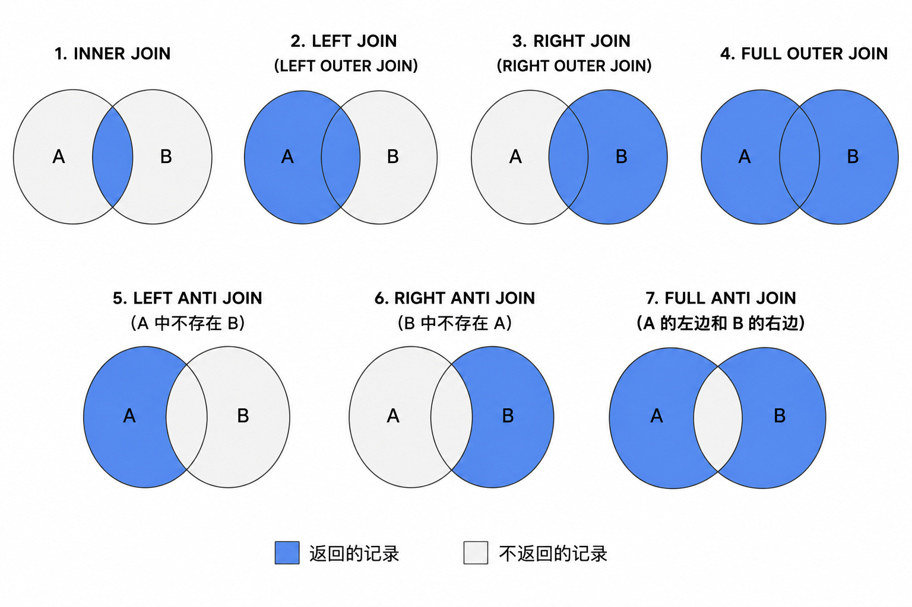

<!-- START doctoc generated TOC please keep comment here to allow auto update -->
<!-- DON'T EDIT THIS SECTION, INSTEAD RE-RUN doctoc TO UPDATE -->
**Table of Contents**  *generated with [DocToc](https://github.com/thlorenz/doctoc)*

- [连接符](#%E8%BF%9E%E6%8E%A5%E7%AC%A6)
- [连接方式](#%E8%BF%9E%E6%8E%A5%E6%96%B9%E5%BC%8F)
  - [1. 内连接 => 求【交集】](#1-%E5%86%85%E8%BF%9E%E6%8E%A5--%E6%B1%82%E4%BA%A4%E9%9B%86)
  - [2. 左外连接（LEFT [OUTER] JOIN）—— 【以左表为主】](#2-%E5%B7%A6%E5%A4%96%E8%BF%9E%E6%8E%A5left-outer-join-%E4%BB%A5%E5%B7%A6%E8%A1%A8%E4%B8%BA%E4%B8%BB)
  - [3. 右外连接（RIGHT [OUTER] JOIN）—— 【以右表为主】](#3-%E5%8F%B3%E5%A4%96%E8%BF%9E%E6%8E%A5right-outer-join-%E4%BB%A5%E5%8F%B3%E8%A1%A8%E4%B8%BA%E4%B8%BB)
  - [4. 全外连接（FULL OUTER JOIN）—— 求【并集】](#4-%E5%85%A8%E5%A4%96%E8%BF%9E%E6%8E%A5full-outer-join-%E6%B1%82%E5%B9%B6%E9%9B%86)
  - [5. 左独有连接（LEFT JOIN EXCLUDING INNER）—— 求【左表差集】](#5-%E5%B7%A6%E7%8B%AC%E6%9C%89%E8%BF%9E%E6%8E%A5left-join-excluding-inner-%E6%B1%82%E5%B7%A6%E8%A1%A8%E5%B7%AE%E9%9B%86)
  - [6. 右独有连接（RIGHT JOIN EXCLUDING INNER）—— 求【右表差集】](#6-%E5%8F%B3%E7%8B%AC%E6%9C%89%E8%BF%9E%E6%8E%A5right-join-excluding-inner-%E6%B1%82%E5%8F%B3%E8%A1%A8%E5%B7%AE%E9%9B%86)
  - [7. 左独有和右独有的合集](#7-%E5%B7%A6%E7%8B%AC%E6%9C%89%E5%92%8C%E5%8F%B3%E7%8B%AC%E6%9C%89%E7%9A%84%E5%90%88%E9%9B%86)
  - [自连接（Self JOIN）](#%E8%87%AA%E8%BF%9E%E6%8E%A5self-join)
- [JOIN 操作规范与避坑指南](#join-%E6%93%8D%E4%BD%9C%E8%A7%84%E8%8C%83%E4%B8%8E%E9%81%BF%E5%9D%91%E6%8C%87%E5%8D%97)
  - [1. 核心铁律：小表驱动大表（Small Table Drives Large Table）](#1-%E6%A0%B8%E5%BF%83%E9%93%81%E5%BE%8B%E5%B0%8F%E8%A1%A8%E9%A9%B1%E5%8A%A8%E5%A4%A7%E8%A1%A8small-table-drives-large-table)
  - [2. 关联字段必须无条件建立索引](#2-%E5%85%B3%E8%81%94%E5%AD%97%E6%AE%B5%E5%BF%85%E9%A1%BB%E6%97%A0%E6%9D%A1%E4%BB%B6%E5%BB%BA%E7%AB%8B%E7%B4%A2%E5%BC%95)
  - [3. 严格限制 JOIN 的表数量（阿里巴巴开发规范：绝不超过 3 张）](#3-%E4%B8%A5%E6%A0%BC%E9%99%90%E5%88%B6-join-%E7%9A%84%E8%A1%A8%E6%95%B0%E9%87%8F%E9%98%BF%E9%87%8C%E5%B7%B4%E5%B7%B4%E5%BC%80%E5%8F%91%E8%A7%84%E8%8C%83%E7%BB%9D%E4%B8%8D%E8%B6%85%E8%BF%87-3-%E5%BC%A0)
  - [4. 类型必须完全一致（防止隐式转换导致 JOIN 索引失效）](#4-%E7%B1%BB%E5%9E%8B%E5%BF%85%E9%A1%BB%E5%AE%8C%E5%85%A8%E4%B8%80%E8%87%B4%E9%98%B2%E6%AD%A2%E9%9A%90%E5%BC%8F%E8%BD%AC%E6%8D%A2%E5%AF%BC%E8%87%B4-join-%E7%B4%A2%E5%BC%95%E5%A4%B1%E6%95%88)
- [MySQL 物理引擎是如何执行 JOIN 的？（底层算法）](#mysql-%E7%89%A9%E7%90%86%E5%BC%95%E6%93%8E%E6%98%AF%E5%A6%82%E4%BD%95%E6%89%A7%E8%A1%8C-join-%E7%9A%84%E5%BA%95%E5%B1%82%E7%AE%97%E6%B3%95)
  - [1. 嵌套循环连接（Index Nested-Loop Join, NLJ）—— 【最理想状态】](#1-%E5%B5%8C%E5%A5%97%E5%BE%AA%E7%8E%AF%E8%BF%9E%E6%8E%A5index-nested-loop-join-nlj-%E6%9C%80%E7%90%86%E6%83%B3%E7%8A%B6%E6%80%81)
  - [2. 块嵌套循环连接（Block Nested-Loop, BNL）—— 【MySQL 5.7 及以前无索引的噩梦】](#2-%E5%9D%97%E5%B5%8C%E5%A5%97%E5%BE%AA%E7%8E%AF%E8%BF%9E%E6%8E%A5block-nested-loop-bnl-mysql-57-%E5%8F%8A%E4%BB%A5%E5%89%8D%E6%97%A0%E7%B4%A2%E5%BC%95%E7%9A%84%E5%99%A9%E6%A2%A6)
  - [3. 哈希连接（Hash Join）—— 【MySQL 8.0+ 的现代救星】](#3-%E5%93%88%E5%B8%8C%E8%BF%9E%E6%8E%A5hash-join-mysql-80-%E7%9A%84%E7%8E%B0%E4%BB%A3%E6%95%91%E6%98%9F)
- [嵌套循环连接的物理执行工作流](#%E5%B5%8C%E5%A5%97%E5%BE%AA%E7%8E%AF%E8%BF%9E%E6%8E%A5%E7%9A%84%E7%89%A9%E7%90%86%E6%89%A7%E8%A1%8C%E5%B7%A5%E4%BD%9C%E6%B5%81)
  - [MySQL 的分层架构](#mysql-%E7%9A%84%E5%88%86%E5%B1%82%E6%9E%B6%E6%9E%84)
  - [阶段一：客户端发送与协议解析](#%E9%98%B6%E6%AE%B5%E4%B8%80%E5%AE%A2%E6%88%B7%E7%AB%AF%E5%8F%91%E9%80%81%E4%B8%8E%E5%8D%8F%E8%AE%AE%E8%A7%A3%E6%9E%90)
    - [1. 客户端（App / Web Backend）：](#1-%E5%AE%A2%E6%88%B7%E7%AB%AFapp--web-backend)
    - [2. 连接器（Connection Pool）：](#2-%E8%BF%9E%E6%8E%A5%E5%99%A8connection-pool)
  - [阶段二：Server 层的编译、解析与物理优化](#%E9%98%B6%E6%AE%B5%E4%BA%8Cserver-%E5%B1%82%E7%9A%84%E7%BC%96%E8%AF%91%E8%A7%A3%E6%9E%90%E4%B8%8E%E7%89%A9%E7%90%86%E4%BC%98%E5%8C%96)
    - [1. 语法/词法解析器（Parser）](#1-%E8%AF%AD%E6%B3%95%E8%AF%8D%E6%B3%95%E8%A7%A3%E6%9E%90%E5%99%A8parser)
    - [2. 预处理器（Preprocessor）](#2-%E9%A2%84%E5%A4%84%E7%90%86%E5%99%A8preprocessor)
    - [3. 查询优化器（Cost-Based Optimizer, CBO）—— 最关键的决策](#3-%E6%9F%A5%E8%AF%A2%E4%BC%98%E5%8C%96%E5%99%A8cost-based-optimizer-cbo-%E6%9C%80%E5%85%B3%E9%94%AE%E7%9A%84%E5%86%B3%E7%AD%96)
  - [阶段三：执行器（Executor）与存储引擎（InnoDB）的交互流](#%E9%98%B6%E6%AE%B5%E4%B8%89%E6%89%A7%E8%A1%8C%E5%99%A8executor%E4%B8%8E%E5%AD%98%E5%82%A8%E5%BC%95%E6%93%8Einnodb%E7%9A%84%E4%BA%A4%E4%BA%92%E6%B5%81)
    - [详细步骤](#%E8%AF%A6%E7%BB%86%E6%AD%A5%E9%AA%A4)
      - [Step 1：扫描驱动表 users](#step-1%E6%89%AB%E6%8F%8F%E9%A9%B1%E5%8A%A8%E8%A1%A8-users)
      - [Step 2：触发被驱动表 orders 的 B+ 树索引查找](#step-2%E8%A7%A6%E5%8F%91%E8%A2%AB%E9%A9%B1%E5%8A%A8%E8%A1%A8-orders-%E7%9A%84-b-%E6%A0%91%E7%B4%A2%E5%BC%95%E6%9F%A5%E6%89%BE)
      - [Step 3：内存字段拼接（Join Assembly）](#step-3%E5%86%85%E5%AD%98%E5%AD%97%E6%AE%B5%E6%8B%BC%E6%8E%A5join-assembly)
  - [阶段四：网络输出与流式响应（Streaming Response）](#%E9%98%B6%E6%AE%B5%E5%9B%9B%E7%BD%91%E7%BB%9C%E8%BE%93%E5%87%BA%E4%B8%8E%E6%B5%81%E5%BC%8F%E5%93%8D%E5%BA%94streaming-response)
  - [阶段五：循环迭代与收尾](#%E9%98%B6%E6%AE%B5%E4%BA%94%E5%BE%AA%E7%8E%AF%E8%BF%AD%E4%BB%A3%E4%B8%8E%E6%94%B6%E5%B0%BE)
- [SQL 逻辑执行顺序 与 物理执行阶段和架构层级 的映射关系](#sql-%E9%80%BB%E8%BE%91%E6%89%A7%E8%A1%8C%E9%A1%BA%E5%BA%8F-%E4%B8%8E-%E7%89%A9%E7%90%86%E6%89%A7%E8%A1%8C%E9%98%B6%E6%AE%B5%E5%92%8C%E6%9E%B6%E6%9E%84%E5%B1%82%E7%BA%A7-%E7%9A%84%E6%98%A0%E5%B0%84%E5%85%B3%E7%B3%BB)
  - [详细过程](#%E8%AF%A6%E7%BB%86%E8%BF%87%E7%A8%8B)
    - [1. FROM 阶段 ── 发生在【阶段二（优化器）】与【阶段三（Step 1）】](#1-from-%E9%98%B6%E6%AE%B5-%E2%94%80%E2%94%80-%E5%8F%91%E7%94%9F%E5%9C%A8%E9%98%B6%E6%AE%B5%E4%BA%8C%E4%BC%98%E5%8C%96%E5%99%A8%E4%B8%8E%E9%98%B6%E6%AE%B5%E4%B8%89step-1)
    - [2. WHERE 阶段 ── 发生在【阶段三（Step 1）】](#2-where-%E9%98%B6%E6%AE%B5-%E2%94%80%E2%94%80-%E5%8F%91%E7%94%9F%E5%9C%A8%E9%98%B6%E6%AE%B5%E4%B8%89step-1)
    - [3. JOIN ... ON ... 阶段 ── 发生在【阶段二（优化器）】与【阶段三（Step 2 & Step 3）】](#3-join--on--%E9%98%B6%E6%AE%B5-%E2%94%80%E2%94%80-%E5%8F%91%E7%94%9F%E5%9C%A8%E9%98%B6%E6%AE%B5%E4%BA%8C%E4%BC%98%E5%8C%96%E5%99%A8%E4%B8%8E%E9%98%B6%E6%AE%B5%E4%B8%89step-2--step-3)
    - [4. SELECT 阶段 ── 发生在【阶段三（Step 3）】与【阶段四（网络输出）】](#4-select-%E9%98%B6%E6%AE%B5-%E2%94%80%E2%94%80-%E5%8F%91%E7%94%9F%E5%9C%A8%E9%98%B6%E6%AE%B5%E4%B8%89step-3%E4%B8%8E%E9%98%B6%E6%AE%B5%E5%9B%9B%E7%BD%91%E7%BB%9C%E8%BE%93%E5%87%BA)
  - [单条数据物理执行的顺序](#%E5%8D%95%E6%9D%A1%E6%95%B0%E6%8D%AE%E7%89%A9%E7%90%86%E6%89%A7%E8%A1%8C%E7%9A%84%E9%A1%BA%E5%BA%8F)
- [WHRER 与 JOIN-ON执行顺序对比](#whrer-%E4%B8%8E-join-on%E6%89%A7%E8%A1%8C%E9%A1%BA%E5%BA%8F%E5%AF%B9%E6%AF%94)

<!-- END doctoc generated TOC please keep comment here to allow auto update -->

当数据分散在多张关联表中时，通过外键或关联字段进行拼表查询。

# 连接符
- UNION：合并后自动去重
- UNION ALL：保留所有记录，包括重复记录。

使用要求， 两个select查询出来的数据必须满足：
- 列数量一致
- 对应列的数据类型兼容
- 最终列名通常以前一个 SELECT 为准


# 连接方式
1. INNER JOIN（内连接）：取两张表的交集（必须满足 ON 条件才返回）。
2. LEFT JOIN（左外连接）：以左表为主，左表数据全保留，右表匹配不上的字段补 NULL（最常用）。
3. RIGHT JOIN（右外连接）：以右表为主，右表数据全保留，左表补 NULL（较少用，通常改写成 LEFT JOIN）。
4. 自连接（Self JOIN）：自己和自己做 JOIN。 在物理上只有一张表，但在 SQL 语义中通过给表起不同的别名，把它当成两张表来联查。




## 1. 内连接 => 求【交集】

参考上图中的 1. INNER JOIN

只返回 A 表和 B 表中关联条件完全匹配 的行。如果某条记录在左表有、右表没有，或者右表有、左表没有，都会被无情过滤掉。


```sql
SELECT a.name, b.order_no 
FROM users a
INNER JOIN orders b ON a.user_id = b.user_id;
```

## 2. 左外连接（LEFT [OUTER] JOIN）—— 【以左表为主】
参考上图中的 2. LEFT OUTER JOIN(LEFT OUTER JOIN)


左表（A）的数据 100% 完整保留。如果在右表（B）中找到了匹配项，就拼上右表的数据；如果右表没有匹配项，右表对应的所有字段自动补 NULL。

```sql
SELECT a.name, b.order_no 
FROM users a
LEFT JOIN orders b ON a.user_id = b.user_id;
```

- users: 用户表
- orders: 订单表

这个就是返回所有用户的订单，如果某个用户没有订单，返回  b.order_no  是null, 但是返回的结果集中任然包含这个用户

## 3. 右外连接（RIGHT [OUTER] JOIN）—— 【以右表为主】
参考上图中的 3. RIGHT JOIN（RIGHT [OUTER] JOIN）

与 LEFT JOIN 完全对称：右表（B）的数据 100% 完整保留，左表匹配不上的字段补 NULL。

```sql
SELECT a.name, b.order_no 
FROM users a
RIGHT JOIN orders b ON a.user_id = b.user_id;
```

> 隐形习惯：在实际开发中，资深开发者几乎从不使用 RIGHT JOIN。因为从左到右的阅读习惯更符合人类直觉。遇到需要右连接的场景，大家都会交换 A、B 表的位置，改写成 LEFT JOIN。

## 4. 全外连接（FULL OUTER JOIN）—— 求【并集】

参考上图中的 4. FULL OUTER JOIN

保留左表和右表所有的行。两边能匹配上的拼在一起，匹配不上的各自补 NULL。

注意：MySQL 原生不支持 FULL OUTER JOIN 关键字！

MySQL 中的替代实现：通过 LEFT JOIN 和 RIGHT JOIN 配合 UNION（去重求并集）来实现：

```sql
SELECT * 
FROM users a 
LEFT JOIN orders b ON a.user_id = b.user_id
UNION
SELECT * 
FROM users a 
RIGHT JOIN orders b ON a.user_id = b.user_id;
```

## 5. 左独有连接（LEFT JOIN EXCLUDING INNER）—— 求【左表差集】

参考上图中的 5. LEFT ANTI JOIN

查出只存在于左表、但在右表中完全没有任何匹配的数据。

```sql
SELECT a.name, b.order_no 
FROM users a
LEFT JOIN orders b ON a.user_id = b.user_id
WHERE b.user_id IS NULL; -- 关键：通过右表主键 IS NULL 来刷掉交集
```

这里是排除a和b两个表的交集，只返回a表


## 6. 右独有连接（RIGHT JOIN EXCLUDING INNER）—— 求【右表差集】

参考上图中的 6. RIGHT ANTI JOIN

查出只存在于右表、但在左表中完全没有任何匹配的数据。

```sql
SELECT a.name, b.order_no 
FROM users a
RIGHT JOIN orders b ON a.user_id = b.user_id
WHERE a.user_id IS NULL; -- 关键：通过左表主键 IS NULL 来刷掉交集
```

这里是排除a和b两个表的交集，只返回a表

## 7. 左独有和右独有的合集
参考上图中的 第7张图片

```sql
-- A 独有：存在于 users，但不存在于 orders
SELECT
    a.name,
    NULL AS order_no
FROM users a
LEFT JOIN orders b
    ON a.user_id = b.user_id
WHERE b.user_id IS NULL

UNION ALL

-- B 独有：存在于 orders，但不存在于 users
SELECT
    NULL AS name,
    b.order_no
FROM orders b
LEFT JOIN users a
    ON a.user_id = b.user_id
WHERE a.user_id IS NULL;
```

## 自连接（Self JOIN）
适用场景：处理树形结构 / 层级关系（如：菜单树、组织架构部门表、员工与直属领导表）。

```sql
SELECT 
    e.emp_name AS '员工', 
    m.emp_name AS '直属领导'
FROM employees e
LEFT JOIN employees m ON e.leader_id = m.id;
```

# JOIN 操作规范与避坑指南
核心：
- JOIN 的本质是内存中的集合拼接。
- 用小表做驱动，为右表建索引；
- 控制联查在 3 表内，防范无索引的笛卡尔积。

## 1. 核心铁律：小表驱动大表（Small Table Drives Large Table）
- 在写 LEFT JOIN 时，一定要把结果集小的表放在左边（作为驱动表），把大表放在右边（作为被驱动表）。
- 为什么？ 因为驱动表决定了循环的总次数。驱动表越小，开启的检索轮次越少，占用的内存资源越低。

## 2. 关联字段必须无条件建立索引
- ON a.user_id = b.user_id 中，b.user_id（右表/被驱动表的关联字段）必须建立索引！
- 如果右表没有索引，SQL 执行计划（EXPLAIN）中就会出现 Using join buffer，高并发下数据库的 CPU 瞬间飙到 100%。

## 3. 严格限制 JOIN 的表数量（阿里巴巴开发规范：绝不超过 3 张）
- 为什么严禁联查 5 张、8 张表？
    - 优化器失效：表越多，MySQL 优化器评估各种执行路径（排列组合 $N!$）的开销呈指数级暴增，经常会做出错误的执行计划选择。
    - 锁冲突与死锁：联查的表越多，涉及的数据页越多，在高并发写操作下极易引发行锁等待和死锁。

- 解法：如果业务需要拼 5 张表的数据，在后端代码层做分步查询（分 2~3 次单表查询），然后由 Go/Java 在应用层内存中进行数据拼装。把压力从昂贵脆弱的数据库转移到易于弹性扩容的应用服务器上。

## 4. 类型必须完全一致（防止隐式转换导致 JOIN 索引失效）
假设 a.user_id 是 INT 类型，而 b.user_id 是 VARCHAR 类型。当执行 ON a.user_id = b.user_id 时，MySQL 会默默隐式调用函数转换类型，导致 右表的 B+ 树索引直接失效，强制退化为全表扫描。


# MySQL 物理引擎是如何执行 JOIN 的？（底层算法）
```
                      【MySQL 处理 JOIN 的物理算法】
                                  │
         ┌────────────────────────┼────────────────────────┐
         v                        v                        v
┌──────────────────┐    ┌──────────────────┐    ┌──────────────────┐
│ Nested-Loop Join │    │ Block Nested-    │    │ Hash Join        │
│ (NLJ)            │    │ Loop (BNL)       │    │ (MySQL 8.0.18+)  │
│ 嵌套循环 (有索引)  │    │ 块嵌套循环(无索引)  │    │   哈希连接 (无索引)│
└──────────────────┘    └──────────────────┘    └──────────────────┘
```

## 1. 嵌套循环连接（Index Nested-Loop Join, NLJ）—— 【最理想状态】
- 触发条件：被驱动表（右表）的关联字段上建有 B+ 树索引。
- 执行逻辑：
    - 驱动表（左表）先取出一条数据；
    - 拿着这条数据的关联 id，直接去被驱动表的 B+ 树索引 里进行精确查找（搜索复杂度近乎 $O(\log N)$）；
    - 找到后拼接返回，
    - 重复该过程。
- 性能：极高。读取行数等于驱动表行数 + 索引定位开销。


## 2. 块嵌套循环连接（Block Nested-Loop, BNL）—— 【MySQL 5.7 及以前无索引的噩梦】
- 触发条件：右表的关联字段上没有索引。
- 执行逻辑：
    - 由于右表没索引，如果每查一条数据都去扫描一次右表全表（Nested-Loop Join），磁盘 I/O 开销会爆炸。
    - MySQL 引入了内存区 Join Buffer：把左表的数据整块加载到内存 Join Buffer 里，然后只对右表做一次全表扫描，在内存中完成比对。

## 3. 哈希连接（Hash Join）—— 【MySQL 8.0+ 的现代救星】
- 触发条件：MySQL 8.0.18 开始引入，用来彻底替代低效的 BNL 算法。
- 执行逻辑：
    - 把小表（驱动表）的关联字段在内存中构建出一个 Hash 表；
    - 扫描大表（被驱动表），用大表的关联字段去 Hash 表里做 O(1) 级快速匹配。
    
- 性能：在没有索引的死局下，Hash Join 比传统的 BNL 快几倍到几十倍。


# 嵌套循环连接的物理执行工作流

```sql
SELECT u.name, u.phone, o.order_no, o.amount
FROM users u
INNER JOIN orders o ON u.id = o.user_id
WHERE u.status = 'ACTIVE';
```

假设环境：
- users 表有 1,000,000 行，status = 'ACTIVE' 的有 100,000 行，主键是 id。
- orders 表有 5,000,000 行，关联字段 user_id 上建有 B+ 树二级索引（idx_user_id）。

上面这个2表连接查询在MySQL 内部的生命流程分为 5 个核心阶段：
```
[阶段一] 客户端发送与连接处理
[阶段二] Server 层编译与优化 (生成物理执行计划)
[阶段三] 迭代器执行 
[阶段四] 内存与磁盘 I/O ( Buffer Pool / 磁盘 )                       
[阶段五] 网络流式响应发送 
```

## MySQL 的分层架构
```
┌──────────────────────────────────────────────────────────┐
│                   MySQL Server 层 (执行器)                 │
│  负责：连接管理、语法解析、执行计划、排序、发送数据给客户端        │
└────────────────────────────▲─────────────────────────────┘
                             │  
                        返回拼接好的一行
                             │  
┌────────────────────────────┴─────────────────────────────┐
│                    InnoDB 存储引擎层                       │
│  负责：去磁盘/内存 Buffer Pool 读写数据、查 B+ 树             │
└──────────────────────────────────────────────────────────┘
```

完整的工作流程：
1. Server 层 对 InnoDB 说：“把 users 表里符合条件的第一条数据给我。”

2. InnoDB 找到了 u.id = 101 的张三，返回给 Server 层。

3. Server 层 拿到 id = 101，再对 InnoDB 说：“用 user_id = 101 去查 orders 表的 B+ 树。”

4. InnoDB 在 orders 的 B+ 树里精准找到了订单，把订单数据 返回 给 Server 层。

5. Server 层 在自己的内存区里，把“张三”和“订单”拼接（组合）在了一起。

6. Server 层 拿着这一行拼接好的完整数据：

    - 如果 SQL 后面没有 ORDER BY，把这行数据放入网络 Send Buffer（发送缓冲区），准备发给客户端；
    - 如果 SQL 后面有 ORDER BY，把这行数据塞进内存 Sort Buffer（排序缓冲区），等待后续排序。

7. 重复以上过程，直到驱动表的数据被全部处理完毕。

## 阶段一：客户端发送与协议解析
### 1. 客户端（App / Web Backend）：
通过 TCP 三次握手建立好的持久连接（Connection），将 SQL 字符串按 MySQL Client/Server Protocol（客户端/服务端协议）打包成网络数据包（Packet），发往 MySQL 的 3306 端口。

### 2. 连接器（Connection Pool）：
MySQL 进程的网卡收到数据包，连接线程（Thread）从 Socket 缓冲区读取 SQL 字符串。此时会对用户进行权限校验（验证该账号是否具备对 users 和 orders 表的 SELECT 权限）。

## 阶段二：Server 层的编译、解析与物理优化
SQL 在被执行前，只是一串无意义的文本，必须经过编译。

### 1. 语法/词法解析器（Parser）
解析器进行词法分析（提取 SELECT、FROM、WHERE 关键字）和语法分析，生成一棵 AST（抽象语法树 Abstract Syntax Tree）。在此阶段如果字母拼错（如把 FROM 拼成 FORM），会立刻抛出 Syntax Error 并中断。

### 2. 预处理器（Preprocessor）
检查 AST 中的表名 users、orders 和列名 name, phone, order_no, amount, status 是否真实存在于数据库的字典表中，并把 u.* 和 o.* 的别名展开还原。

### 3. 查询优化器（Cost-Based Optimizer, CBO）—— 最关键的决策
优化器基于数据库收集的统计信息（Statistics）计算 CPU 和磁盘 I/O 成本，做出了 3 个至关重要的物理决策：

1. 决策 A：驱动表选择（CBO 成本计算）
- 方案 1：以 orders 做驱动表，扫描 500 万行。
- 方案 2：以 users 做驱动表，利用 idx_status 或全表扫描找 status = 'ACTIVE' 的 10 万行。
- 最终结论：方案 2 的总 Cost（成本）远低于方案 1，因此确定 users 为驱动表（Outer Table），orders 为被驱动表（Inner/Joined Table）。


2. 决策 B：JOIN 算法选择
因为被驱动表 orders 的 user_id 字段上建有 B+ 树索引，优化器决定使用 Index Nested-Loop Join (NLJ，索引嵌套循环连接) 算法。


3. 决策 C：确定执行树
生成最终的物理执行计划（Execution Plan）。

## 阶段三：执行器（Executor）与存储引擎（InnoDB）的交互流
MySQL Server 层采用 Volcano Iterator Model（火山模型/迭代器模式）。执行器不会一次性把 10 万条数据全部读进内存，而是按行拉取（Volcano Pull），流水线作业。

我们来看单条数据在迭代过程中的物理闭环：

```
┌────────────────────────────────────────────────────────────────────────┐
│                        MySQL Server 层 (执行器)                         │
└───────────┬────────────────────────────────────────────▲───────────────┘
            │ 1. 给我下一个 ACTIVE 用户                    │ 4. 给你张三 (id=101)
            │ 5. 去 orders 树找 user_id=101               │ 8. 给你订单 20260803001
            v                                            │
┌────────────────────────────────────────────────────────┴───────────────┐
│                       InnoDB 存储引擎层 (磁盘/内存)                      │
│                                                                        │
│   【users B+树主键索引】                     【orders idx_user_id 二级索引】│
│   ┌────────┐                               ┌────────┐                  │
│   │ id=101 │ ──> 找到张三, status='ACTIVE'   │u_id=101│ ──> 指向主键 id   │
│   └────────┘                               └────────┘          │       │
│                                                                v       │
│                                              【orders B+树聚簇索引】    │
│                                              ┌────────┐                │
│                                              │order...│ ──> 取出 amount│
│                                              └────────┘                │
└────────────────────────────────────────────────────────────────────────┘
```

### 详细步骤
#### Step 1：扫描驱动表 users
1. 执行器向 InnoDB 存储引擎发出指令：“开始扫描 users 表”。

2. InnoDB 检查内存 Buffer Pool（缓冲池） 中是否有 users 表的数据页（Page）。如果不在内存中，触发磁盘物理 I/O，将 16KB 的数据页加载到 Buffer Pool。

3. InnoDB 找到第一条符合 status = 'ACTIVE' 的行记录：
    - id = 101, name = '张三', phone = '13800000000', status = 'ACTIVE'。
4. InnoDB 将这一行记录返回给 Server 层。

#### Step 2：触发被驱动表 orders 的 B+ 树索引查找
1. Server 层的执行器拿到 id = 101，开始执行 JOIN 逻辑。它拿着 101 这个值，向 InnoDB 发出第二个指令：“去 orders 表查 user_id = 101 的数据”。

2. InnoDB 走到 orders 表的 idx_user_id 二级索引 B+ 树：

    - 从根节点一路向下比对，定位到叶子节点，找到 user_id = 101 的索引条目。

    - 该二级索引条目里存储的是 orders 表的主键 order_id = 90001。

3. 回表（Table Access By Index Rowid）：

    - InnoDB 拿着主键 order_id = 90001，再次走到 orders 表的 聚簇索引（主键 B+ 树）。

    - 找到真实的数据页，提取出 order_no = '20260803001', amount = 99.00。

4. InnoDB 将查到的订单记录返回给 Server 层。

#### Step 3：内存字段拼接（Join Assembly）
Server 层的执行器在自己的线程内存区中，将 Step 1 拿到的 (张三, 13800000000) 与 Step 2 拿到的 (20260803001, 99.00) 进行物理字段拼接，组合成最终的一行结果集数据：
```
{［ "张三" , "13800000000" , "20260803001" , 99.00 ］}
```
（注：如果张三有 3 笔订单，Step 2 和 Step 3 会在循环中重复执行 3 次，拼接出 3 行数据。）

## 阶段四：网络输出与流式响应（Streaming Response）
拼接好一行数据后，MySQL 不会傻等 10 万条全部拼完才发给客户端（防止 Server 层内存被撑爆）。

1. 写写入 Socket 缓冲区：
Server 层把刚刚拼接好的这一行数据，写入当前连接线程的 Net Buffer（网络缓冲区，默认 16KB）。

2. 刷盘/发送（Flush）：
当 Net Buffer 塞满，或者当前数据块读取完毕时，MySQL 调用 Linux 系统的 send() 网络 API，将数据包通过 TCP 协议推送到网卡，发往前端/客户端。

3. 前端/客户端接收：
前端在 Node.js / Java / Go 层面的 Socket 收到数据包，流式（Stream）反序列化出 JSON 数据。

## 阶段五：循环迭代与收尾
1. 驱动表指针推进：
执行器向 InnoDB 发出指令：“给我 users 表里下一条 status = 'ACTIVE' 的数据”。

2. 重复上述 Step 1 $\rightarrow$ Step 3 的物理循环，直到 users 表中所有符合条件的记录被全部扫描完毕。

3. 资源释放：
执行器向 Server 层汇报：“数据拉取完毕”。Server 层向客户端发送一个 EOF Packet（或 OK Packet），标志着该 SQL 语句彻底执行结束，连接线程重置状态，等待下一个请求。

# SQL 逻辑执行顺序 与 物理执行阶段和架构层级 的映射关系
```
【逻辑执行顺序】                   【物理架构与阶段映射】

1. FROM users                       ───> [阶段二: 优化器]  确定 users 为驱动表 (决定数据源)
                                    ───> [阶段三: Step 1] InnoDB 扫描 users 数据页

2. JOIN orders ON u.id = o.user_id  ───> [阶段二: 优化器]  确定用 Index Nested-Loop Join
                                    ───> [阶段三: Step 2] InnoDB 查 orders 索引并回表
                                    ───> [阶段三: Step 3] Server 层在内存中把两表字段“拼接”

3. WHERE u.status = 'ACTIVE'        ───> [阶段三: Step 1] 在扫描 users 时直接进行条件过滤
                                                          (或利用 Index Condition Pushdown 下推)

4. SELECT name, phone, order_no...  ───> [阶段三: Step 3] 拼接时只提取 SELECT 要求的这 4 个字段
                                    ───> [阶段四]        写入 Net Buffer 流式发往客户端
```

## 详细过程
### 1. FROM 阶段 ── 发生在【阶段二（优化器）】与【阶段三（Step 1）】
- 逻辑语义：确定查询的主数据源在哪里。
- 物理落实：
    - 在阶段二（优化器）：优化器计算 Cost（成本），决定先去读哪张表。这里确定了把 users 当作驱动表（主数据源）。
    - 在阶段三（执行器 Step 1）：执行器向 InnoDB 发出第一次指令，开启对 users 表的物理 Page（数据页）读取。

### 2. WHERE 阶段 ── 发生在【阶段三（Step 1）】
- 逻辑语义：在数据进入后续处理前，先把不符合条件的原始行过滤掉。

- 物理落实：

    - 物理上，WHERE 紧紧贴着 FROM 执行。

    - 当 InnoDB 扫描 users 表的数据页时，立刻就会检查 status = 'ACTIVE'。如果发现某行 status = 'INACTIVE'，InnoDB 会直接把它丢弃，根本不会拿着这个 ID 去查 orders 表！

(注：在现代 MySQL 中，这叫 ICP（Index Condition Pushdown，索引下推）技术，直接在存储引擎层把 WHERE 刷掉，极大节省了后续 JOIN 的物理 I/O)。

### 3. JOIN ... ON ... 阶段 ── 发生在【阶段二（优化器）】与【阶段三（Step 2 & Step 3）】
- 逻辑语义：拿着通过 WHERE 筛选后的驱动表数据，去跟被驱动表进行匹配和缝合。

- 物理落实：

    - 在阶段二：优化器确定拼表方式为 Index Nested-Loop Join (NLJ)。

    - 在阶段三 Step 2：只有通过了 status = 'ACTIVE' 筛选的 user_id（如 id=101），执行器才会拿着它去查 orders 表的 B+ 树。

    - 在阶段三 Step 3：InnoDB 把订单查出来后，Server 层在内存里把两张表的字段“拼接”在一起。到这里，JOIN 动作物理完成。

### 4. SELECT 阶段 ── 发生在【阶段三（Step 3）】与【阶段四（网络输出）】
- 逻辑语义：在拼接出来的大宽行中，只裁切并保留用户指定的列，丢弃其他无关列。

- 物理落实：

    - 在阶段三 Step 3（内存投影）：虽然 users 表和 orders 表可能包含几十个字段，但在 Server 层做拼接时，执行器只提取并保留 u.name, u.phone, o.order_no, o.amount 这 4 个字段。

    - 在阶段四（网络输出）：将裁切好的这 4 个字段的数据，打包塞进 Net Buffer 发送给网卡。

## 单条数据物理执行的顺序
```
获取单行 users 数据 (FROM)
        │
        ▼
检查 status='ACTIVE' (WHERE) ───[不符合? 扔掉! 读下一行]
        │
        ▼ (符合)
拿着 id 去查 orders B+树并拼接 (JOIN)
        │
        ▼
只提取所需的 4 个字段 (SELECT)
        │
        ▼
写入 Net Buffer 发送网络包
```

```
┌────────────────────────────────────────────────────────┐
│ 1. [FROM 驱动表] 取出 users 表的一行记录 (例如 id=101)  │
└───────────────────────────┬────────────────────────────┘
                            │
                            v
┌────────────────────────────────────────────────────────┐
│ 2. [WHERE 过滤] 检查这行的 status 决定是否继续        │
└───────────────┬────────────────────────┬───────────────┘
                │                        │
       (status != 'ACTIVE')     (status == 'ACTIVE')
                │                        │
                v                        v
        【直接丢弃！】           ┌────────────────────────────────────────┐
   (根本不去查 orders 表，       │ 3. [JOIN 查被驱动表]                     │
   直接跳去读下一行 users)       │ 拿着 id=101 去 orders 的 B+ 树精准查找     │
                               └────────────────────────────────────────┘
```

也就是说实际上WHERE在物理执行上靠近FROM的

# WHRER 与 JOIN-ON执行顺序对比
```
┌────────────────────────────────────────────────────────────────────────┐
│                        条件作用于【驱动表】 (u.status)                     │
├────────────────────────────────────────────────────────────────────────┤
│ 写在 WHERE 或 ON：物理性能完全一致，都在第一步（读驱动表时）被立刻刷掉。          │
└────────────────────────────────────────────────────────────────────────┘

┌────────────────────────────────────────────────────────────────────────┐
│                       条件作用于【被驱动表】 (o.amount)                    │
├────────────────────────────────────────────────────────────────────────┤
│ 写在 ON：   强制保留左表所有行，优化器被绑定，性能受限于驱动表全量扫描。           │
│             (逻辑语义：查所有用户，顺便附带符合条件的订单)                     │
│                                                                        │
│ 写在 WHERE：直接将语义降级为 INNER JOIN，优化器可自由重排驱动顺序，             │
│             物理性能往往更高或相等！                                        │
│             (逻辑语义：只查下单了高额商品的用户)                             │
└────────────────────────────────────────────────────────────────────────┘
```

1. 绝对禁止 出现 LEFT JOIN ... WHERE 被驱动表字段 IS NOT NULL / > 0 / = 'xxx' 这种伪外连接， 这个可以直接做成内连接
