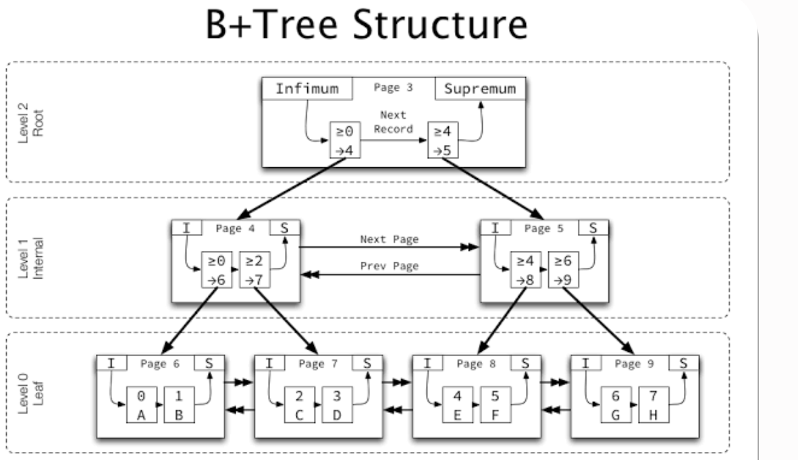

<!-- START doctoc generated TOC please keep comment here to allow auto update -->
<!-- DON'T EDIT THIS SECTION, INSTEAD RE-RUN doctoc TO UPDATE -->
**Table of Contents**  *generated with [DocToc](https://github.com/thlorenz/doctoc)*

- [三层架构深度拆解](#%E4%B8%89%E5%B1%82%E6%9E%B6%E6%9E%84%E6%B7%B1%E5%BA%A6%E6%8B%86%E8%A7%A3)
  - [一、全局视图：一棵 3 层 B+ 树长什么样](#%E4%B8%80%E5%85%A8%E5%B1%80%E8%A7%86%E5%9B%BE%E4%B8%80%E6%A3%B5-3-%E5%B1%82-b-%E6%A0%91%E9%95%BF%E4%BB%80%E4%B9%88%E6%A0%B7)
  - [二、第 1 层：根节点（Root Page）](#%E4%BA%8C%E7%AC%AC-1-%E5%B1%82%E6%A0%B9%E8%8A%82%E7%82%B9root-page)
    - [物理特征](#%E7%89%A9%E7%90%86%E7%89%B9%E5%BE%81)
    - [根页内部示意](#%E6%A0%B9%E9%A1%B5%E5%86%85%E9%83%A8%E7%A4%BA%E6%84%8F)
    - [根节点的特殊性](#%E6%A0%B9%E8%8A%82%E7%82%B9%E7%9A%84%E7%89%B9%E6%AE%8A%E6%80%A7)
  - [三、第 2 层：中间层（Internal / Branch Pages）](#%E4%B8%89%E7%AC%AC-2-%E5%B1%82%E4%B8%AD%E9%97%B4%E5%B1%82internal--branch-pages)
    - [物理特征](#%E7%89%A9%E7%90%86%E7%89%B9%E5%BE%81-1)
    - [中间层节点内部示意](#%E4%B8%AD%E9%97%B4%E5%B1%82%E8%8A%82%E7%82%B9%E5%86%85%E9%83%A8%E7%A4%BA%E6%84%8F)
    - [为什么中间层"几乎免费"？](#%E4%B8%BA%E4%BB%80%E4%B9%88%E4%B8%AD%E9%97%B4%E5%B1%82%E5%87%A0%E4%B9%8E%E5%85%8D%E8%B4%B9)
  - [四、第 3 层：叶子层（Leaf Pages）](#%E5%9B%9B%E7%AC%AC-3-%E5%B1%82%E5%8F%B6%E5%AD%90%E5%B1%82leaf-pages)
    - [物理特征](#%E7%89%A9%E7%90%86%E7%89%B9%E5%BE%81-2)
    - [聚簇索引 vs 二级索引的叶子页对比](#%E8%81%9A%E7%B0%87%E7%B4%A2%E5%BC%95-vs-%E4%BA%8C%E7%BA%A7%E7%B4%A2%E5%BC%95%E7%9A%84%E5%8F%B6%E5%AD%90%E9%A1%B5%E5%AF%B9%E6%AF%94)
  - [五、查询过程：一次点查如何走完三层](#%E4%BA%94%E6%9F%A5%E8%AF%A2%E8%BF%87%E7%A8%8B%E4%B8%80%E6%AC%A1%E7%82%B9%E6%9F%A5%E5%A6%82%E4%BD%95%E8%B5%B0%E5%AE%8C%E4%B8%89%E5%B1%82)
    - [I/O 分析](#io-%E5%88%86%E6%9E%90)
  - [六、范围查询：叶子层双向链表的威力](#%E5%85%AD%E8%8C%83%E5%9B%B4%E6%9F%A5%E8%AF%A2%E5%8F%B6%E5%AD%90%E5%B1%82%E5%8F%8C%E5%90%91%E9%93%BE%E8%A1%A8%E7%9A%84%E5%A8%81%E5%8A%9B)
    - [ORDER BY 为什么不需要额外排序？](#order-by-%E4%B8%BA%E4%BB%80%E4%B9%88%E4%B8%8D%E9%9C%80%E8%A6%81%E9%A2%9D%E5%A4%96%E6%8E%92%E5%BA%8F)
  - [七、根节点和中间层为什么能常驻 Buffer Pool？](#%E4%B8%83%E6%A0%B9%E8%8A%82%E7%82%B9%E5%92%8C%E4%B8%AD%E9%97%B4%E5%B1%82%E4%B8%BA%E4%BB%80%E4%B9%88%E8%83%BD%E5%B8%B8%E9%A9%BB-buffer-pool)
    - [数量极少](#%E6%95%B0%E9%87%8F%E6%9E%81%E5%B0%91)
    - [访问频率极高](#%E8%AE%BF%E9%97%AE%E9%A2%91%E7%8E%87%E6%9E%81%E9%AB%98)
    - [叶子层则不同](#%E5%8F%B6%E5%AD%90%E5%B1%82%E5%88%99%E4%B8%8D%E5%90%8C)
  - [八、总结](#%E5%85%AB%E6%80%BB%E7%BB%93)
- [扩展与延伸](#%E6%89%A9%E5%B1%95%E4%B8%8E%E5%BB%B6%E4%BC%B8)
  - [B+树的结构](#b%E6%A0%91%E7%9A%84%E7%BB%93%E6%9E%84)
  - [核心组件与底层逻辑拆解](#%E6%A0%B8%E5%BF%83%E7%BB%84%E4%BB%B6%E4%B8%8E%E5%BA%95%E5%B1%82%E9%80%BB%E8%BE%91%E6%8B%86%E8%A7%A3)
    - [1. 虚拟边界记录：Infimum & Supremum](#1-%E8%99%9A%E6%8B%9F%E8%BE%B9%E7%95%8C%E8%AE%B0%E5%BD%95infimum--supremum)
    - [2. 内部节点（Non-Leaf Node）组件](#2-%E5%86%85%E9%83%A8%E8%8A%82%E7%82%B9non-leaf-node%E7%BB%84%E4%BB%B6)
    - [3. 叶子节点（Leaf Node）组件](#3-%E5%8F%B6%E5%AD%90%E8%8A%82%E7%82%B9leaf-node%E7%BB%84%E4%BB%B6)
    - [4. 节点间的双向链表](#4-%E8%8A%82%E7%82%B9%E9%97%B4%E7%9A%84%E5%8F%8C%E5%90%91%E9%93%BE%E8%A1%A8)

<!-- END doctoc generated TOC please keep comment here to allow auto update -->

# 三层架构深度拆解

> **前置阅读**：[从二叉树到B+树的进化](02-从二叉树到B+树的进化.md)——你需要知道 B+ 树为什么"矮"、为什么快。
> **本文目标**：掰开 B+ 树的三层结构，搞清楚每一层在物理上到底存了什么、干了什么。

---


## 一、全局视图：一棵 3 层 B+ 树长什么样

先看一棵简化的 3 层 B+ 树（主键 1~48，每个叶子页存 8 行数据）：

```
                              ┌──────────────┐
                              │  Root Page   │
                 第 1 层       │  [17] [33]   │             ← 根节点：只有 1 个页
                 (根节点)      │ /    |    \  │
                              └─┬────┼─────┬─┘
                                │    │     │
              ┌─────────────────┘    │     └──────────────────┐
              ▼                      ▼                        ▼
      ┌──────────────┐     ┌──────────────┐          ┌──────────────┐
      │ Internal P1  │     │ Internal P2  │          │ Internal P3  │
 第 2 层 │  [5] [9] [13]│     │ [21] [25] [29]│          │ [37] [41] [45]│
 (中间层)│ / | |  |  \  │     │ /  |  |  |  \ │          │ /  |  |  |  \ │
      └┬─┬─┬──┬──┬──┘     └┬──┬──┬──┬──┬─┘          └┬──┬──┬──┬──┬─┘
       │ │ │  │  │          │  │  │  │  │              │  │  │  │  │
       ▼ ▼ ▼  ▼  ▼          ▼  ▼  ▼  ▼  ▼              ▼  ▼  ▼  ▼  ▼
      ┌──┐┌──┐┌──┐┌──┐   ┌──┐┌──┐┌──┐┌──┐          ┌──┐┌──┐┌──┐┌──┐
 第 3 层 │L1││L2││L3││L4│   │L5││L6││L7││L8│          │L9││LA││LB││LC│
 (叶子层)│1-4││5-8││9 ││13│   │17││21││25││29│          │33││37││41││45│
      │  ││  ││-12││-16│   │-20││-24││-28││-32│          │-36││-40││-44││-48│
      └──┘└──┘└──┘└──┘   └──┘└──┘└──┘└──┘          └──┘└──┘└──┘└──┘
       ←→  ←→  ←→  ←→     ←→  ←→  ←→  ←→            ←→  ←→  ←→  ←→
       \_________________双向链表串联所有叶子页____________________/
```

---

## 二、第 1 层：根节点（Root Page）

### 物理特征

| 属性 | 说明 |
| --- | --- |
| 数量 | 全表**只有 1 个**根页 |
| 存储内容 | 只存 key + 子页指针，**不存行数据** |
| 内存位置 | 几乎**永远常驻 Buffer Pool**（因为每次查询都从这里开始） |
| I/O 开销 | **0 次磁盘 I/O**（除了冷启动第一次加载） |

### 根页内部示意

```
┌───────────────── Root Page (页号 3) ──────────────────┐
│                                                       │
│   File Header: prev=NULL, next=NULL, page_no=3        │
│                                                       │
│   Infimum → [key=17, ptr→P1] → [key=33, ptr→P2] → Supremum  │
│              ↓                   ↓                    │
│       ptr0→P1(Internal)   ptr1→P2(Internal)   ptr2→P3(Internal) │
│       (key < 17)          (17 ≤ key < 33)      (key ≥ 33)│
│                                                       │
│   Page Directory: [Slot0→Infimum] [Slot1→key33] [Slot2→Supremum] │
│                                                       │
└───────────────────────────────────────────────────────┘
```

### 根节点的特殊性

1. **根页的页号一旦分配就不会改变**。即使数据增长导致根页分裂，InnoDB 也是把根页的内容搬到两个新页，然后根页自身变成一个只存两个指针的"上层目录"——根页的物理页号始终不变。
2. 这么做的原因：InnoDB 的数据字典（Data Dictionary）中记录了每棵 B+ 树的根页号。如果根页号变了，所有引用都要更新，代价太大。

---

## 三、第 2 层：中间层（Internal / Branch Pages）

### 物理特征

| 属性 | 说明 |
| --- | --- |
| 数量 | 取决于数据量，通常几百到几千个页 |
| 存储内容 | 只存 key + 子页指针，**不存行数据** |
| 角色 | 是"目录的目录"——帮你快速缩小到正确的叶子页 |
| 内存位置 | **大概率常驻 Buffer Pool**（数量少，访问频率高） |
| I/O 开销 | 通常 **0 次磁盘 I/O** |

### 中间层节点内部示意

```
┌──────────── Internal Page P1 (页号 5) ─────────────┐
│                                                     │
│   File Header: prev=NULL, next=P2(页号6)            │
│                                                     │
│   Infimum → [key=5] → [key=9] → [key=13] → Supremum │
│              │         │         │                   │
│   ptr0→L1   ptr1→L2  ptr2→L3  ptr3→L4              │
│   (key<5)  (5≤key<9)(9≤key<13)(key≥13)             │
│                                                     │
└─────────────────────────────────────────────────────┘
```

### 为什么中间层"几乎免费"？

以 BIGINT 主键为例，一个中间层节点：
- 每个 key = 8 字节
- 每个指针 = 6 字节
- 每页能装 key 数 = 16384 / 14 ≈ **1170 个**

一个根页指向 1170 个中间层页，总共 1170 个页 × 16KB = **约 18 MB**。

在生产环境中 Buffer Pool 通常有几 GB 到几十 GB，18 MB 占比微乎其微。所以中间层几乎总是缓存在内存中，**不产生磁盘 I/O**。

---

## 四、第 3 层：叶子层（Leaf Pages）

### 物理特征

| 属性 | 说明 |
| --- | --- |
| 数量 | 数据量越大，叶子页越多（千万行表有上百万个叶子页） |
| 存储内容 | **完整的行数据**（聚簇索引）或 **索引列 + 主键值**（二级索引） |
| 横向连接 | 通过 `FIL_PAGE_PREV` / `FIL_PAGE_NEXT` 组成**双向链表** |
| 内存位置 | 热点数据可能在 Buffer Pool，冷数据通常不在 |
| I/O 开销 | 这是**唯一可能产生磁盘 I/O 的层** |

### 聚簇索引 vs 二级索引的叶子页对比

```
聚簇索引（主键索引）叶子页：存完整行
┌────────────────────────────────────────────────────┐
│  [pk=1, name='张三', age=25, email='z@x.com', ...] │
│  [pk=2, name='李四', age=30, email='l@x.com', ...] │
│  [pk=3, name='王五', age=28, email='w@x.com', ...] │
│  ...                                               │
└────────────────────────────────────────────────────┘

二级索引（如 idx_name）叶子页：只存索引列 + 主键值
┌──────────────────────────────┐
│  [name='李四', pk=2]          │
│  [name='王五', pk=3]          │
│  [name='张三', pk=1]          │   ← 按 name 排序，不是按 pk 排序
│  ...                          │
└──────────────────────────────┘
  ↑ 如果需要完整行数据，还得拿 pk 回聚簇索引查（回表）
```

这就是为什么"二级索引查询可能需要回表"——二级索引叶子页里没有完整行数据，只有主键值。

---

## 五、查询过程：一次点查如何走完三层

以 `SELECT * FROM users WHERE id = 25` 为例（聚簇索引查询）：

```
Step 1：从根页出发
┌──────────────┐
│  Root Page   │
│  [17] [33]   │   25 ≥ 17 且 25 < 33 → 走中间指针，到 Internal P2
└──────────────┘
       │
       ▼
Step 2：在中间层定位
┌──────────────────┐
│  Internal P2     │
│  [21] [25] [29]  │   25 ≥ 25 且 25 < 29 → 走 ptr2，到叶子页 L7
└──────────────────┘
       │
       ▼
Step 3：在叶子页中找到数据
┌──────────────────────────────────────┐
│  Leaf Page L7                        │
│  pk=25: {name='赵六', age=35, ...}   │  ← Page Directory 二分 + 链表短遍历
│  pk=26: {name='钱七', age=22, ...}   │
│  pk=27: ...                          │
│  pk=28: ...                          │
└──────────────────────────────────────┘
```

### I/O 分析

| 步骤 | 访问的页 | 是否在 Buffer Pool | 磁盘 I/O |
| --- | --- | --- | --- |
| Step 1 | Root Page | ✅ 永远在 | 0 次 |
| Step 2 | Internal P2 | ✅ 大概率在 | 0 次 |
| Step 3 | Leaf L7 | ❓ 不一定 | **0 或 1 次** |
| **总计** | | | **最坏 1 次** |

**2000 万行数据的主键点查，磁盘 I/O 通常只需要 1 次**——这就是 B+ 树 + Buffer Pool 的威力。

---

## 六、范围查询：叶子层双向链表的威力

以 `SELECT * FROM users WHERE id BETWEEN 10 AND 30 ORDER BY id` 为例：

```
Step 1-2：通过根页和中间层，定位到 id=10 所在的叶子页 L3

Step 3：叶子层横向扫描（利用双向链表）

[L3: 9-12] →→ [L4: 13-16] →→ [L5: 17-20] →→ [L6: 21-24] →→ [L7: 25-28]
     ↑ 从 id=10 开始                                              ↑ 到 id=30 结束
     scan ──────────────────────────────────────────────────────→ stop
```

整个过程：
1. **纵向下探 1 次**：根 → 中间 → 叶子（定位到起始页）
2. **横向扫描 N 页**：沿叶子双向链表，一路读到 id=30

**不需要回到根节点重新查找！** 如果没有双向链表（比如 B 树），每找一个值都要从根开始走，效率天差地别。

### ORDER BY 为什么不需要额外排序？

因为叶子页本身就是按主键有序排列的，双向链表串起来的就是一条有序的数据链。`ORDER BY id` 直接顺着链表读就行，不需要 filesort。

这也是为什么 `ORDER BY` 非索引列时会出现 `Using filesort`（需要额外排序），而 `ORDER BY` 索引列时不需要——因为数据本身已经有序。

---

## 七、根节点和中间层为什么能常驻 Buffer Pool？

### 数量极少

对于一棵 3 层 B+ 树（存 2000 万行数据）：

| 层级 | 页数 | 占用空间 |
| --- | --- | --- |
| 根节点 | 1 页 | 16 KB |
| 中间层 | ≈ 1170 页 | ≈ 18 MB |
| 叶子层 | ≈ 1,370,000 页 | ≈ 21 GB |
| **总计** | ≈ 1,371,171 页 | ≈ 21 GB |

根节点 + 中间层总共只有约 **18 MB**。即使 Buffer Pool 只有 1 GB，也能轻松缓存。

### 访问频率极高

**每一次查询都从根页开始，每一次查询都经过中间层。** 根据 LRU（Least Recently Used）淘汰策略，访问频率最高的页最不可能被淘汰。所以根页和中间层几乎永远驻留在内存中。

### 叶子层则不同

叶子层有上百万个页，总量远超 Buffer Pool 容量。只有"热点数据"的叶子页会留在 Buffer Pool，冷数据的叶子页会被 LRU 淘汰。这也是为什么实际查询中 I/O 主要发生在叶子层。

---

## 八、总结

| 层级 | 存储内容 | 数量 | Buffer Pool | I/O 开销 |
| --- | --- | --- | --- | --- |
| **根节点** | key + 指针 | 1 个页 | 永远在 | 0 |
| **中间层** | key + 指针 | ~1170 页 | 几乎总在 | ≈0 |
| **叶子层** | 完整行数据/索引列+pk | ~百万页 | 热数据在 | 0~1 次 |

三层 B+ 树 = 一个**极度不对称的结构**：前两层轻如鸿毛（常驻内存），第三层重如泰山（存真实数据）。查询时，前两层是零成本的"路标导航"，唯一的磁盘代价在第三层。

> 这棵树如何从无到有地生长、如何分裂和合并，见 → [数据页与目录页的动态演变](04-数据页目录页页分裂页合并.md)
> 具体的数学推导见 → [三层撑起两千万数据的数学证明](05-扇出度和树高的计算.md)

---

> **上一篇** ← [从二叉树到B+树的进化](02-从二叉树到B+树的进化.md)
> **下一篇** → [数据页与目录页的动态演变](04-数据页目录页页分裂页合并.md)


# 扩展与延伸

## B+树的结构



## 核心组件与底层逻辑拆解

如底层的物理 Page 结构所示，InnoDB 的 B+ 树组件具备以下硬核特征：

### 1. 虚拟边界记录：Infimum & Supremum

在任何一个数据页（无论是根节点还是叶子节点）初始化时，都会默认创建两个伪记录：

* **Infimum**：限制当前页内所有用户记录的下界。
* **Supremum**：限制当前页内所有用户记录的上界。
* 页内所有的行记录（User Records）通过**单向链表**串联，起始于 Infimum，终止于 Supremum。

### 2. 内部节点（Non-Leaf Node）组件

* **组成**：存放的是 `(主键值 + 子页号 Page No.)`。
* **不含非索引数据**：由于去除了 `preview_title`、`detail_desc` 等非索引字段，内部节点的单条记录极大。在真实的 16KB 物理页中，一个内部节点通常可以存放过百上千个指针，从而使 B+ 树的层高控制在 3~4 层，支持亿级数据。

### 3. 叶子节点（Leaf Node）组件

* **数据对齐**：由于是聚簇索引，行记录在叶子节点按照主键 `id` 递增单向链接。
* **溢出页隐患**：注意你定义的 `detail_desc TEXT` 字段。如果该字段存储大量大文本（单行数据超过约 8KB），InnoDB 在叶子节点只会在行记录内保留一个 20 字节的指针，将实际文本直接剥离至 **Uncompress BLOB Page（溢出页）** 中存储，防止单页容纳行数过少导致 B+ 树结构极度退化。

### 4. 节点间的双向链表

* 所有处于同一层高（Level 0）的叶子节点物理页之间，通过页头（File Header）中的 `FIL_PAGE_PREV` 和 `FIL_PAGE_NEXT` 指针构成了**双向链表**。这正是对主键进行 `WHERE id BETWEEN 3 AND 10` 范围扫描时，免去重复回溯根节点、实现 `O(1)` 水平切页推进的核心底层支撑。
