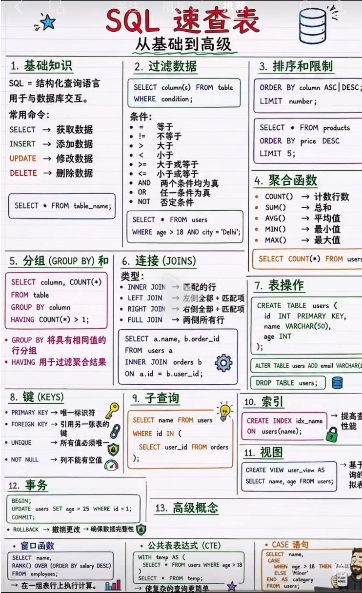

<!-- START doctoc generated TOC please keep comment here to allow auto update -->
<!-- DON'T EDIT THIS SECTION, INSTEAD RE-RUN doctoc TO UPDATE -->
**Table of Contents**  *generated with [DocToc](https://github.com/thlorenz/doctoc)*

- [🗺️ 架构师修炼手册：从数据库底层到分布式高并发设计](#-%E6%9E%B6%E6%9E%84%E5%B8%88%E4%BF%AE%E7%82%BC%E6%89%8B%E5%86%8C%E4%BB%8E%E6%95%B0%E6%8D%AE%E5%BA%93%E5%BA%95%E5%B1%82%E5%88%B0%E5%88%86%E5%B8%83%E5%BC%8F%E9%AB%98%E5%B9%B6%E5%8F%91%E8%AE%BE%E8%AE%A1)
  - [阅读顺序](#%E9%98%85%E8%AF%BB%E9%A1%BA%E5%BA%8F)
  - [章节依赖关系](#%E7%AB%A0%E8%8A%82%E4%BE%9D%E8%B5%96%E5%85%B3%E7%B3%BB)
  - [各章节子文件索引](#%E5%90%84%E7%AB%A0%E8%8A%82%E5%AD%90%E6%96%87%E4%BB%B6%E7%B4%A2%E5%BC%95)
    - [一、建表](#%E4%B8%80%E5%BB%BA%E8%A1%A8)
    - [二、查询](#%E4%BA%8C%E6%9F%A5%E8%AF%A2)
    - [三、B+ 树索引](#%E4%B8%89b-%E6%A0%91%E7%B4%A2%E5%BC%95)
    - [四、主键与唯一约束](#%E5%9B%9B%E4%B8%BB%E9%94%AE%E4%B8%8E%E5%94%AF%E4%B8%80%E7%BA%A6%E6%9D%9F)
    - [五、索引](#%E4%BA%94%E7%B4%A2%E5%BC%95)
    - [六、锁机制](#%E5%85%AD%E9%94%81%E6%9C%BA%E5%88%B6)
    - [七、外键禁令](#%E4%B8%83%E5%A4%96%E9%94%AE%E7%A6%81%E4%BB%A4)
    - [八、联合主键与复合检索](#%E5%85%AB%E8%81%94%E5%90%88%E4%B8%BB%E9%94%AE%E4%B8%8E%E5%A4%8D%E5%90%88%E6%A3%80%E7%B4%A2)
    - [九、检索排序与分页](#%E4%B9%9D%E6%A3%80%E7%B4%A2%E6%8E%92%E5%BA%8F%E4%B8%8E%E5%88%86%E9%A1%B5)
    - [十、视图与查询封装](#%E5%8D%81%E8%A7%86%E5%9B%BE%E4%B8%8E%E6%9F%A5%E8%AF%A2%E5%B0%81%E8%A3%85)
    - [十一、分布式全局 ID](#%E5%8D%81%E4%B8%80%E5%88%86%E5%B8%83%E5%BC%8F%E5%85%A8%E5%B1%80-id)
    - [十二、面向失败编程](#%E5%8D%81%E4%BA%8C%E9%9D%A2%E5%90%91%E5%A4%B1%E8%B4%A5%E7%BC%96%E7%A8%8B)
  - [后续扩展预留](#%E5%90%8E%E7%BB%AD%E6%89%A9%E5%B1%95%E9%A2%84%E7%95%99)

<!-- END doctoc generated TOC please keep comment here to allow auto update -->

# 🗺️ 架构师修炼手册：从数据库底层到分布式高并发设计

> 本手册的每一章都是下一章的**物理因果前置**。建议按以下顺序阅读，拒绝跳章。
>
> **目录整理说明**：现有内容已按 `01`–`12` 编号目录和文件顺序归位；缺失主题仅建立“占位大纲”，不会自动生成完整课件。旧目录暂不清理，避免误删历史内容。

---



## 阅读顺序

| 序号 | 章节 | 核心问题 | 前置依赖 |
|:----:|------|----------|----------|
| 一 | [01-建表](./01-建表/) | 如何把业务实体稳定地映射成表结构？ | 无 |
| 二 | [02-查询](./02-查询/) | SQL 查询如何表达，执行链路如何运转？ | 第一章 |
| 三 | [03-B+树索引](./03-B+树索引/) | 数据在磁盘上到底长什么样？ | 第一、二章 |
| 四 | [04-主键与唯一约束](./04-主键与唯一约束/) | 为什么必须有主键？如何保证业务唯一性？ | 第一、三章 |
| 五 | [05-索引](./05-索引/) | 如何组织数据、定位记录并减少回表？ | 第三、四章 |
| 六 | [06-锁机制](./06-锁机制/) | 读写并发时底层怎么协调？ | 第三、五章 |
| 七 | [07-外键禁令](./07-外键禁令/) | 为什么工业界禁止物理外键？ | 第六章 |
| 八 | [08-联合主键与复合检索](./08-联合主键与复合检索/) | 联合索引的物理排列和检索路径 | 第三、五章 |
| 九 | [09-检索排序与分页](./09-检索排序与分页/) | 大表翻页为什么崩？怎么防？ | 第二、三、八章 |
| 十 | [10-视图与查询封装](./10-视图与查询封装/) | 如何复用查询、控制暴露边界并保持性能可解释？ | 第二、九章 |
| 十一 | [11-分布式全局 ID](./11-分布式全局ID/) | 主键选型的终极演进 | 第三、四章 |
| 十二 | [12-面向失败编程](./12-面向失败编程/) | 服务端开发的隐形底线 | 全部 |

## 当前跟读位置

主线课程当前进入 `04.01 索引基础与查询计划`。本目录对应的跟读路径是：

```text
03-B+树索引
→ 04-主键与唯一约束
→ 05-索引
→ 08-联合主键与复合检索
→ 主线课程 04.01.02 EXPLAIN
→ 09-检索排序与分页
```

如果已经掌握 `B+Tree` 页结构，可以从 `05-索引/01-索引基本概念.md` 开始；否则从 `03-B+树索引/01-InnoDB页结构基础.md` 开始。

---

## 章节依赖关系

```
     ┌──────────┐       ┌──────────┐
     │ 一、建表  │──────▶│ 二、查询  │
     └────┬─────┘       └────┬─────┘
          └──────────┬───────┘
                     ▼
                 ┌──────────────┐
                 │ 三、B+ 树索引 │
                 └──────┬───────┘
            ┌───────────┼───────────┐
            ▼           ▼           ▼
     ┌──────────┐ ┌──────────┐ ┌──────────┐
     │ 四、主键  │ │ 六、锁机制 │ │十一、分布式│
     └────┬─────┘ └────┬─────┘ │   全局 ID │
          ▼            ▼       └──────────┘
   ┌──────────────┐ ┌──────────┐
   │五、索引     │ │七、外键禁令│
   └──────┬───────┘ └──────────┘
          ▼
   ┌──────────────────┐
   │八、联合主键与复合检索│
   └──────┬───────────┘
          ▼
   ┌──────────────────┐
   │ 九、检索排序与分页  │
   └──────┬───────────┘
          ▼
   ┌──────────────────┐
   │ 十、视图与查询封装  │
   └──────┬───────────┘
          ▼
   ┌──────────────────┐
   │ 十二、面向失败编程  │
   └──────────────────┘
```

---

## 各章节子文件索引

### 一、建表

| # | 文件 | 知识点 |
|---|------|--------|
| 1 | [建表规则](./01-建表/02-建表规则.md) | 表宽控制、数据类型选择、通用字段、JSON 边界与索引前置设计 |

### 二、查询

| # | 文件 | 知识点 |
|---|------|--------|
| 1 | [基础查询](./02-查询/01-基础查询.md) | `SELECT` 完整骨架、书写顺序与执行顺序、三值逻辑、比较及集合操作符 |

### 三、B+ 树索引

| # | 文件 | 知识点 |
|---|------|--------|
| 1 | [InnoDB 页结构基础](./03-B+树索引/01-InnoDB页结构基础.md) | 表空间→段→区→页的层级，16KB 页内部结构，Buffer Pool |
| 2 | [从二叉树到 B+ 树的进化](./03-B+树索引/02-从二叉树到B+树的进化.md) | BST/红黑树/B 树/B+ 树的淘汰进化史与磁盘 I/O 对比 |
| 3 | [三层架构深度拆解](./03-B+树索引/03-三层架构深度拆解.md) | 根节点、中间层、叶子层的物理角色与双向链表 |
| 4 | [数据页与目录页的动态演变](./03-B+树索引/04-数据页目录页页分裂页合并.md) | 页分裂、页合并、有序插入 vs 随机插入 |
| 5 | [三层撑起两千万数据的数学证明](./03-B+树索引/05-扇出度和树高的计算.md) | 扇出度计算、I/O 次数分析、主键长度影响 |

### 四、主键与唯一约束

| # | 文件 | 知识点 |
|---|------|--------|
| 1 | [主键本质与 InnoDB 强制要求](./04-主键与唯一约束/01-主键本质与InnoDB强制要求.md) | 主键定义、不指定主键时的替代策略、`dict_sys->mutex` 竞争 |
| 2 | [自然键 vs 代理键](./04-主键与唯一约束/02-自然键vs代理键.md) | 业务字段做主键的两大灾难场景 |
| 3 | [自增 ID 与雪花算法决策](./04-主键与唯一约束/03-自增ID与雪花算法决策.md) | 对比表、绝对不能使用的场景、决策流 |
| 4 | [唯一约束与规范命名](./04-主键与唯一约束/04-唯一约束与规范命名.md) | UNIQUE 本质、`uk_` 前缀在线上排查中的价值 |

### 五、索引

| # | 文件 | 知识点 |
|---|------|--------|
| 1 | [索引基本概念](./05-索引/01-索引基本概念.md) | 区分约束层与索引层，建立索引全景 |
| 2 | [聚簇索引](./05-索引/02-聚簇索引.md) | 主键索引的肉身与完整行数据 |
| 3 | [二级索引](./05-索引/03-二级索引.md) | 辅助 B+Tree、普通/唯一/联合/前缀索引、主键回指 |
| 4 | [回表机制](./05-索引/04-回表机制.md) | 二级索引查到主键后如何获取完整行 |
| 5 | [覆盖索引](./05-索引/05-覆盖索引.md) | 让查询只访问二级索引，减少回表 |
| 6 | [三星索引法则](./05-索引/06-三星索引法则.md) | 最小化扫描、消除排序、消除回表 |
| 7 | [索引设计四大铁律](./05-索引/07-索引设计四大铁律.md) | 最左前缀、选择性、列干净、数量控制 |
| 8 | [索引失效场景](./05-索引/08-索引失效场景.md) | 9 种典型失效场景与底层原因 |

### 六、锁机制（占位大纲）

| # | 文件 | 知识点 |
|---|------|--------|
| 1 | [读写与共享排他的映射关系](./06-锁机制/01-读写与共享排他的映射关系.md) | S/X 锁、意向锁、锁粒度层级 |
| 2 | [元数据锁 MDL](./06-锁机制/02-元数据锁MDL.md) | MDL 导致全站堵死的因果链、排查与防御 |
| 3 | [自动加锁与 FOR UPDATE](./06-锁机制/03-自动加锁与FOR-UPDATE.md) | 两阶段锁、快照读 vs 当前读、扣库存实战 |
| 4 | [死锁检测与分析](./06-锁机制/04-死锁检测与分析.md) | wait-for graph、`SHOW ENGINE INNODB STATUS` 解读、预防习惯 |

### 七、外键禁令

| # | 文件 | 知识点 |
|---|------|--------|
| 1 | [理论一致性 vs 高并发瓶颈](./07-外键禁令/01-理论一致性vs高并发瓶颈.md) | 外键的理论价值与工业界禁止的原因 |
| 2 | [外键锁延展与级联删除](./07-外键禁令/02-外键锁延展与级联删除.md) | 锁延展、级联 I/O 暴涨、多米诺效应 |
| 3 | [应用层逻辑外键与软删除](./07-外键禁令/03-应用层逻辑外键与软删除.md) | 代码层维护一致性、软删除模式、孤儿记录清理 |

### 八、联合主键与复合检索（占位大纲）

| # | 文件 | 知识点 |
|---|------|--------|
| 1 | [最左前缀原则的底层真相](./08-联合主键与复合检索/01-最左前缀原则的底层真相.md) | 联合索引在 B+ 树中的物理排列 |
| 2 | [关联表为什么不需要自增 ID](./08-联合主键与复合检索/02-关联表为什么不需要自增ID.md) | 中间表联合主键的天然优势与例外 |
| 3 | [检索的三种命运](./08-联合主键与复合检索/03-检索的三种命运.md) | Index Seek / Range Scan / Full Table Scan |
| 4 | [反向二级联合索引设计](./08-联合主键与复合检索/04-反向二级联合索引设计.md) | 双向高频查询的覆盖索引方案 |

### 九、检索排序与分页（占位大纲）

| # | 文件 | 知识点 |
|---|------|--------|
| 1 | [数据物理排列的真相](./09-检索排序与分页/01-数据物理排列的真相.md) | 聚簇索引决定物理顺序，删除不清除 |
| 2 | [Filesort 与索引的决定性影响](./09-检索排序与分页/02-Filesort与索引的决定性影响.md) | 有索引零排序 vs 无索引 Filesort 溢出 |
| 3 | [深度翻页性能死穴](./09-检索排序与分页/03-深度翻页性能死穴.md) | LIMIT offset 的扫描开销、游标分页、延迟关联 |
| 4 | [OLTP 到异步导出的闭环设计](./09-检索排序与分页/04-OLTP到异步导出的闭环设计.md) | 在线系统不做大导出、异步 Worker 分批方案 |

### 十、视图与查询封装

| # | 文件 | 知识点 |
|---|------|--------|
| 1 | [视图的本质与适用边界](./10-视图与查询封装/01-视图的本质与适用边界.md) | 查询定义、非物化特征、适用场景与职责边界 |
| 2 | [CREATE、ALTER 与 DROP VIEW](./10-视图与查询封装/02-CREATE-ALTER-DROP-VIEW.md) | 创建、替换、查看和删除视图 |
| 3 | [视图查询展开与性能](./10-视图与查询封装/03-视图查询展开与性能.md) | MERGE、TEMPTABLE、执行计划和底层索引 |
| 4 | [可更新视图与 WITH CHECK OPTION](./10-视图与查询封装/04-可更新视图与WITH-CHECK-OPTION.md) | 可更新条件、LOCAL/CASCADED 检查与写入边界 |
| 5 | [权限隔离与安全边界](./10-视图与查询封装/05-权限隔离与安全边界.md) | 行列裁剪、DEFINER/INVOKER 与最小权限 |
| 6 | [视图的工程实践与反模式](./10-视图与查询封装/06-视图的工程实践与反模式.md) | 命名、迁移、依赖、性能基线和上线检查 |

### 十一、分布式全局 ID

| # | 文件 | 知识点 |
|---|------|--------|
| 1 | [主键 B+ 树的写入偏好](./11-分布式全局ID/01-主键B+树的写入偏好.md) | 尾部追加 vs 中段爆破的页分裂对比 |
| 2 | [四大全局 ID 方案对比](./11-分布式全局ID/02-四大全局ID方案对比.md) | 自增/雪花/号段/UUID 的技术内幕与选型 |
| 3 | [前端隐藏物理主键](./11-分布式全局ID/03-前端隐藏物理主键.md) | 为什么前端不能感知 DB 主键、三种隐藏方案 |

### 十二、面向失败编程

| # | 文件 | 知识点 |
|---|------|--------|
| 1 | [数据库极限量化与定义](./12-面向失败编程/01-数据库极限量化与定义.md) | 耗时/算力/并发/容量四维红线 |
| 2 | [主动防御链条](./12-面向失败编程/02-主动防御链条.md) | 研发→测试→上线→运维的全链路防御 |
| 3 | [顶级开发者的呼吸习惯](./12-面向失败编程/03-顶级开发者的呼吸习惯.md) | SELECT *、N+1、超时控制、链路追踪 |

---

## 后续扩展预留

以下主题待学习到对应阶段后补充：

- **事务与 ACID**：事务生命周期、隔离级别、redo/undo log
- **MVCC**：多版本并发控制、ReadView、快照读 vs 当前读
- **行锁与间隙锁**：Record Lock / Gap Lock / Next-Key Lock
- **EXPLAIN 实战**：执行计划解读与优化
